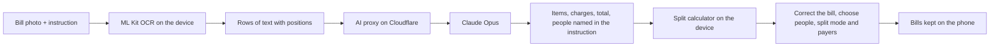

# Split Vibe POC

A proof-of-concept Android app (Kotlin, Jetpack Compose) for an AI "split bill" feature inside a
payment app.

You scan or photograph a bill, in several pages if it is long, and type how it should be split.
The phone reads the text of the bill with on-device OCR and sends that text and its position on the
page to the app's AI proxy, a Cloudflare Worker that asks Claude and sends the bill back as
structured data. The app then does the arithmetic itself: you correct anything that was misread,
choose who is on the bill, how it is split and who paid, and every bill is kept on the phone. The
app holds no API key.

Then it asks each person for their share with a message of their own, carrying a payment link or QR
code for the way you get paid (VietQR, PromptPay, UPI, SEPA, PayPal.Me or a link you paste), and
tracks who has paid. Groups keep balances across many bills and currencies and suggest the fewest
payments that settle them. The app never holds or moves money.




## What the app does

1. **Home** shows the latest bills and a "Split a bill" entry. **See all** opens every bill kept on
   the phone, to search by place, item or person, open again or delete.
2. **New split** takes the bill and an instruction such as `Split with Minh and Lan. Minh had the
   beers.` or `We are 3, I didn't drink.` The bill comes from Google's document scanner, which finds
   its edges, straightens it and takes up to five pages; from the camera or the photo picker; from a
   photo shared by another app; from the bundled sample bill; or it is typed in by hand.
3. **Result** shows the items, the taxes and fees, and the total, and, for a bill in another
   currency, what it comes to in your own at the day's rate or a rate you type in.
   - **Who is on the bill:** everyone named in the instruction, anyone you add by name or from the
     people you split with before, and anyone you pick in the phone's contact picker.
   - **How it is split:** equally, by item, by shares, by percent or by exact amounts. Each item can
     be divided its own way too.
   - **Who paid:** one person, or several with an amount each.
   - Every share is shown, and the shares always add up to the bill total.
4. **Change the split by a sentence:** type or say something like "Lan didn't have beer" or "add a
   10% tip". Claude proposes the changes, each person's share shows before and after, and nothing
   changes until you apply them; Undo puts the split back. A change takes 0.2 of a call.
5. **Edit bill** corrects every item, quantity, price, tax, fee, discount, the total and the bill's
   category. When the lines and the printed total disagree, it shows by how much and offers two ways
   to settle it.
6. **Ask for the money** gives each person who owes something a message of their own to send in any
   chat app: what it is for, the amount, and how to pay it, as a QR code, a link or details to type
   in, built from one of your **ways to get paid**. A card with the whole split can go to the group
   chat as a picture. Signed in, each request is also kept on Split Vibe's server, so the payer can
   say they paid from the app and you confirm it. A finished split stays in the list and can be
   changed later.
7. **Everyone picks their items:** a link from the result screen that everyone at the table opens in
   a browser, without the app. They type their name and tap what they had, and the picks show live.
   You say who each person is on the bill, close the picking, and send what everyone owes, which the
   page then shows with how to pay.
8. **Groups** (from the home screen) keep the bills of a trip or a shared flat in one currency: each
   member's balance, the fewest payments that settle the group, the people and places kept for
   those without the app, the bills and what changed. A split is added to a group from its result
   screen, matching people to members and converting the total once at the day's rate; from then on
   it is settled in the group, not asked for person by person. Invite links let people join, or ask
   for a place kept under their name, which the group's owner decides; the owner can also take
   someone out of the group, keeping what they paid and owe.
9. **Requests** lists what you have to pay, with its code and details, and what you asked for, to
   confirm once the money arrived, remind by hand or on a schedule, or delete.
10. **Insights** (from the home screen) shows what the finished bills came to by month, category,
    person and group, in your own currency and with your own share. A period exports as three CSV
    files (bills, items and shares) or a PDF summary.
11. **Recurring bills:** a finished bill can repeat every week or month. On its day the app makes a
    draft to check and finish, and says so in a notice.
12. **Settings** also holds your name in groups and on requests, and the **ways to get paid**:
    bank accounts by VietQR or SEPA, PromptPay, UPI, PayPal.Me, a link made in another payment app
    (Revolut, Wise, Venmo, Cash App) or plain details such as a Zelle address. They stay on the phone.
13. **Pro** (from Settings, or from the notice when the AI calls run out) is a Google Play
    subscription, monthly or yearly, that gives 300 AI calls a month instead of 10. Everything else
    stays free. The screen shows Google Play's prices and any offer, how the plan renews and where to
    cancel it; a Pro member sees their plan, when it renews or ends, and can switch between monthly
    and yearly or restore a purchase. Only a signed-in account buys, so Pro stays with it.

Every change is saved as a draft as it is made, so a split survives the app being closed.

## Run it

Requirements: Android Studio with support for Android Gradle Plugin 9.1 (or JDK 17+ and the Android
SDK with platform 37 on the command line), and a device or emulator running Android 8.0 (API 26) or
newer.

```bash
./gradlew :app:assembleDevDebug
```

```bash
./gradlew :app:installDevDebug
```

The `dev` flavor installs as `com.dantech.splitvibe.dev`, next to the real app and with its own data.
The `prod` flavor is the app that will be published.

Reading a bill needs the AI proxy. A debug build looks for it at `http://127.0.0.1:8787`: run it
on your computer as [docs/proxy.md](docs/proxy.md) describes (`npm ci`, a `.dev.vars` file with the
key, `npm run dev`), then forward the port to the phone or emulator:

```bash
adb reverse tcp:8787 tcp:8787
```

A deployed proxy and Google sign-in are set in `local.properties` (git-ignored). A release build
requires https, and without an address it is built with AI reading off. A value that is not a real
address or client ID, such as one with a `<placeholder>` still in it, stops the build:

```properties
splitvibe.aiProxyUrl=https://split-vibe-proxy.<your-subdomain>.workers.dev
splitvibe.googleWebClientId=<web client ID>.apps.googleusercontent.com
```

Push notices about requests and groups come through Firebase Cloud Messaging, which the app uses for
nothing else. They need the four public values of the Android app in the Firebase console (Project
settings, Your apps), and come on only when all four are set; without them every flow works the
same, only without notices:

```properties
splitvibe.firebaseAppId=1:<number>:android:<hex>
splitvibe.firebaseApiKey=<API key of the Android app>
splitvibe.firebaseProjectId=<project id>
splitvibe.firebaseSenderId=<project number>
```

Pro is sold through RevenueCat, with RevenueCat's public SDK key for the app on Google Play, which
starts with `goog_` and is made to ship inside the app. Without it the app is built without Pro: the
Pro screen says Pro is not available, and every other flow works the same. Any other value, such as
RevenueCat's secret key, stops the build. Google Play sells the subscription only to the `prod`
flavor's package, so only `prod` builds get the key: a `dev` build is always built without it, never
calls RevenueCat, and its Pro screen says Pro is not available in this build. Test purchases with
`prod`:

```properties
splitvibe.revenueCatApiKey=goog_<public SDK key>
```

Invite links (`/g/#…`) and request links (`/r/#…`) are on the proxy's own address and open in the app
through Android App Links, once the proxy's `ANDROID_CERT_SHA256` variable lists the certificate the
app is signed with (see [docs/proxy.md](docs/proxy.md)).

Without signing in, each install gets 3 free calls to Claude: reading a bill takes a whole call, and
changing a split by a sentence takes 0.2. **Settings** (gear icon) shows the calls left with the plan
they count against, and offers "Sign in with Google" for 10 calls a month, **Pro** for 300 a month,
signing out and deleting the account. When a sign-in
runs out, the app asks to sign in again and never falls back to the phone's free calls on its own;
signing out does that. It
also holds the app's **local currency** (the currency the payment app works in), which defaults to
the currency of the phone's region.

Without a real bill at hand, tap **Use the sample bill** on the new-split screen.

## How it works

### 1. On-device OCR with positions

`MlKitBillTextRecognizer` runs ML Kit Text Recognition v2 with the bundled Latin-script model, so it
works offline. Latin script covers English, Vietnamese and most European languages.

OCR engines return text block by block. On a receipt that usually means all item names first and all
prices later, so the reading order alone does not say which price belongs to which item.
`OcrLayoutEncoder` fixes that before anything is sent:

- it straightens the page using the direction the text runs in (a bill photographed at an angle is fine),
- it groups text fragments that sit at the same height into rows,
- it writes every fragment with its box, in coordinates from 0 to 1000.

This is the kind of document the model receives (real ML Kit output for the sample bill, typos included):

```text
<bill_ocr rows="22">
1 | [307,0,704,41] "QUÁN ỐC BA MIỂN"
...
13 | [5,526,328,552] "Bia Saigon Special" | [552,532,567,548] "6" | [675,531,779,550] "22.000" | [875,532,996,551] "132.000"
14 | [5,564,163,587] "NƯớc sUối" | [553,571,567,587] "2" | [675,569,780,592] "12.000" | [892,571,996,590] "24.000"
...
18 | [0,795,173,827] "TỔNG CỘNG" | [862,805,993,826] "902.664"
</bill_ocr>

<user_instruction>
Split with Minh and Lan. Minh had the beers.
</user_instruction>
```

### 2. Claude reads the bill, through the proxy

`GatewayBillAnalyzer` posts the document, the instruction and the local currency to the proxy's
`POST /v1/bill-analysis` and reads its answer line by line while the model works. The proxy
([docs/proxy.md](docs/proxy.md)) calls the Messages API through the official Anthropic TypeScript SDK:

- model `claude-opus-5-5`, effort `medium`, adaptive thinking left on;
- the system prompt in `proxy/src/prompt.ts` explains the document format, typical OCR mistakes and what to extract;
- the answer is constrained to the JSON Schema in `proxy/src/schema.ts` with structured outputs, so it always parses;
- server-side refusal fallbacks are switched on (beta `server-side-fallback-2026-07-01`,
  `fallbacks: "default"`): if a safety classifier declines the request, the API re-runs it on another
  model instead of failing.

The proxy counts the calls (3 free per install, 10 a month per Google account, 300 a month with
Pro), limits each network address, caps the day's spend, and charges a call only once the model has
answered. When a read is cancelled, fails, or brings an answer the app cannot use, reading the same
bill again keeps its request id, so the proxy does not charge twice.

The model returns items, charges, the total, the currency, the number of decimals the prices are
printed with, and what the instruction said about people:
who is named, how many people there are, and item rules of two kinds. `only` means the item belongs
to the people named ("Minh had the beers"). `all_except` means the people named did not have it ("I
didn't drink"), which leaves it to everyone else. The model does not compute anyone's share.

### 3. The arithmetic stays on the device

- Amounts are converted to whole minor units (`BillCurrency`), so nothing is lost to rounding.
- The currency and its precision come from the bill. A bill is never split finer than its prices
  are printed, and never finer than the currency allows. So a rupiah, forint or dong bill is split
  in whole units, and a dollar bill printed with cents is split to the cent.
- A bill that shows no currency is taken to be in the app's local currency (Settings). A bill in
  another currency is split in its own currency. `ExchangeRate` also shows it in the local one, at
  the day's rate the proxy hands out or at a rate the user types in; the shares stay in the bill's
  currency.
- `BillReconciler` turns a line with a negative amount, such as a voucher, into a deduction on the
  whole bill. When the lines do not add up to the printed total, the printed total wins, the gap is
  shared in proportion and shown, and `BillEditor` offers to use the lines as the total or to keep
  the total and add the difference as a line.
- `SplitCalculator` divides the whole bill equally, by shares, by percent (in hundredths) or by exact
  amounts, or item by item:
  - an item is shared equally by the people who had it, or divided its own way;
  - items shared by exactly the same group are added up and divided once;
  - taxes, fees, tips and discounts follow each person's items proportionally;
  - a part that cannot be divided goes by the largest remainder, or to the first person in the list,
    and the user is listed first.
- `SplitPlanner` turns every name in the instruction into someone on the bill. A name that is exactly
  that of someone split with before is that person again; any other name is someone new, named as
  typed, whom the user can rename. `NameMatcher` also suggests people split with before as a name
  is typed.
- `Payments` checks that what the payers paid adds up to the bill total. A split with a problem, such
  as percentages that do not add up to 100, has no shares until it is fixed, and cannot be finished.

### 4. Bills stay on the phone

`BillRepository` keeps every bill in a Room database on the phone: the bill, who is on it, how it is
split, who paid and the shares worked out from that. Each save writes the whole bill as the next
revision, and a save from a copy that is no longer the latest is refused, so two screens editing the
same bill cannot overwrite each other. A finished bill that a change leaves unbalanced becomes a
draft again. The photos of a bill's pages are kept in the app's own storage and deleted with it. The
screen on show, the bill and the photos come back after the system ends the app.

### 5. Groups and requests live on the proxy, payment methods on the phone

Groups and payment requests are shared with other people, so they are kept in the proxy's D1
database, and the proxy checks every permission: only members read a group, only a bill's author
or the group's owner changes a bill, payments back are only ever added, only the payer says a
request was paid and only the requester confirms it. Balances are worked out on the phone from the
group's bills and payments back (`Balances`, `DebtSimplifier` and `GroupConversion` in
`core/domain`): they always add up to zero, also across currencies, and the suggested payments
never number more than the members minus one. The phone keeps the proxy's last answers to read
without a connection, and empties that copy on every sign-in, sign-out and account deletion.

The ways to get paid never leave the phone, except as the one copy a request carries. The payer's
app builds the link, the QR code and the details from that copy (`PaymentRequestBuilder` and
`EmvQr`). PromptPay and VietQR codes match the open-source implementations bank apps read,
character for character with their CRC, and the SEPA code follows the European Payments Council's
guidelines.

### Privacy

Only the OCR text and the typed instruction leave the phone to be read. The photos are never
uploaded, and the app holds no permission to read contacts: the system's contact picker hands it the
one name picked. Bills, people, photos and payment methods stay on the phone. A bill added to a group
carries what was bought and how it was split, but no photo, read text or instruction. The request
for exchange rates says nothing about who asks. The proxy keeps no email, Google name or photo: the
names in groups and on requests are the ones people type, and push notices carry fixed words of the
app's own, never a name, an amount or a link. Only while someone is signed in does the app talk to
RevenueCat, and then as the account's purchaser, an id the proxy makes that names no one; Google
Play handles the payment, and the app keeps no payment details.

## Project layout

```text
core/designsystem/            the look of the app: theme, tokens, components, motion
core/domain/                  plain Kotlin, no Android: the money logic and the data contracts
  domain/     Bill, BillCurrency, BillEditor, BillReconciler, ExchangeRate, Participant, Payment,
              SplitCalculator, SplitMode, SplitPlan, NameMatcher, and for groups Balances,
              DebtSimplifier, GroupConversion
    payments/ PaymentMethod, PaymentRequestBuilder, EmvQr, VietQrBanks
  ocr/        OcrResult, OcrLayoutEncoder (one page or several)
  llm/        BillAnalyzer, BillAnalysisParser
app/src/main/java/com/dantech/splitvibe/
  di/         the Koin module that wires the app together
  ocr/        BillTextRecognizer (ML Kit), BillImageLoader
  scan/       DocumentScanner (Google's document scanner)
  llm/        GatewayBillAnalyzer, which reads a bill through the AI proxy
  data/       bills (Room database, revisions, page photos), people (people split with before,
              names from the contact picker), fx (exchange rates kept for offline use), account
              (install id, encrypted session, Google sign-in), proxy (the proxy's routes over
              OkHttp, the copy of its answers), groups, requests, payments (ways to get paid),
              settings (local currency, your name)
  share/      QR codes (ZXing) and the split card shared as a picture
  notifications/ push notices through Firebase, and the device the proxy sends them to
  billing/    Pro through RevenueCat and Google Play, and the proxy's check of the plan
  ui/         navigation and app links, home, history, split (new split, result, sheets, the request
              step), editor, groups, requests, payments, settings, paywall (Pro)
app/schemas/                  the Room database schema, one file per version
app/src/test/                 unit tests, UI tests on the JVM and the reference screenshots
app/src/androidTest/          on-device tests
app/src/sharedTest/resources/ recorded ML Kit output, a recorded Claude answer, and the request
                              the app sends for them, which the proxy's tests send too
baseline-profile/             records the startup profile and holds the benchmarks
proxy/                        the AI proxy: a Cloudflare Worker in TypeScript, with its tests
```

[docs/architecture.md](docs/architecture.md) explains the modules, the navigation, the build
variants and every check in more detail. [docs/design-system.md](docs/design-system.md) describes
the look: the palette, the components and the rules for using them. [docs/proxy.md](docs/proxy.md)
describes the AI proxy: its routes, its limits, what it keeps, and how to run and deploy it.

## Tests

```bash
./gradlew :core:domain:test :core:designsystem:testDebugUnitTest :app:testProdDebugUnitTest
```

290 tests cover the split rules (for each of the five ways to split, 2,000 random bills whose shares
must add up to the total, and payments that must too), group balances (2,000 random groups in up to
six currencies, whose balances must add up to zero and settle in fewer payments than members, and a
trip worked out by hand), the payment codes (PromptPay, VietQR and SEPA against published examples,
character for character), the payment methods and the links they accept, editing a bill, currency
handling and exchange rates, name matching, split planning, row layout of one page or several,
answer parsing, the bills kept on the phone and their revisions, the proxy client, groups, requests
and their copy kept on the phone, the request step, invite and request links, push registration,
the account and sign-in, the UI flow, app startup, navigation, the dependency wiring, the text
contrast of the colour palette, the motion, and the design system components.

- The proxy client tests run the real client against a local server that answers as the proxy does.
  They pin down the request, which must match the shared fixture the proxy's tests send, and every
  kind of answer: the bill, free calls used up, sign-in run out, AI switched off, app too old,
  rate limits, busy, refused, too long, timeout, and an answer that stops half way.
- `SplitFlowTest` walks through the real screens without a device (Robolectric): sample photo,
  instruction, analysis, the people named, exact shares, changing who shares an item, request
  confirmation and the saved bill. It replays two recordings of the real pipeline: the text ML Kit
  read on a device and the answer Claude Opus gave for it, streamed the way the proxy sends it.
- `BillLifecycleTest` and `BillSafetyTest` follow a bill through its life on the phone: a bill of
  three items typed in by hand, an item corrected, a draft brought back after the system ends the
  app, a bill in dollars shown in dong, a copy saved elsewhere, a finished split broken by a change,
  and the cases where a bill must not be overwritten or lose a photo.
- `ScreenGalleryTest` draws every screen in the light and the dark theme, and the four main screens
  with text at twice its size, and compares each with the reference image in
  `app/src/test/screenshots`. After an intended visual change, record new images with
  `./gradlew :app:testProdDebugUnitTest -Pscreenshots=record` and review them like code.
- `AppStartupTest` and `BackNavigationTest` start the real application and activity: moving between
  the screens, restoring them after the activity is recreated, the back swipe preview, and back
  cancelling running work before it leaves the split screen.
- `AmountAnimationTest`, `ReducedMotionTest` and `ComponentBehaviourTest` check the motion and the
  components: an amount that changes mid-run, nothing moving with animations switched off, and what
  the choice group, the menus and the person chips do when they are tapped and how a screen reader
  reads them.

```bash
./gradlew :app:pixel6Api34ProdDebugAndroidTest
```

The on-device tests cover what only a device can show: starting the app, the real ML Kit recognizer
on the sample bill, the proxy client reading a streamed answer on the Android runtime, the Keystore
encryption of the session, and splitting the sample bill from the photo to the sent requests. Every
tap in them also runs Android's accessibility checks on the screen it lands on. They need no
network. The command above lets Gradle download, start and stop its own Android 14 emulator;
`./gradlew :app:connectedProdDebugAndroidTest` uses a device that is already connected.

The other checks, all of which also run in GitHub Actions for every pull request and every push to `main`:

```bash
./gradlew ktlintCheck
```

```bash
./gradlew :app:lintProdDebug :core:designsystem:lintDebug
```

The AI proxy has its own 96 tests, which run in the workers runtime against a fake model and a fake
source of exchange rates. From `proxy/`:

```bash
npm test
```

## How it was verified

| What | How | Result |
|---|---|---|
| Build | `./gradlew :app:assembleProdDebug :app:assembleProdRelease :app:bundleProdRelease` (R8) | all three build; the release is unsigned unless the signing variables are set |
| Unit tests | `./gradlew :core:domain:test :core:designsystem:testDebugUnitTest :app:testProdDebugUnitTest` | 222 pass |
| UI flow | `SplitFlowTest` on the JVM, with the real screens, view model and proxy client | passes |
| AI proxy | `npm run typecheck` and `npm test` in `proxy/` | 96 pass; each rule about calls, holds and spend was also broken on purpose to see its test fail |
| Exchange rates, live | `GET /v1/fx-rates` on the deployed proxy | 161 currencies with their day, VND, USD, EUR, INR and THB among them |
| On-device tests | `./gradlew :app:pixel6Api34ProdDebugAndroidTest` in GitHub Actions, on an Android 14 emulator that Gradle manages | 8 pass, the sample bill split from the photo to the sent requests among them |
| OCR | Real ML Kit on two rendered receipts (Vietnamese, tilted 2 degrees; US, tilted 3 degrees) | every item row came back with its prices on the same row |
| Prompt and schema | The exact system prompt and schema, with the real ML Kit output, sent to Claude Opus 5.5 | items, charges and totals correct for English, Vietnamese and German instructions; tips, "X had", "X didn't have" and "I didn't have" understood; a noisy bill with misread digits and an injected instruction still reconciled; a parking sign was rejected as not a bill; a rupiah bill came back with zero decimals and a bill without a currency symbol in the app's local currency |

What has not been verified:

- **A live bill read through the proxy.** The proxy is deployed and hands out exchange rates, but
  its Anthropic key is not set yet, so no bill has gone from the app through the proxy to the live
  API. The proxy is tested against a fake model and the app against a stand-in for the proxy; the
  request is the same in both ([docs/proxy.md](docs/proxy.md)).
- **Scanning, sharing and picking contacts on a phone.** The document scanner needs Google Play
  services, and a bill of two pages, a photo shared from the gallery and the system contact picker
  have not been tried on a device yet.
- **Google sign-in on a phone.** Credential Manager needs the OAuth clients, so sign-in has only been
  tested with a stand-in for Google's account picker.
- **Buying Pro.** The subscription, its products in Play Console and RevenueCat's project are not set
  up yet, so buying, switching and restoring have only been tested with a stand-in for RevenueCat.
- **A physical phone.** Everything on-device ran on an emulator.
- **The release build at runtime.** It builds with R8, but only debug builds were run.
- **Performance numbers.** The benchmarks in `baseline-profile` exist but have not been run on a
  real phone yet, so there is no measured cold start or frame time.

## Known limits

- **Free calls are per install.** Clearing the app's data makes a new install with 3 new calls. The
  proxy's limits per network address and its daily spend caps bound what that can cost.
- **The app never moves money.** A request carries a link, a QR code or details for the payer's own
  banking or payment app; "paid" counts once the requester confirms it.
- **Payment codes still need a check with real apps.** VietQR and PromptPay have no public
  specification, so their codes follow open-source implementations; each kind of code and link has
  to be scanned or opened with real banking apps before release.
- **Venmo, Cash App, Revolut, Wise and Zelle cannot be filled in.** A link made in those apps is
  pasted as it is, or the details are given, and the payer types the amount.
- **Groups and tracked requests need a Google sign-in.** Without one, a request is a message only.
- **Latin script only.** Chinese, Japanese, Korean and Devanagari need the matching ML Kit artifacts.
- **Converted amounts are only shown.** A bill in another currency is split and kept in its own
  currency; the day's rate comes from Frankfurter through the proxy and may be a day or two old.
- **Bills stay on one phone.** There is no sync between devices yet, and clearing the app's data
  deletes the bills, except the copies added to a group.
- **Bills printed without decimals are split in whole units**, including the rare dollar or euro bill
  that shows no cents.
- **App size.** ML Kit ships native code for four CPU types, so the release APK is large; an app
  bundle splits it per device.
- **English UI strings** are written inline rather than in string resources.
- **Very long bills** could exceed the answer token limit; the app then asks to photograph only the
  lines that matter, or to type the bill in by hand.

## Toolchain

Android Gradle Plugin 9.1.1 (built-in Kotlin), Gradle 9.4.1, Kotlin 2.3.21, Compose BOM 2026.09.00
(Compose UI 1.12.1) with material3 pinned to 1.5.0-rc01, compileSdk 37, targetSdk 36, minSdk 26,
Koin 4.2.2, Navigation 3 1.2.1, Room 2.8.5 with KSP 2.3.12, ML Kit text-recognition 16.0.1 and
document scanner 16.0.0, OkHttp 4.12.0, Credential Manager 1.6.0 with Google ID 1.2.1, RevenueCat
11.3.0 with Google Play Billing Library 9.1.0. The AI proxy: TypeScript 5.9 on Cloudflare Workers with Durable Objects,
wrangler 4.162.0, `@anthropic-ai/sdk` 1.8.0, jose 6.2.17, vitest 5.1.0.

## License

Copyright © 2026 dantech0xff. The source is published for reference under the
[PolyForm Strict License 1.0.0](LICENSE): noncommercial use only, with no redistribution
and no modified versions.
