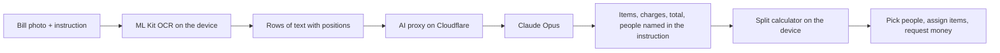
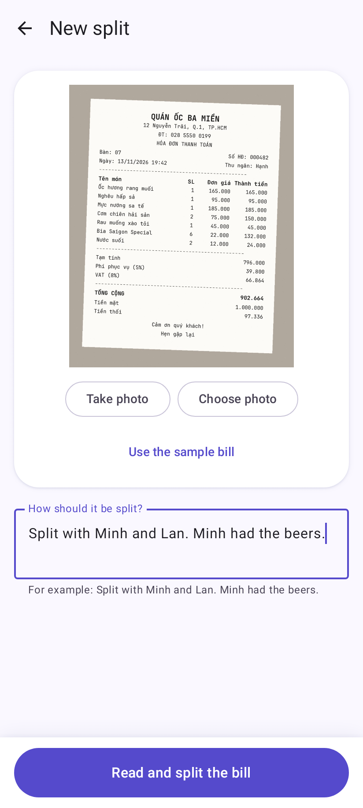

# Split Vibe POC

A proof-of-concept Android app (Kotlin, Jetpack Compose) for an AI "split bill" feature inside a
payment app.

You photograph a bill and type how it should be split. The phone reads the text of the bill with
on-device OCR and sends that text and its position on the page to the app's AI proxy, a Cloudflare
Worker that asks Claude and sends the bill back as structured data. The app then does the
arithmetic itself and lets you pick the contacts who share the bill and who shares each item. The
app holds no API key.





## What the app does

1. **Home** shows the in-app contacts (other users of the payment app) and a "Split a bill" entry.
2. **New split** takes a bill photo (camera, gallery, or the bundled sample bill) and an instruction
   such as `Split with Minh and Lan. Minh had the beers.` or `We are 3, I didn't drink.`
3. **Result** shows the items, the taxes and fees, and the total. People named in the instruction are
   matched to contacts and pre-selected. You can add or remove people, tap an item to choose who
   shares it, and see what each person pays. The shares always add up to the bill total.
4. **Request** confirms the amounts that would be requested from each person. This step is a mock.

## Run it

Requirements: Android Studio with support for Android Gradle Plugin 9.1 (or JDK 17+ and the Android
SDK with platform 37 on the command line), and a device or emulator running Android 8.0 (API 26) or
newer.

```bash
./gradlew :app:assembleDevDebug
```

```bash
./gradlew :app:installDevDebug
```

The `dev` flavor installs as `com.dantech.splitvibe.dev`, next to the real app and with its own data.
The `prod` flavor is the app that will be published.

Reading a bill needs the AI proxy. A debug build looks for it at `http://127.0.0.1:8787`: run it
on your computer as [docs/proxy.md](docs/proxy.md) describes (`npm ci`, a `.dev.vars` file with the
key, `npm run dev`), then forward the port to the phone or emulator:

```bash
adb reverse tcp:8787 tcp:8787
```

A deployed proxy and Google sign-in are set in `local.properties` (git-ignored). A release build
requires https, and without an address it is built with AI reading off:

```properties
splitvibe.aiProxyUrl=https://split-vibe-proxy.<your-subdomain>.workers.dev
splitvibe.googleWebClientId=<web client ID>.apps.googleusercontent.com
```

Without signing in, each install gets 3 free reads. **Settings** (gear icon) shows the reads left
and offers "Sign in with Google" for 10 reads a month, signing out and deleting the account. It
also holds the app's **local currency** (the currency the payment app works in), which defaults to
the currency of the phone's region.

Without a real bill at hand, tap **Use the sample bill** on the new-split screen.

## How it works

### 1. On-device OCR with positions

`MlKitBillTextRecognizer` runs ML Kit Text Recognition v2 with the bundled Latin-script model, so it
works offline. Latin script covers English, Vietnamese and most European languages.

OCR engines return text block by block. On a receipt that usually means all item names first and all
prices later, so the reading order alone does not say which price belongs to which item.
`OcrLayoutEncoder` fixes that before anything is sent:

- it straightens the page using the direction the text runs in (a bill photographed at an angle is fine),
- it groups text fragments that sit at the same height into rows,
- it writes every fragment with its box, in coordinates from 0 to 1000.

This is the kind of document the model receives (real ML Kit output for the sample bill, typos included):

```text
<bill_ocr rows="22">
1 | [307,0,704,41] "QUÁN ỐC BA MIỂN"
...
13 | [5,526,328,552] "Bia Saigon Special" | [552,532,567,548] "6" | [675,531,779,550] "22.000" | [875,532,996,551] "132.000"
14 | [5,564,163,587] "NƯớc sUối" | [553,571,567,587] "2" | [675,569,780,592] "12.000" | [892,571,996,590] "24.000"
...
18 | [0,795,173,827] "TỔNG CỘNG" | [862,805,993,826] "902.664"
</bill_ocr>

<user_instruction>
Split with Minh and Lan. Minh had the beers.
</user_instruction>
```

### 2. Claude reads the bill, through the proxy

`GatewayBillAnalyzer` posts the document, the instruction and the local currency to the proxy's
`POST /v1/bill-analysis` and reads its answer line by line while the model works. The proxy
([docs/proxy.md](docs/proxy.md)) calls the Messages API through the official Anthropic TypeScript SDK:

- model `claude-opus-5-5`, effort `medium`, adaptive thinking left on;
- the system prompt in `proxy/src/prompt.ts` explains the document format, typical OCR mistakes and what to extract;
- the answer is constrained to the JSON Schema in `proxy/src/schema.ts` with structured outputs, so it always parses;
- server-side refusal fallbacks are switched on (beta `server-side-fallback-2026-07-01`,
  `fallbacks: "default"`): if a safety classifier declines the request, the API re-runs it on another
  model instead of failing.

The proxy counts the calls (3 free per install, 10 a month per Google account), limits each network
address, caps the day's spend, and charges a call only once the model has answered. When a read
fails, reading the same bill again keeps its request id, so the proxy does not charge twice.

The model returns items, charges, the total, the currency, the number of decimals the prices are
printed with, and what the instruction said about people:
who is named, how many people there are, and item rules of two kinds. `only` means the item belongs
to the people named ("Minh had the beers"). `all_except` means the people named did not have it ("I
didn't drink"), which leaves it to everyone else. The model does not compute anyone's share.

### 3. The arithmetic stays on the device

- Amounts are converted to whole minor units (`BillCurrency`), so nothing is lost to rounding.
- The currency and its precision come from the bill. A bill is never split finer than its prices
  are printed, and never finer than the currency allows. So a rupiah, forint or dong bill is split
  in whole units, and a dollar bill printed with cents is split to the cent.
- A bill that shows no currency is taken to be in the app's local currency (Settings). A bill in a
  different currency is split in its own currency and marked with a note; nothing is converted.
- `BillReconciler` checks that items plus charges equal the total. If they do not, the printed total
  wins and the gap is shown as an explicit "Unallocated difference" line with a warning. A line with
  a negative amount, such as a voucher, is treated as a deduction on the whole bill.
- `SplitCalculator` applies these rules:
  - an item is shared equally by the people assigned to it, or by everyone when it is unassigned;
  - items shared by exactly the same group are added up and divided once;
  - taxes, fees, tips and discounts follow each person's items proportionally;
  - with no assignments at all, the whole bill is divided equally;
  - the unit that cannot be divided goes to the first person in the list, and the payer is listed first.
- `SplitPlanner` and `NameMatcher` match the names from the instruction against the contact list on the
  device. A contact is pre-selected only when the typed name is that person's full name, handle or
  given name and nobody else fits as well. A surname or middle name alone, a name shared by two
  contacts, or an unknown name is never guessed: the app shows a notice and the user picks the person.

### Privacy

Only the OCR text and the typed instruction leave the phone. The photo is never uploaded, and the
contact list is never sent: the model only repeats names that appear in the instruction. The proxy
keeps no bill text, name or address: it holds counters under salted hashes, and logs one line of
numbers per request.

## Project layout

```text
core/designsystem/            the look of the app: theme, tokens, components, motion
core/domain/                  plain Kotlin, no Android: the money logic and the data contracts
  domain/     Bill, BillCurrency, BillReconciler, SplitCalculator, SplitPlan, NameMatcher
  ocr/        OcrResult, OcrLayoutEncoder
  llm/        BillAnalyzer, BillAnalysisParser
  data/       Contact
app/src/main/java/com/dantech/splitvibe/
  di/         the Koin module that wires the app together
  ocr/        BillTextRecognizer (ML Kit), BillImageLoader
  llm/        GatewayBillAnalyzer, which reads a bill through the AI proxy
  data/       account (install id, encrypted session, Google sign-in), proxy (the proxy's
              routes over OkHttp), contacts (seeded), settings (local currency)
  ui/         navigation, home, split (new split, result, sheets, confirmation), settings, theme
app/src/test/                 unit tests, UI tests on the JVM and the reference screenshots
app/src/androidTest/          on-device tests
app/src/sharedTest/resources/ recorded ML Kit output, a recorded Claude answer, and the request
                              the app sends for them, which the proxy's tests send too
baseline-profile/             records the startup profile and holds the benchmarks
proxy/                        the AI proxy: a Cloudflare Worker in TypeScript, with its tests
```

[docs/architecture.md](docs/architecture.md) explains the modules, the navigation, the build
variants and every check in more detail. [docs/design-system.md](docs/design-system.md) describes
the look: the palette, the components and the rules for using them. [docs/proxy.md](docs/proxy.md)
describes the AI proxy: its routes, its limits, what it keeps, and how to run and deploy it.

## Tests

```bash
./gradlew :core:domain:test :core:designsystem:testDebugUnitTest :app:testProdDebugUnitTest
```

129 tests cover the split rules (including 2,000 random bills whose shares must add up to the
total without anyone owing a negative amount), currency handling, name matching, split planning, row
layout, answer parsing, the proxy client, the account and sign-in, the UI flow, app startup,
navigation, the dependency wiring, the text contrast of the colour palette, the motion, and the
design system components.

- The proxy client tests run the real client against a local server that answers as the proxy does.
  They pin down the request, which must match the shared fixture the proxy's tests send, and every
  kind of answer: the bill, free reads used up, sign-in run out, AI switched off, app too old,
  rate limits, busy, refused, too long, timeout, and an answer that stops half way.
- `SplitFlowTest` walks through the real screens without a device (Robolectric): sample photo,
  instruction, analysis, people pre-selected, exact shares, changing who shares an item, request
  confirmation. It replays two recordings of the real pipeline: the text ML Kit read on a device
  and the answer Claude Opus gave for it, streamed the way the proxy sends it.
- `ScreenGalleryTest` draws every screen in the light and the dark theme, and the four main screens
  with text at twice its size, and compares each with the reference image in
  `app/src/test/screenshots`. After an intended visual change, record new images with
  `./gradlew :app:testProdDebugUnitTest -Pscreenshots=record` and review them like code.
- `AppStartupTest` and `BackNavigationTest` start the real application and activity: moving between
  the screens, restoring them after the activity is recreated, the back swipe preview, and back
  cancelling running work before it leaves the split screen.
- `AmountAnimationTest`, `ReducedMotionTest` and `ComponentBehaviourTest` check the motion and the
  components: an amount that changes mid-run, nothing moving with animations switched off, and what
  the choice group, the menus and the person chips do when they are tapped and how a screen reader
  reads them.

```bash
./gradlew :app:pixel6Api34ProdDebugAndroidTest
```

The on-device tests cover what only a device can show: starting the app, the real ML Kit recognizer
on the sample bill, the proxy client reading a streamed answer on the Android runtime, the Keystore
encryption of the session, and splitting the sample bill from the photo to the sent requests. Every
tap in them also runs Android's accessibility checks on the screen it lands on. They need no
network. The command above lets Gradle download, start and stop its own Android 14 emulator;
`./gradlew :app:connectedProdDebugAndroidTest` uses a device that is already connected.

The other checks, all of which also run in GitHub Actions for every pull request and every push to `main`:

```bash
./gradlew ktlintCheck
```

```bash
./gradlew :app:lintProdDebug :core:designsystem:lintDebug
```

The AI proxy has its own 81 tests, which run in the workers runtime against a fake model. From
`proxy/`:

```bash
npm test
```

## How it was verified

| What | How | Result |
|---|---|---|
| Build | `./gradlew :app:assembleProdDebug :app:assembleProdRelease :app:bundleProdRelease` (R8) | all three build; the release is unsigned unless the signing variables are set |
| Unit tests | `./gradlew :core:domain:test :core:designsystem:testDebugUnitTest :app:testProdDebugUnitTest` | 129 pass |
| UI flow | `SplitFlowTest` on the JVM, with the real screens, view model and proxy client | passes |
| AI proxy | `npm run typecheck` and `npm test` in `proxy/` | 81 pass; each rule about calls, holds and spend was also broken on purpose to see its test fail |
| On-device tests | `./gradlew :app:pixel6Api34ProdDebugAndroidTest` in GitHub Actions, on an Android 14 emulator that Gradle manages | 8 tests; the proxy client test on a device has not run yet |
| OCR | Real ML Kit on two rendered receipts (Vietnamese, tilted 2 degrees; US, tilted 3 degrees) | every item row came back with its prices on the same row |
| Prompt and schema | The exact system prompt and schema, with the real ML Kit output, sent to Claude Opus 5.5 | items, charges and totals correct for English, Vietnamese and German instructions; tips, "X had", "X didn't have" and "I didn't have" understood; a noisy bill with misread digits and an injected instruction still reconciled; a parking sign was rejected as not a bill; a rupiah bill came back with zero decimals and a bill without a currency symbol in the app's local currency |

What has not been verified:

- **A live call through the proxy.** The proxy is tested against a fake model and the app against a
  stand-in for the proxy; the request is the same in both. The proxy has not been deployed, so no
  bill has gone from the app through the proxy to the live API yet. That needs the owner's
  Cloudflare account, Anthropic key and Google OAuth clients ([docs/proxy.md](docs/proxy.md)).
- **Google sign-in on a phone.** Credential Manager needs the OAuth clients, so sign-in has only been
  tested with a stand-in for Google's account picker.
- **The screens after analysis on a device.** The home and new-split screens were seen running on
  the emulator. The result, item and confirmation screens were exercised only in `SplitFlowTest`,
  because the emulator session ended before the on-device walk-through finished.
- **A physical phone.** Everything on-device ran on an emulator.
- **The release build at runtime.** It builds with R8, but only debug builds were run.
- **Performance numbers.** The benchmarks in `baseline-profile` exist but have not been run on a
  real phone yet, so there is no measured cold start or frame time.

## Known limits

- **Free reads are per install.** Clearing the app's data makes a new install with 3 new reads. The
  proxy's limits per network address and its daily spend caps bound what that can cost.
- **Mock data.** Contacts are seeded in `SeededContactRepository`, and "Request" creates nothing.
- **Latin script only.** Chinese, Japanese, Korean and Devanagari need the matching ML Kit artifacts.
- **No currency conversion.** A bill in another currency than the app's local currency stays in
  its own currency. Converting would need an exchange rate source.
- **Bills printed without decimals are split in whole units**, including the rare dollar or euro bill
  that shows no cents.
- **App size.** ML Kit ships native code for four CPU types, so the release APK is large; an app
  bundle splits it per device.
- **State is in memory.** A split in progress survives rotation but not the app being killed.
- **English UI strings** are written inline rather than in string resources.
- **Very long bills** could exceed the answer token limit; the app then asks for two photos.

## Toolchain

Android Gradle Plugin 9.1.1 (built-in Kotlin), Gradle 9.4.1, Kotlin 2.3.21, Compose BOM 2026.09.00
(Compose UI 1.12.1) with material3 pinned to 1.5.0-rc01, compileSdk 37, targetSdk 36, minSdk 26,
Koin 4.2.2, Navigation 3 1.2.1, ML Kit text-recognition 16.0.1, OkHttp 4.12.0, Credential Manager
1.6.0 with Google ID 1.2.1. The AI proxy: TypeScript 5.9 on Cloudflare Workers with Durable Objects,
wrangler 4.162.0, `@anthropic-ai/sdk` 1.8.0, jose 6.2.17, vitest 5.1.0.

## License

Copyright © 2026 dantech0xff. The source is published for reference under the
[PolyForm Strict License 1.0.0](LICENSE): noncommercial use only, with no redistribution
and no modified versions.
