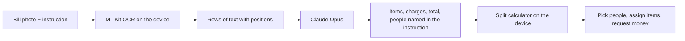

# Split Vibe POC

A proof-of-concept Android app (Kotlin, Jetpack Compose) for an AI "split bill" feature inside a
payment app.

You photograph a bill and type how it should be split. The phone reads the text of the bill with
on-device OCR, sends that text and its position on the page to Claude, and gets the bill back as
structured data. The app then does the arithmetic itself and lets you pick the contacts who share
the bill and who shares each item.




## What the app does

1. **Home** shows the in-app contacts (other users of the payment app) and a "Split a bill" entry.
2. **New split** takes a bill photo (camera, gallery, or the bundled sample bill) and an instruction
   such as `Split with Minh and Lan. Minh had the beers.` or `We are 3, I didn't drink.`
3. **Result** shows the items, the taxes and fees, and the total. People named in the instruction are
   matched to contacts and pre-selected. You can add or remove people, tap an item to choose who
   shares it, and see what each person pays. The shares always add up to the bill total.
4. **Request** confirms the amounts that would be requested from each person. This step is a mock.

## Run it

Requirements: Android Studio with support for Android Gradle Plugin 9.1 (or JDK 17+ and the Android
SDK with platform 36 on the command line), and a device or emulator running Android 8.0 (API 26) or
newer.

```bash
./gradlew assembleDebug
```

```bash
./gradlew installDebug
```

Then give the app an Anthropic API key in one of two ways:

- In the app, open **Settings** (gear icon) and paste the key. It is encrypted with a key from the
  Android Keystore before it is stored.
- Or, for debug builds, add this line to `local.properties` (the file is git-ignored) and rebuild:

  ```properties
  ANTHROPIC_API_KEY=sk-ant-...
  ```

  A debug APK built this way contains the key in readable form. Do not hand that APK to anyone.

Settings also holds the app's **local currency** (the currency the payment app works in). It
defaults to the currency of the phone's region.

Without a real bill at hand, tap **Use the sample bill** on the new-split screen.

## How it works

### 1. On-device OCR with positions

`MlKitBillTextRecognizer` runs ML Kit Text Recognition v2 with the bundled Latin-script model, so it
works offline. Latin script covers English, Vietnamese and most European languages.

OCR engines return text block by block. On a receipt that usually means all item names first and all
prices later, so the reading order alone does not say which price belongs to which item.
`OcrLayoutEncoder` fixes that before anything is sent:

- it straightens the page using the direction the text runs in (a bill photographed at an angle is fine),
- it groups text fragments that sit at the same height into rows,
- it writes every fragment with its box, in coordinates from 0 to 1000.

This is the kind of document the model receives (real ML Kit output for the sample bill, typos included):

```text
<bill_ocr rows="22">
1 | [307,0,704,41] "QUÁN ỐC BA MIỂN"
...
13 | [5,526,328,552] "Bia Saigon Special" | [552,532,567,548] "6" | [675,531,779,550] "22.000" | [875,532,996,551] "132.000"
14 | [5,564,163,587] "NƯớc sUối" | [553,571,567,587] "2" | [675,569,780,592] "12.000" | [892,571,996,590] "24.000"
...
18 | [0,795,173,827] "TỔNG CỘNG" | [862,805,993,826] "902.664"
</bill_ocr>

<user_instruction>
Split with Minh and Lan. Minh had the beers.
</user_instruction>
```

### 2. Claude reads the bill

`ClaudeBillAnalyzer` calls the Messages API through the official Anthropic Java SDK:

- model `claude-opus-5-5` (changeable in Settings), effort `medium`, adaptive thinking left on;
- the system prompt in `BillPrompt` explains the document format, typical OCR mistakes and what to extract;
- the answer is constrained to the JSON Schema in `BillSchema` with structured outputs, so it always parses;
- server-side refusal fallbacks are switched on (beta `server-side-fallback-2026-07-01`,
  `fallbacks: "default"`): if a safety classifier declines the request, the API re-runs it on another
  model instead of failing. If the API rejects that beta option, the request is sent again without it,
  and the option is left out for the rest of the session.

The model returns items, charges, the total, the currency, the number of decimals the prices are
printed with, and what the instruction said about people:
who is named, how many people there are, and item rules of two kinds. `only` means the item belongs
to the people named ("Minh had the beers"). `all_except` means the people named did not have it ("I
didn't drink"), which leaves it to everyone else. The model does not compute anyone's share.

### 3. The arithmetic stays on the device

- Amounts are converted to whole minor units (`BillCurrency`), so nothing is lost to rounding.
- The currency and its precision come from the bill. A bill is never split finer than its prices
  are printed, and never finer than the currency allows. So a rupiah, forint or dong bill is split
  in whole units, and a dollar bill printed with cents is split to the cent.
- A bill that shows no currency is taken to be in the app's local currency (Settings). A bill in a
  different currency is split in its own currency and marked with a note; nothing is converted.
- `BillReconciler` checks that items plus charges equal the total. If they do not, the printed total
  wins and the gap is shown as an explicit "Unallocated difference" line with a warning. A line with
  a negative amount, such as a voucher, is treated as a deduction on the whole bill.
- `SplitCalculator` applies these rules:
  - an item is shared equally by the people assigned to it, or by everyone when it is unassigned;
  - items shared by exactly the same group are added up and divided once;
  - taxes, fees, tips and discounts follow each person's items proportionally;
  - with no assignments at all, the whole bill is divided equally;
  - the unit that cannot be divided goes to the first person in the list, and the payer is listed first.
- `SplitPlanner` and `NameMatcher` match the names from the instruction against the contact list on the
  device. A contact is pre-selected only when the typed name is that person's full name, handle or
  given name and nobody else fits as well. A surname or middle name alone, a name shared by two
  contacts, or an unknown name is never guessed: the app shows a notice and the user picks the person.

### Privacy

Only the OCR text and the typed instruction leave the phone. The photo is never uploaded, and the
contact list is never sent: the model only repeats names that appear in the instruction.

## Project layout

```text
app/src/main/java/com/dantech/splitvibe/
  domain/     Bill, BillCurrency, BillReconciler, SplitCalculator, SplitPlan, NameMatcher
  ocr/        BillTextRecognizer (ML Kit), BillImageLoader, OcrLayoutEncoder, OcrResult
  llm/        BillAnalyzer, ClaudeBillAnalyzer, BillPrompt, BillSchema, BillAnalysisParser
  data/       contacts (seeded), settings (encrypted API key)
  ui/         home, split (new split, result, sheets, confirmation), settings, theme
app/src/test/                 unit tests
app/src/androidTest/          on-device tests
app/src/sharedTest/resources/ recorded ML Kit output and a recorded Claude answer
```

`domain`, `OcrLayoutEncoder` and most of `llm` are plain Kotlin and run in unit tests without a device.

## Tests

```bash
./gradlew testDebugUnitTest
```

80 unit tests cover the split rules (including 2,000 random bills whose shares must add up to the
total without anyone owing a negative amount), currency handling, name matching, split planning, row
layout, answer parsing, the Claude client and the UI flow.

- The client tests run the real SDK against a local HTTP server and pin down the exact request and
  every kind of API answer: success, invalid key, unknown model, refusal, cut-off answer, fallback
  model, timeout.
- `SplitFlowTest` walks through the real screens without a device (Robolectric): sample photo,
  instruction, analysis, people pre-selected, exact shares, changing who shares an item, request
  confirmation. It replays two recordings of the real pipeline: the text ML Kit read on a device
  and the answer Claude Opus gave for it.

```bash
./gradlew connectedDebugAndroidTest
```

The on-device tests cover what only a device can show: the real ML Kit recognizer on the sample
bill, the real Anthropic SDK on the Android runtime, and the Keystore encryption. They need no API
key.

To exercise the real API with your key (a few cents per run):

```bash
ANTHROPIC_API_KEY=sk-ant-... ./gradlew :app:testDebugUnitTest --tests '*LiveClaudeBillAnalyzerTest*' --rerun
```

## How it was verified

| What | How | Result |
|---|---|---|
| Build | `./gradlew assembleDebug` and `assembleRelease` (R8) | both build |
| Unit tests | `./gradlew testDebugUnitTest` | 79 pass, 1 skipped (the live API test, which needs a key) |
| UI flow | `SplitFlowTest` on the JVM, with the real screens, view model and SDK client | passes |
| On-device tests | Each test class run with `am instrument` on an Android 14 emulator (x86_64, software emulation) | all passed on the first delivery; not re-run since the currency change |
| OCR | Real ML Kit on two rendered receipts (Vietnamese, tilted 2 degrees; US, tilted 3 degrees) | every item row came back with its prices on the same row |
| Prompt and schema | The exact system prompt and schema, with the real ML Kit output, sent to Claude Opus 5.5 | items, charges and totals correct for English, Vietnamese and German instructions; tips, "X had", "X didn't have" and "I didn't have" understood; a noisy bill with misread digits and an injected instruction still reconciled; a parking sign was rejected as not a bill; a rupiah bill came back with zero decimals and a bill without a currency symbol in the app's local currency |

What has not been verified:

- **The live API call from this project.** The model runs above went through the Claude Code command
  line of the build environment, because that environment could not hold an Anthropic API key. The
  request this app sends through the SDK is pinned down by tests against a local server, but it has
  not yet been sent to the live API. Run `LiveClaudeBillAnalyzerTest` with a key to close that gap.
- **The screens after analysis on a device.** The home and new-split screens were seen running on
  the emulator. The result, item and confirmation screens were exercised only in `SplitFlowTest`,
  because the emulator session ended before the on-device walk-through finished.
- **A physical phone.** Everything on-device ran on an emulator.
- **The release build at runtime.** It builds with R8, but only debug builds were run.
- **The Gradle `connectedDebugAndroidTest` task itself.** The same test classes were run one by one.

## Known limits

- **API key on the device.** Acceptable for a proof of concept only. A real payment app must call its
  own backend, and the backend calls Claude. `ClaudeBillAnalyzer` takes a `baseUrl` for that, and
  `BillAnalyzer` is the interface to implement against a backend. Note that the SDK sends the key as
  `Authorization: Bearer`.
- **Mock data.** Contacts are seeded in `SeededContactRepository`, and "Request" creates nothing.
- **Latin script only.** Chinese, Japanese, Korean and Devanagari need the matching ML Kit artifacts.
- **No currency conversion.** A bill in another currency than the app's local currency stays in
  its own currency. Converting would need an exchange rate source.
- **Bills printed without decimals are split in whole units**, including the rare dollar or euro bill
  that shows no cents.
- **First request is slower.** The SDK sets up its JSON machinery on first use. This happens on a
  background thread; later requests in the same app session skip it.
- **App size.** The debug APK is about 72 MB because the SDK's code is not shrunk. R8 shrinks the code
  from 82 MB to under 6 MB; the release APK is still 46 MB because ML Kit ships native code for four
  CPU types, which an app bundle would split per device.
- **State is in memory.** A split in progress survives rotation but not the app being killed.
- **English UI strings** are written inline rather than in string resources.
- **Very long bills** could exceed the answer token limit; the app then asks for two photos.

## Toolchain

Android Gradle Plugin 9.1.1 (built-in Kotlin), Gradle 9.4.1, Kotlin 2.3.21, Compose BOM 2026.03.01,
compileSdk and targetSdk 36, minSdk 26, ML Kit text-recognition 16.0.1, anthropic-java 3.8.0.
