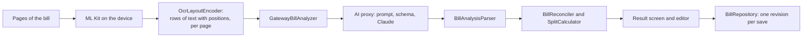
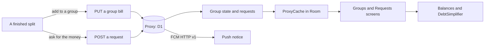
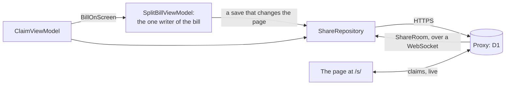
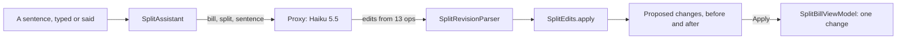
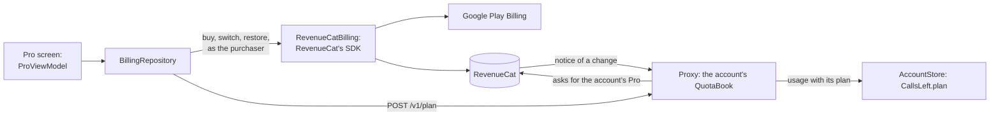

# Architecture

How the code is organised today, why, and which checks guard it. The product roadmap lives in
[the production plan](../plans/261114-0220-split-vibe-production/plan.md); this page describes
only what is in the repository now.

## Modules

```mermaid
flowchart LR
    app[":app<br/>screens, navigation, dependency wiring,<br/>ML Kit text recognition and scanning,<br/>the bills on the phone, the proxy client,<br/>groups, requests, push, bill links,<br/>edits by a sentence, insights, recurring bills,<br/>Pro through RevenueCat"]
    domain[":core:domain<br/>plain Kotlin: money, split rules,<br/>group balances, payment codes,<br/>data contracts, answer parsing"]
    design[":core:designsystem<br/>theme, tokens,<br/>components, motion"]
    profile[":baseline-profile<br/>records the startup profile,<br/>holds the benchmarks"]
    app --> domain
    app --> design
    profile -. drives and measures .-> app
    proxy["proxy/<br/>Cloudflare Worker:<br/>prompt, calls, limits, Claude,<br/>the day's exchange rates,<br/>groups and requests in D1, push,<br/>bill links and their live claims,<br/>edits of a split by a sentence"]
    web["web/<br/>the pages a link opens:<br/>Vite, Preact, TypeScript"]
    app -. HTTPS and a WebSocket .-> proxy
    revenuecat["RevenueCat<br/>over Google Play Billing"]
    app -. Pro, as the account's purchaser .-> revenuecat
    revenuecat -. notices of changes .-> proxy
    web -. built into .-> proxy
    design -. tokens.css .-> web
```

| Module | Kind | Holds |
|---|---|---|
| `:app` | Android application | Compose screens, `AppNavHost`, the Koin module, `MlKitBillTextRecognizer`, `DocumentScanner`, `GatewayBillAnalyzer` and `ProxyApi` (the proxy's routes over OkHttp), the bills kept on the phone (`SplitVibeDatabase`, `BillRepository`, `BillPages`), the people split with before (`PeopleRepository`, `ContactNames`), the exchange rates (`FxRepository`), the account (install id, encrypted session, Google sign-in through Credential Manager), settings storage, the ways to get paid (`PaymentMethodRepository`), groups and requests (`GroupRepository`, `RequestRepository`, `ProxyCache`), sharing (`QrCodes`, `ShareCardRenderer`), push (`Push`, `DeviceRegistrar`, `PushService`), app links (`AppLink`), bill links (`ShareRepository`, `ClaimViewModel`), changing a split by a sentence (`SplitAssistant`, `VoiceInput`, `ProxyModelCall`), insights and export (`InsightsViewModel`, `Exporter`, `CsvExport`, `PdfSummary`), recurring bills (`RecurringBillRepository`, `RecurringDrafts`, `RecurringBillWorker`), Pro (`Billing`, `RevenueCatBilling`, `BillingRepository`, `ProViewModel`), the texts in `res/values/strings.xml` with `UiText` and `ContentWords`, deleting what only the phone keeps (`PhoneData`) |
| `:core:domain` | Kotlin JVM library | `Bill`, `BillCurrency`, `BillEditor`, `BillReconciler`, `ExchangeRate`, `Participant`, `Person`, `Payment`, `SplitMode`, `SplitCalculator`, `SplitPlan`, `NameMatcher`, `Balances`, `DebtSimplifier`, `GroupConversion`, `ClaimSplit`, `BillCategory`, `SplitEdit` and `SplitEdits`, `Insights`, `Recurrence`, `payments` (`PaymentMethod`, `PaymentRequestBuilder`, `EmvQr`, `VietQrBanks`), `OcrResult`, `OcrLayoutEncoder`, `BillAnalyzer`, `BillAnalysisParser`, `SplitRevisionParser`, `SplitRevisionRequest` |
| `:core:designsystem` | Android library | `SplitVibeTheme` (Material 3 Expressive, violet palette, light and dark); the colour, type, spacing, shape and elevation tokens; the components (`Sv…`); the motion pieces (`SvAmount`, `SvSteps`, `sharedSurface` and others) |
| `:baseline-profile` | Android test module | `BaselineProfileGenerator`, `StartupBenchmark`, `SplitFlowBenchmark` |
| `proxy/` | Cloudflare Worker, TypeScript | the prompt and answer schema, the calls per install and per Google account, the limits per address, the daily spend caps, the Google ID token check and the proxy's own session, groups, payment requests, devices and their permissions in D1, push through FCM, App Links, bill links with what people claim on them and their live updates (`ShareRoom`), the web pages, edits of a split by a sentence, calls counted in hundredths so that an edit weighs 0.2; described in [proxy.md](proxy.md) |
| `web/` | Web pages, TypeScript | the pages a bill link, a payment request link and a group invite open (`/s/`, `/r/`, `/g/`), with Vite and Preact; built into the Worker, so the proxy serves them from its own address; described in [web.md](web.md) |

`:core:domain` applies only the Kotlin JVM plugin, so it cannot import an Android class. Everything
that decides how much a person pays lives there and is tested without a device. The package names
are the same in both modules (`com.dantech.splitvibe.domain`, `.ocr`, `.llm`), so moving a file
between them does not change any import.

`:core:designsystem` owns how the app looks. A screen wraps itself in nothing: `MainActivity` applies
`SplitVibeTheme` once, and screens read colours, type and elevation from it.
[design-system.md](design-system.md) lists the tokens and components. These rules in that module
are worth knowing before changing it:

- Every colour role takes a fixed lightness step of one of five ramps, so text and its background
  always differ enough to read. `ColorTokensTest` fails when a changed value breaks that.
- Depth is `SvElevation`. In the light theme a level is a soft violet-tinted shadow; in the dark
  theme it is a lighter surface and no shadow is drawn. The only part of a shadow that may be
  animated is its strength, which moves opacity and offset. The blur radius is fixed per level
  because changing it every frame is expensive.
- Screens decide nothing about the look themselves: no theme, no colour value, no shadow, no
  animation timing, and no experimental Expressive API outside this module.
  `DesignSystemBoundaryTest` fails when a screen does, and names the line.

## Inside the app

### Texts and languages

Every text the person reads is a resource in `app/src/main/res/values/strings.xml`: a plurals
resource wherever it holds a count, and a formatted string, with numbered arguments, wherever a
sentence is built from parts. v1.0 is in English only, so a new language is a new
`values-xx/strings.xml` and no change to the code.

- Screens read their texts with `stringResource`, and through `UiText` every text that holds a
  count and every plural.
- View models, repositories and `llm/` say what to show as a `UiText` (`text/UiText.kt`): a string
  or plurals resource with its arguments, which may be `UiText`s themselves, or text that is not
  the app's own, such as a name someone typed or what the model wrote (`UiText.Raw`). The screen
  reads it with `resolve()`; code with a `Context`, such as a notice, the share sheet or the
  exporter, with `resolve(resources)`. None of them reads resources itself, and none gets a
  `Context` for it.
- A failed call to the model carries its text as the cause of the domain's `BillAnalyzerException`
  (`ModelCallFailure`), as that exception holds only a message for developers; `e.text` reads it.
- Numbers are written as English writes them, whatever the phone's language or region: the digits 0
  to 9, "." before decimals and "," between thousands, as the counts, the calls left and the
  ordinals of the texts always were. `TEXT_LOCALE` in `:core:domain` is that locale. `UiText` fills a
  text's placeholders in it, where `Resources.getString` would use the phone's locale and so, on a
  phone set to Persian or Arabic, its digits; `NumbersInTextsTest` fails when a text with a count, or
  a plural, is read another way. Money (`BillCurrency.format`), exchange rates, the payment details a
  request carries, the domain's own sentences and dates (`dateText`, with English month and day
  names) are written in `TEXT_LOCALE` too. Only the CSV files follow the phone's locale, for the
  spreadsheet app that opens them.
- What the app writes into what it keeps or sends, rather than shows, comes from `ContentWords`,
  read from the resources once when the app starts: the user as "You" in the stored list of a
  bill's people and in the totals by person, the name of a recurring bill without one, the lines
  and people without a name on a bill's page, and whom a group request greets or comes from. What
  was kept or sent stays in the language it was written in.
- Some text stays in code, each for a reason: the sentences `:core:domain` writes (a reason a split
  does not add up, a proposed edit, a payment method's problem or name, a bill's warnings), which
  the screens show as they come; the CSV files' headings and words, a format for spreadsheet apps
  that stays the same in every language; and the PDF summary's headings, as the device test builds
  `PdfSummary` without them. Log lines and messages of exceptions are for developers and stay in
  code too.

Debug builds carry the pseudolocales `en-XA`, which makes every text of the resources longer and
accented, and `ar-XB`, which writes them right to left. Text that is cut off, overlaps or is not in
the resources shows up in them; `PseudoLocaleGalleryTest` draws four main screens in `en-XA`.

### Deleting the account

Settings deletes the account only once the person confirms it, and the confirmation has a box, off
each time it opens, to delete what only this phone keeps with it.

1. The person's choice is written to the phone's storage (`DeletionStore`) before the request goes
   out.
2. The proxy deletes what it keeps about the account (`DELETE /v1/account`, see
   [proxy.md](proxy.md)). Only its 204 counts, and the call follows no redirect. When the proxy
   refuses, limits the deletion (429), cannot reach RevenueCat (502) or cannot be reached, nothing
   on the phone is deleted and the account stays signed in. A 401 means the proxy no longer takes
   the session, so the sign-in counts as run out on the phone, as after any call, and nothing else
   changes.
3. Once the proxy has deleted the account, the phone notes that, then forgets the session and the
   groups and requests kept from the proxy.
4. With the box ticked, `PhoneData` then deletes the bills and their drafts with the photos of their
   pages, the recurring bills, the people split with, the ways to get paid, all of the app's cache
   (where photos from the camera and the document scanner and the copies shared to another app
   wait), the app's notices, and the user's name. The rows go in one transaction, so a failure there
   leaves every table as it was. A file that is still there after it was deleted counts as a failure
   too. The screen then says that not all of it could be deleted, and that clearing Split Vibe's
   storage in the phone's settings deletes the rest. The currency and the consent to the speech
   service stay. Without the box ticked, all of it stays as before.

The deletion runs in `AccountRepository`'s own scope rather than the screen's, so leaving Settings
stops neither the request nor what follows it. Settings opened meanwhile shows it working, and the
next time Settings shows it says how the deletion ended. When the app is ended part of the way
through, its next start finishes the deletion: it asks the proxy again when the answer had not come,
and once the proxy has deleted the account it deletes what is left on the phone, the phone's data
too when the box was ticked. If the proxy then no longer takes the session, which is also how it
answers once the earlier request deleted the account, nothing on the phone is deleted and Settings
says that the deletion could not be confirmed. Without a connection, the next start, or Settings
opening, asks again.

Deleting the account does not cancel Pro, which the dialog says. Settings and the Pro screen link
the privacy policy and the terms of use, which the proxy serves at `/privacy` and `/terms`; a build
without the proxy's address shows neither link.

### Dependency wiring

`di/AppModule.kt` and `di/SpendingModule.kt` (insights, export and recurring bills) are the Koin
modules that list every long-lived object and the view models. `SplitVibeApp` starts Koin when the
process starts. Screens get objects with `koinViewModel()` and `koinInject()`.

Koin resolves the graph when the app runs, not when it compiles. `AppModuleTest` and
`SpendingModuleTest` therefore resolve every definition in a local test, and `AppStartupTest` starts
the real application and activity. A wiring mistake fails the checks instead of crashing a screen.

### Navigation

`ui/AppNavHost.kt` uses Navigation 3. The back stack is a list of keys (`HomeKey`, `SplitKey`,
`HistoryKey`, `SettingsKey`, `PaymentMethodsKey`, `GroupsKey`, `GroupKey(id)`,
`JoinGroupKey(token)`, `RequestsKey`, `RequestLinkKey(token)`, `ClaimKey`, `InsightsKey`,
`RecurringKey`, `ProKey`) that the screen code owns directly:

- The keys are `@Serializable`, so the list is saved with the activity and the open screens come
  back after the system recreates it.
- A screen closes itself by name (`backStack.remove(SettingsKey)`) instead of popping whatever is on
  top. A double tap on a back arrow is therefore harmless.
- The system back gesture is handled by `NavDisplay`, which also draws the preview of the previous
  screen while the finger is down. The split screen grows out of the button that opens it and
  shrinks back into it during that preview (`Modifier.sharedSurface`). A screen that needs back for something else declares a
  `BackHandler`, and that one wins while it is enabled. `SplitScreen` uses this to cancel running
  work before it lets the user leave.
- Inside the split screen the four steps (photo, editor, result, the request step) follow from the view
  model's state and fade into each other through `SvSteps`. Each step carries the state it shows,
  so a step that is being left is drawn unchanged while it fades out, and back always belongs to
  the step on screen. The button that sends the requests turns into the mark that confirms them.
- Two decorators wrap every screen: one keeps `rememberSaveable` state per screen, the other gives
  each screen its own view model store. `SplitBillViewModel` is requested above `NavDisplay` on
  purpose, so a split in progress survives a visit to Settings.
- A bill opened from Home or the list of bills opens the split screen on its result, and back
  returns to where it was opened from. Photos shared from another app open a new split with them
  (`MainActivity` takes them from the share intent).
- An invite link (`/g/#{token}`) or a request link (`/r/#{token}`) on the proxy's own address, and a
  tapped push notice, open their screen on top of Home (`AppLink` reads them from the intent; a link
  to any other address opens nothing). The token rides in the fragment, which a browser never sends,
  and the app sends it to the proxy in a request body, so no token appears in an address the proxy
  or Cloudflare could log. The links reach the app through Android App Links: the
  manifest's intent filter names the proxy's host, which the build takes from the proxy's address,
  and Android checks the proxy's `/.well-known/assetlinks.json` before it hands the app a link.

To add a screen: declare a `@Serializable data object` (or data class) that implements `NavKey`, add
an `entry<ThatKey> { ... }` to the `entryProvider` block, and open it with `backStack.open(ThatKey)`.

### The split flow



The model reads the bill and reports what the instruction says about people. It never computes a
share: the arithmetic is done in `:core:domain`, in whole minor units of the bill's currency.
`SplitBillViewModel` saves the bill a moment after each change. Each save writes the whole bill as
the next revision of the copy the screen descends from, and Room refuses it when that copy is no
longer the latest, so two writers never overwrite each other. Reading other photos or typing a bill
in by hand starts a new bill; only reading the same photos again replaces their bill. What was on
screen comes back from `SavedStateHandle` and the database after the system ends the app. The
proxy streams its answer as lines of JSON, and the app's error kinds follow the proxy's codes: free
calls used up, sign-in run out, AI switched off, app too old, busy, refused, too long. Calls used up
lead to the Pro screen in a build that sells Pro, except for a Pro member, and otherwise to Settings
for the install's trial.
The [README](../README.md) describes each step in detail.

### Groups, requests and push



- `GroupRepository` and `RequestRepository` call the proxy's signed-in routes through
  `ProxyApi.signedIn` and keep its answers in `ProxyCache`, a table of the Room database, so groups
  and requests can be read without a connection. The cache is emptied on every sign-in, sign-out and
  account deletion, and its generation moves on each time, so an answer to a call made before that
  is dropped however late it arrives: another account never sees them. A group is kept with each
  bill's name and amounts but not its whole document, so the copy stays small at any size, and it is
  read off the main thread. A session the proxy refuses turns into a sign-in to renew, as for reading
  bills.
- A request's id follows what it asks for: the bill and person (or the group and the two members),
  the amount and a hash of the payment method. Asking again for the same thing is the same request;
  a changed amount or a corrected account is a new one, and the open request it replaces is
  withdrawn. A payment back is recorded under one id per choice, so a retry records it once, and
  getting money that was asked for confirms that request rather than recording it again. A bill in a
  group is settled through the group and is not asked for person by person.
- A group bill is the member's `SavedBill` without its photos, read text, instruction and own rate,
  with the member each participant is (`GroupBillDocument`), and its amounts in the group's
  currency. `GroupConversion` converts the total once and divides the result by the largest
  remainder in proportion to the parts and, separately, the payments. The local bill remembers its
  group and the revision the proxy accepted (`GroupLink`), so a later change goes as the next
  revision and the proxy refuses it when someone else changed the group's copy first.
- `GroupState.balances` adds up the bills whose amounts check out and the payments back; a bill that
  does not, which only a broken or tampered copy can be, is left out whole, so the balances still
  add up to zero. `DebtSimplifier` pairs the largest debt with the largest credit until all are zero.
- Payment methods are kept in their own table and never leave the phone, except as the one copy a
  request carries. `PaymentRequestBuilder` turns a method, an amount and a note into a link, a QR
  payload or both, always with the details as text; `QrCodes` draws the code with ZXing, and
  `ShareCardRenderer` records a card drawn by the design system's components (`Modifier.shareCard`)
  and saves it for the share sheet through the `FileProvider`.
- Push goes through Firebase Cloud Messaging, started by hand from four `BuildConfig` values when
  they are all set (no Google services plugin and no `google-services.json`). `DeviceRegistrar` sends
  the install's token to the proxy once someone signs in, and takes it back on signing out;
  `PushService` shows a notice with words of the app's own for the kind of notice the proxy sent.

### Bill links and live claims



- A bill on a link keeps a `ShareLink`: the link's id, its address with the token after the `#`,
  when it was made and when it runs out, a fingerprint of what its page shows, whether the amounts
  on the page are settled, and who each claim is on the bill (`matches`, `added`). The token goes
  nowhere else: a group's copy of the bill leaves the link out.
- The page shows a `BillProjection` of the bill: its items, its charges (more than 20 are shown as
  19 and one line for the rest), its total and its participants, the user under their own name, all
  without control characters or the invisible formatting characters the proxy takes out (it keeps
  the zero-width joiner and non-joiner). `ShareRepository.fingerprint` hashes it together with the
  shares that settling would put on the page, so a save that changes neither, such as finishing the
  split, sends nothing.
- `SplitBillViewModel` stays the only writer of the bill. The link's screen reads and changes the
  bill through `BillOnScreen`: the bill on screen, its stored copy once the pending save is written,
  its link and its plan. After each save of a bill on a link, `ShareRepository.project` sends the
  page a copy when the fingerprint changed. Its writes go one at a time, and it never sends a
  revision older than one it sent before. A link the proxy no longer has, or one that ran out, is
  forgotten, and the user is told when a change took the settled amounts off the page.
- `ClaimViewModel` makes the link when the bill has none, and a new one when the old one ran out or
  is gone; a link made while another account was signed in can be replaced with a new one. It
  follows the link only while its screen shows: `ShareRepository.live` opens a WebSocket with the
  token as a `Sec-WebSocket-Protocol` value, reads the link as it is on each new connection, opens
  the connection again after 1, 2, 5, 10 and then 30 seconds, and drops one that stays silent
  through two pings.
- Each claim is suggested as the participant of the same name (`NameMatcher`) or as someone new.
  Closing the picking turns the claims into a split by item (`ClaimSplit`): an item several people
  picked is shared between them, one nobody picked stays shared by everyone, and someone new joins
  the bill as a participant who is never suggested for later bills. No more than 30 people end up
  on the bill, as many as its page shows.
- Sending the amounts finishes the split and puts the shares the phone saved on the page, with who
  paid (`paidBy`) and who each claim is on the bill (`matches`), so people find what they owe. The
  page asks people for money only when the user paid the whole bill and it is in no group, by the
  payment method chosen on the screen; when that method changes later, the screen offers to send the
  new details. `PaymentPayload` keeps a method's link, QR payload and details within what the proxy
  accepts, so a request and a link carry the same payment.
- The pages in `web/` are built into the Worker's bundle: `npm run build:web` in `proxy/` builds
  them, and `scripts/embed-web.mjs` writes `src/web-assets.generated.ts`, which is not committed.
  `npm run bundle -- <directory>` then writes the bundle a deploy uploads, and refuses to bundle
  without the pages.
  Their colours and type come from the design system: `WebTokensTest` writes `web/src/tokens.css`
  when run with `-PwebTokens=write`, and otherwise fails when the file no longer matches the tokens.
  [proxy.md](proxy.md#bill-links-and-the-web-pages) describes the routes, the limits and the pages.

### Changing a split by a sentence



- `SplitRevisionRequest` sends the bill's lines and its split as the domain keeps them, with the
  text cleaned as for bill links and the sentence on one line. The divisions of items go only while
  the bill is split by item, so the model never sees divisions that are not in effect.
- The proxy answers with edits drawn from thirteen ops, a short explanation, or a question when the
  sentence is too unclear. The ops cover who shares an item, how the bill is divided, people added or
  taken off, a charge or a tip, who paid, and an item's amount or quantity. The model never works
  out a share.
- `SplitEdits.apply` applies the edits in order and rejects, with a reason, each one it cannot apply:
  an unknown item or person, a number out of range, sums that do not add up. A rejected edit changes
  nothing. An item edit on a bill split as a whole starts a split by item from an even split.
- `SplitAssistantViewModel` shows each edit in words, with a tick to drop it, and each person's share
  before and after, worked out again when an edit is dropped. Nothing changes until Apply, which goes
  through `SplitBillViewModel` as one change, so the bill is saved like any other edit. Undo puts the
  bill back exactly as it was, its status included. A question from the model is shown on its own and
  answered in the same field. A proposal and its Undo last through rotation and the screens opened
  from the split, but not the system ending the app; asking again costs another 0.2 of a call.
- An edit costs 0.2 of a call from the same allowance as a bill read. The proxy counts in hundredths
  and the app reads the numbers as decimals (`CallsLeft`). `ProxyModelCall` holds what both AI routes
  share: the request id that keeps a retry from being charged twice, the streamed answer and the
  error kinds.
- `VoiceInput` wraps `SpeechRecognizer`. It uses the phone's own recognizer when there is one, and
  asks before using a speech service that may send the sound over the network; that consent can be
  withdrawn in Settings. It asks for the microphone only when the mic is tapped, stops when the
  screen does, and puts what it heard into the field for the user to check. It never sends by itself.

### Insights and export

- `InsightsViewModel` builds the domain's `InsightBill`s from the finished bills, and `Insights.of`
  adds them up by month, category, person and group, in the local currency, with the user's own
  share.
- Each bill is converted with the rate saved with it: the day's rate the result screen showed, saved
  when the split was finished, or a rate the user typed. A bill in another currency without a rate
  is left out of the sums, and the screen says how many there are and how to add a rate. A bill
  without a readable date counts on the day it was saved.
- People are told apart by their name, without case, accents or punctuation, which is how the phone
  tells the people it remembers apart; groups by their id.
- `Exporter` writes a period as three CSV files (`bills.csv`, `items.csv`, `shares.csv`) or a PDF
  summary (`PdfSummary`, drawn with `PdfDocument`).
  - The CSV files are UTF-8 with a byte order mark and RFC 4180 quoting. They use commas and `.` for
    decimals, or semicolons and `,` where the locale writes decimals with a comma. Text a spreadsheet
    would take for a formula gets an apostrophe in front.
  - Files go only where the user picks them to go, through the Storage Access Framework, or to the
    share sheet through the `FileProvider` (`exports/` in the cache).

### Recurring bills

- A recurring bill (`RecurringBillRepository`) keeps a finished bill's lines and split with a weekly
  or monthly schedule (`Recurrence`). It leaves out the photos, the read text and the reading's
  warnings, the link, the group, and the people who joined from the link.
- The schedule recurs on the bill's own day, or on the day the user picks for the first draft. A
  monthly day that a month lacks falls back to its last day, and comes back the month after.
- `RecurringDrafts.makeDue` makes a draft for every day due since the last one it made
  (`madeThrough`). A draft's id is `Recurrence.draftId`, a name-based UUID of the recurring bill and
  the day. `BillRepository.createIfAbsent` writes it in one transaction, so however many runs there
  are, each draft is made once, and the id is one the proxy takes for groups, requests and links.
  A deleted draft is not made again. A paused bill makes nothing, and resuming skips what passed
  meanwhile.
- The drafts are made when the app comes to the foreground, and by a daily `RecurringBillWorker`
  (WorkManager unique work, stopped while no recurring bill is active). A run posts one notice per
  recurring bill on its own channel. The notice names the bill once the phone is unlocked, says only
  that a recurring bill is due on the lock screen, and opens the newest draft.
- Database version 3 adds the bills' `category` column, filled from each bill's stored document, and
  the `recurring_bills` table, through an automatic migration. `DatabaseMigrationTest` opens a
  version 2 database with Room.

### Pro



- The proxy alone decides what Pro gives. The app shows the plan the proxy counts the calls against
  (`usage.plan`: `trial`, `free` or `pro`, read into `CallsLeft.plan`; a proxy from before Pro sends
  none, which reads as the trial for `period: "trial"` and free otherwise) and what RevenueCat's SDK
  reports about the subscription: its plan, when it renews or ends, and a payment that failed.
- The purchaser is the account's id at RevenueCat, 64 lowercase hex characters, which the proxy hands
  out in `POST /v1/session`, `GET /v1/usage` and `POST /v1/plan`; the app never works it out, and a
  value of another shape reads as missing. An answer without it, as a part of the proxy still on the
  code from before a deploy gives for a few minutes, keeps the one stored for the session, or waits
  for the next answer that has it. `AccountStore` keeps it with the session, encrypted the
  same way, and forgets it with the session: on signing out, on deleting the account, and when the
  sign-in runs out. An answer that arrives after the session changed is not kept.
- `Billing` is the app's interface to the store. `RevenueCatBilling` implements it over
  `com.revenuecat.purchases:purchases`, and the tests use a stand-in. The SDK is only ever configured
  with the signed-in account's purchaser: `BillingRepository.follow`, which `MainActivity` starts,
  configures it when someone is signed in with a known purchaser, switches with `logIn` when another
  account signs in, and closes it with `Purchases.close()` while nobody is. It never calls `logOut`,
  which would make an anonymous id, so a phone where nobody signed in sends nothing to RevenueCat.
  A change of user, a purchase, a restore and reading the offer take turns under one lock, so a
  sign-out while Google Play's purchase is open waits until it is done. `follow` starts in the
  activity rather than the application because every local test creates the application, and as
  early as that so that a purchase the SDK has not sent to RevenueCat yet goes out soon.
- RevenueCat's SDK sends such a purchase, one whose sending failed after Google Play took the
  payment or one whose payment Google Play completes later, as whoever it runs as when it next tries
  (when it is set up, when the app comes to the foreground, when it reads the customer info), not as
  the account that made it. So when a purchase or a switch in this run of the app failed after
  Google Play may have charged, left its payment pending, ended unseen, or came back with Pro that
  the SDK worked out on the phone because RevenueCat's server failed, `BillingRepository` runs
  `syncPurchases` as that account before the store stops or changes user. It waits 5 seconds at most,
  and stops or changes user all the same after that or after a failure.
  - What remains: a payment that is still pending then, and a purchase the sync could not send (no
    connection, RevenueCat failing), stay on the phone, and the SDK sends them later as whoever is
    signed in on it then. With "Keep with original App User ID", that account keeps the
    subscription, and the buyer's restore is refused. A purchase left unsent by an earlier run of the
    app is not known to this one, so nothing sends it before a stop. After an account deletion the
    sync still runs, so such a purchase can reach RevenueCat under the purchaser the proxy has just
    forgotten.
- A build sells Pro only with RevenueCat's public key (`splitvibe.revenueCatApiKey`, read into
  `BuildConfig.REVENUECAT_API_KEY`, which `dev` builds leave empty) and with signing in, as only a
  signed-in account buys. Without them the Pro screen says Pro is not available, and calls used up
  lead to Settings as before.
- The Pro screen (`ui/paywall/`, `ProKey`) opens from the plan row in Settings ("Get Pro" or "Manage
  Pro") and from the notice when the calls run out. It first has the proxy check the plan with
  `POST /v1/plan`, then reads the current offering's `$rc_monthly` and `$rc_annual` packages: Google
  Play's price and period, and the phases of the offer that buying applies (`defaultOption`), which
  the screen writes out, such as "Free for 7 days, then $3.99 a month.". Google Play counts a single
  payment as 0 cycles, which reads as one period, and a plan with a phase that never ends before its
  full price is left out. The yearly plan shows its yearly price. The person's Pro is read from
  RevenueCat's server (`CacheFetchPolicy.FETCH_CURRENT`) rather than the SDK's copy, which can
  predate a purchase on another phone. Signed out, its main action is signing in. Opening the
  screen, and every change of session, forget the Pro and the message shown before.
- A check of the plan refused for a limit (429), with RevenueCat out of the proxy's reach (502) or
  with a 500 is not fatal. A 503 `not_configured`, while the proxy has no RevenueCat secret, takes Pro
  off sale: `BillingRepository.onSale` keeps that answer until the proxy answers a check again, and
  the screen then shows "Pro cannot be bought right now" in place of the plans, Subscribe and the
  switch, while restoring and the manage link stay.
- A Pro member is someone RevenueCat reports the `pro` entitlement active for, or whose calls the
  proxy counts as Pro's, as the proxy keeps Pro through Google Play's delay in renewing. A Google
  Play entitlement that RevenueCat reports inactive but that still renews, or has a billing issue,
  shows as the person's subscription too, never the offer: "Renewal pending", or the notice about
  the payment with a button that opens the subscription in Google Play.
- A purchase and a switch of plans first have the proxy check the plan, and are refused while it
  says that it cannot check subscriptions, or said so last when it cannot be reached. A purchase, a
  switch of plans and a restore are each followed by `POST /v1/plan`, so the calls change without
  waiting for RevenueCat's notice. A switch between monthly and yearly names the subscription
  without its base plan (`oldProductId`) and uses `StoreReplacementMode.WITHOUT_PRORATION` both
  ways: the new plan starts at once and its price is charged from the next renewal.
- RevenueCat keeps a purchase with the account that bought it, so a purchase or a restore of it on
  another account is refused with `ReceiptAlreadyInUseError`, and the screen says to sign in with
  that account. When Google Play answers a purchase with `ProductAlreadyPurchasedError`, as its
  account has the subscription already, the screen restores first and has the proxy check the
  plan: a restore that works shows this account's Pro, and only a refused one says the subscription
  is another account's. A purchase the person cancels says nothing; a pending payment says that Pro
  starts once Google Play confirms it. No message shows an exception's own text.
- The proxy's side of this, its routes and RevenueCat's notices, is in [proxy.md](proxy.md).

## Build variants

| Dimension | Values | Effect |
|---|---|---|
| Flavor `environment` | `dev`, `prod` | `dev` has the application id `com.dantech.splitvibe.dev`, so it installs next to the real app and never shares its data. It is built without RevenueCat's key, as Google Play sells Pro only to `prod`, so it sells no Pro and never calls RevenueCat. `prod` is `com.dantech.splitvibe`. |
| Build type | `debug`, `release` | `release` is shrunk with R8. `debug` carries the pseudolocales `en-XA` and `ar-XB`. |
| Added by the baseline profile plugin | `nonMinifiedRelease`, `benchmarkRelease` | Used only to record the profile and to run the benchmarks. |

The version is `versionCode` 1 and `versionName` "0.1.0" unless the Gradle properties
`splitvibe.versionCode` and `splitvibe.versionName` say otherwise, which is how a release build
takes the version of its tag. A code that is not a whole number from 1 to 2100000000 stops the build.

### Release signing

No key is stored in the repository. A release build is signed only when all four variables below
are set. With none of them set it comes out unsigned, which is what every check uses. With only some
of them set the build stops and names the missing ones, because that can only be a mistake in the
release setup. A blank value counts as not set.

| Variable | Meaning |
|---|---|
| `SPLITVIBE_UPLOAD_KEYSTORE_FILE` | Path of the keystore file |
| `SPLITVIBE_UPLOAD_KEYSTORE_PASSWORD` | Password of the keystore |
| `SPLITVIBE_UPLOAD_KEY_ALIAS` | Alias of the key inside it |
| `SPLITVIBE_UPLOAD_KEY_PASSWORD` | Password of that key |

Only a release workflow that a maintainer approves may set them. That workflow does not exist yet.

### Library versions worth knowing

- `compileSdk` is 37 because Compose 1.12 and material3 1.5 require it. `targetSdk` stays 36, so
  none of Android 17's behaviour changes apply.
- material3 is pinned to `1.5.0-rc01` beside the Compose BOM, because no BOM includes the release
  with the Material 3 Expressive components yet. Do not publish to production on a release candidate.
- RevenueCat's SDK 11.3.0 brings Google Play Billing Library 9.1.0, which meets Google's rule of
  version 8 or later. Its own R8 rules are enough for the shrunk release build.

## Checks

Two workflows in `.github/workflows` run the checks, and every action in them is pinned to a commit.
A third, `checksums.yml`, is described under dependency checksums below.
`ci.yml` runs for every pull request, including one from a fork, and for every push to `main`. It
reads no secret and never signs or deploys, so untrusted code can run it safely.
`device-tests.yml` runs every night, on request, and when a push to this repository changes the
device tests, the profile module or the dependencies.

For the checks to guard `main`, the repository has to require them: in the branch protection of
`main`, require the status checks "Style, tests, lint and packages", "AI proxy" and "Secret scan".

| Check | Command | What it guards |
|---|---|---|
| Code style | `./gradlew ktlintCheck` | The rules in `.editorconfig`. `./gradlew ktlintFormat` fixes most findings. |
| Unit tests | `./gradlew :core:domain:test :core:designsystem:testDebugUnitTest :app:testProdDebugUnitTest` | Split rules for every way to split, editing, exchange rates, parsing, the bills on the phone and their revisions, the proxy client and the account against a stand-in for the proxy, Pro against a stand-in for RevenueCat, the UI flow, app startup, navigation and back handling, text contrast of the palette |
| Screenshots | part of the unit tests | Every screen against the reference images in `app/src/test/screenshots` |
| Android Lint | `./gradlew :app:lintProdDebug :core:designsystem:lintDebug` | Platform and API misuse |
| Packages | `./gradlew :app:assembleProdDebug :app:assembleProdRelease :app:bundleProdRelease` | The debug package, the shrunk release package and the app bundle all build, and none of them, nor the dev package, holds a class of `com.anthropic` |
| AI proxy | `npm ci`, `npm run bundle` (after `npm ci` in `web/`), `npm test` in `web/`, then `npm run typecheck` and `npm test` in `proxy/` | The Worker's routes, its calls, limits, holds and spend caps, the sign-in and the session, bill links with their claims and live updates, in the workers runtime against a fake model; the web pages' states, money, claims and live connection; and that the bundle a deploy uploads builds with the web pages in it |
| Secret scan | gitleaks over the whole history | A key or token that was ever committed |
| Device tests | `./gradlew :app:pixel6Api34ProdDebugAndroidTest` | Starting the app, the keystore, ML Kit and the HTTP client on a real Android runtime, and splitting the sample bill from the photo to the sent requests. Every tap also runs Android's accessibility checks on the screen it lands on. Nightly, and when those tests change. |
| Baseline profile | `./gradlew :app:generateProdReleaseBaselineProfile` | The recording still works. Nightly; the result is kept as a workflow artifact. |

### Secret scan

gitleaks reads every commit with its default rules. It is a net for accidents: a key pasted into a
file, a token left in a test. It honours a `.gitleaks.toml`, a `.gitleaksignore` and inline
`gitleaks:allow` markers in the repository, which is how a false positive is silenced. A pull
request that adds or changes any of those switches part of the scan off, so review such a change
like code.

### Screenshot tests

`ScreenGalleryTest` and `BackNavigationTest` draw the real screens on the build machine and compare
them with the reference images. Every screen has a light and a dark image, and the four main
screens have one more with text at twice its size, where nothing may be cut off. Home, a split's
result, Settings and the Pro screen also have one in the pseudolocale `en-XA`.
`ComponentCatalogTest` does the same for the catalog of design system components, so a change to
a token or a component shows up even when no screen uses it yet.

A picture has to be the same on every run, so two things that move with real time are kept out of
it. Touch ripples are switched off in the gallery, because the platform draws them on its own clock.
And the working state, which shows an endless animation, is captured with the animation clock
stopped at a fixed moment. After an intended visual change, record new images and review them
in the pull request like code:

```bash
./gradlew :app:testProdDebugUnitTest -Pscreenshots=record
```

When a comparison fails, the test writes a side-by-side image of the old and the new version to
the `outputs/roborazzi` folder of the app's output directory. The workflow keeps those images in the
`reports` artifact of the failed run.

### Dependency checksums

`gradle/verification-metadata.xml` holds the SHA-256 of every library and plugin file. Gradle stops
the build when a downloaded file does not match, which catches a tampered or swapped artifact.

A version bump therefore needs new checksums. The workflow `checksums.yml` works them out on a
clean machine whenever the version catalog, the Gradle wrapper or a build file changes, also on the
branches Dependabot pushes, and on request. It commits nothing and keeps the new file as the
artifact `verification-metadata`. Download it, compare it with the file in the repository, and
commit it when the difference is only what the version change explains:

```bash
gh run download --name verification-metadata --dir gradle <run id>
```

The clean machine matters. With a filled cache Gradle skips parent and version-alignment files it
has already read, leaves them out of the list, and the next clean machine, such as the CI runner,
rejects them. The same can be done by hand with an empty Gradle home, which downloads everything
again:

```bash
GRADLE_USER_HOME="$(mktemp -d)" ./gradlew --write-verification-metadata sha256 ktlintCheck :core:domain:test :core:designsystem:testDebugUnitTest :app:testProdDebugUnitTest :app:lintProdDebug :core:designsystem:lintDebug :app:assembleProdDebug :app:assembleProdRelease :app:bundleProdRelease :app:assembleDevDebug :app:assembleProdDebugAndroidTest :baseline-profile:assembleProdNonMinifiedRelease
```

The AI proxy's packages need no such list: `proxy/package-lock.json` records the integrity hash of
every package, `npm ci` refuses a package that does not match it, and `package.json` pins each one to
an exact version. Dependabot opens the npm updates for `/proxy`, and the "AI proxy" job checks them.

Three things to keep in mind. Source and documentation jars are exempt (`trusted-artifacts` at the
top of the file): only an IDE downloads them, and they are never compiled or run. The file lists the
Linux, macOS and Windows variants of the resource packaging tool for the current Android Gradle
Plugin; after a plugin upgrade each system's variant has to be recorded again on that system. And
the Android images that Robolectric downloads for the local UI tests are fetched by Robolectric
itself, outside Gradle's verification.

### Performance

The baseline profile lists the code that runs while the app starts and a split begins. A release
that ships it has those paths compiled at install time. The recording runs on a Gradle-managed
emulator, so its result does not depend on the machine.

The benchmarks measure time, and an emulator's timings say little about a phone. Run them on a
real device that is connected over adb:

```bash
./gradlew :baseline-profile:connectedProdBenchmarkReleaseAndroidTest
```

`StartupBenchmark` reports cold start with and without the profile. `SplitFlowBenchmark` reports
frame times for the first steps of a split.
