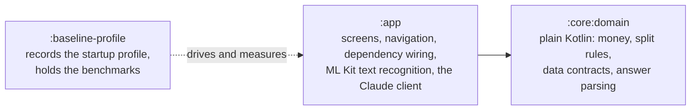
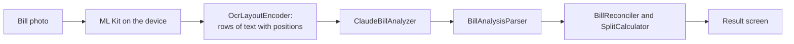

# Architecture

How the code is organised today, why, and which checks guard it. The product roadmap lives in
[the production plan](../plans/261114-0220-split-vibe-production/plan.md); this page describes
only what is in the repository now.

## Modules



| Module | Kind | Holds |
|---|---|---|
| `:app` | Android application | Compose screens, `AppNavHost`, the Koin module, `MlKitBillTextRecognizer`, `ClaudeBillAnalyzer`, settings storage |
| `:core:domain` | Kotlin JVM library | `Bill`, `BillCurrency`, `BillReconciler`, `SplitCalculator`, `SplitPlan`, `NameMatcher`, `Contact`, `OcrResult`, `OcrLayoutEncoder`, `BillAnalyzer`, `BillAnalysisParser` |
| `:baseline-profile` | Android test module | `BaselineProfileGenerator`, `StartupBenchmark`, `SplitFlowBenchmark` |

`:core:domain` applies only the Kotlin JVM plugin, so it cannot import an Android class. Everything
that decides how much a person pays lives there and is tested without a device. The package names
are the same in both modules (`com.dantech.splitvibe.domain`, `.ocr`, `.llm`, `.data.contacts`), so
moving a file between them does not change any import.

## Inside the app

### Dependency wiring

`di/AppModule.kt` is one Koin module that lists every long-lived object and the view model.
`SplitVibeApp` starts Koin when the process starts. Screens get objects with `koinViewModel()` and
`koinInject()`.

Koin resolves the graph when the app runs, not when it compiles. `AppModuleTest` therefore resolves
every definition in a local test, and `AppStartupTest` starts the real application and activity.
A wiring mistake fails the checks instead of crashing a screen.

### Navigation

`ui/AppNavHost.kt` uses Navigation 3. The back stack is a list of keys (`HomeKey`, `SplitKey`,
`SettingsKey`) that the screen code owns directly:

- The keys are `@Serializable`, so the list is saved with the activity and the open screens come
  back after the system recreates it.
- A screen closes itself by name (`backStack.remove(SettingsKey)`) instead of popping whatever is on
  top. A double tap on a back arrow is therefore harmless.
- The system back gesture is handled by `NavDisplay`, which also draws the preview of the previous
  screen while the finger is down. A screen that needs back for something else declares a
  `BackHandler`, and that one wins while it is enabled. `SplitScreen` uses this to cancel running
  work before it lets the user leave.
- Two decorators wrap every screen: one keeps `rememberSaveable` state per screen, the other gives
  each screen its own view model store. `SplitBillViewModel` is requested above `NavDisplay` on
  purpose, so a split in progress survives a visit to Settings.

To add a screen: declare a `@Serializable data object` (or data class) that implements `NavKey`, add
an `entry<ThatKey> { ... }` to the `entryProvider` block, and open it with `backStack.open(ThatKey)`.

### The split flow



The model reads the bill and reports what the instruction says about people. It never computes a
share: the arithmetic is done in `:core:domain`, in whole minor units of the bill's currency.
The [README](../README.md) describes each step in detail.

## Build variants

| Dimension | Values | Effect |
|---|---|---|
| Flavor `environment` | `dev`, `prod` | `dev` has the application id `com.dantech.splitvibe.dev`, so it installs next to the real app and never shares its data. `prod` is `com.dantech.splitvibe`. |
| Build type | `debug`, `release` | `release` is shrunk with R8. |
| Added by the baseline profile plugin | `nonMinifiedRelease`, `benchmarkRelease` | Used only to record the profile and to run the benchmarks. |

### Release signing

No key is stored in the repository. A release build is signed only when all four variables below
are set; with any of them missing it comes out unsigned, which is what every check uses.

| Variable | Meaning |
|---|---|
| `SPLITVIBE_UPLOAD_KEYSTORE_FILE` | Path of the keystore file |
| `SPLITVIBE_UPLOAD_KEYSTORE_PASSWORD` | Password of the keystore |
| `SPLITVIBE_UPLOAD_KEY_ALIAS` | Alias of the key inside it |
| `SPLITVIBE_UPLOAD_KEY_PASSWORD` | Password of that key |

Only a release workflow that a maintainer approves may set them. That workflow does not exist yet.

### Library versions worth knowing

- `compileSdk` is 37 because Compose 1.12 and material3 1.5 require it. `targetSdk` stays 36, so
  none of Android 17's behaviour changes apply.
- material3 is pinned to `1.5.0-rc01` beside the Compose BOM, because no BOM includes the release
  with the Material 3 Expressive components yet. Do not publish to production on a release candidate.

## Checks

Two workflows in `.github/workflows` run the checks. Neither reads a secret, signs or deploys, so a
pull request from a fork can run them. Every action is pinned to a commit.

| Check | Command | What it guards |
|---|---|---|
| Code style | `./gradlew ktlintCheck` | The rules in `.editorconfig`. `./gradlew ktlintFormat` fixes most findings. |
| Unit tests | `./gradlew :core:domain:test :app:testProdDebugUnitTest` | Split rules, parsing, the Claude client against a local server, the UI flow, app startup, navigation and back handling |
| Screenshots | part of the unit tests | Every screen against the reference images in `app/src/test/screenshots` |
| Android Lint | `./gradlew :app:lintProdDebug` | Platform and API misuse |
| Packages | `./gradlew :app:assembleProdDebug :app:assembleProdRelease :app:bundleProdRelease` | The debug package, the shrunk release package and the app bundle all build |
| Secret scan | gitleaks over the whole history | A key or token that was ever committed |
| Device tests | `./gradlew :app:pixel6Api34ProdDebugAndroidTest` | Starting the app, the keystore, ML Kit and the HTTP client on a real Android runtime. Nightly, and when those tests change. |
| Baseline profile | `./gradlew :app:generateProdReleaseBaselineProfile` | The recording still works. Nightly; the result is kept as a workflow artifact. |

### Screenshot tests

`ScreenGalleryTest` and `BackNavigationTest` draw the real screens on the build machine and compare
them with the reference images. After an intended visual change, record new images and review them
in the pull request like code:

```bash
./gradlew :app:testProdDebugUnitTest -Pscreenshots=record
```

When a comparison fails, the test writes `*_compare.png` next to the reference image. Those files
are git-ignored, and the workflow keeps them as an artifact.

### Dependency checksums

`gradle/verification-metadata.xml` holds the SHA-256 of every library and plugin file. Gradle stops
the build when a downloaded file does not match, which catches a tampered or swapped artifact.

A version bump therefore needs new checksums. After changing `gradle/libs.versions.toml`, or when
Gradle reports that an artifact failed verification, refresh the file, read the diff and commit it:

```bash
GRADLE_USER_HOME="$(mktemp -d)" ./gradlew --write-verification-metadata sha256 ktlintCheck :core:domain:test :app:testProdDebugUnitTest :app:lintProdDebug :app:assembleProdDebug :app:assembleProdRelease :app:bundleProdRelease :app:assembleProdDebugAndroidTest :baseline-profile:assembleProdNonMinifiedRelease
```

The empty Gradle home matters. With a filled cache Gradle skips parent and version-alignment files
it has already read, leaves them out of the list, and the next clean machine, such as the CI
runner, rejects them. The price is that everything is downloaded again, which takes a while.

Three things to keep in mind. Source and documentation jars are exempt (`trusted-artifacts` at the
top of the file): only an IDE downloads them, and they are never compiled or run. The file lists the
Linux, macOS and Windows variants of the resource packaging tool for the current Android Gradle
Plugin; after a plugin upgrade each system's variant has to be recorded again on that system. And
the Android images that Robolectric downloads for the local UI tests are fetched by Robolectric
itself, outside Gradle's verification.

### Performance

The baseline profile lists the code that runs while the app starts and a split begins. A release
that ships it has those paths compiled at install time. The recording runs on a Gradle-managed
emulator, so its result does not depend on the machine.

The benchmarks measure time, and an emulator's timings say little about a phone. Run them on a
real device that is connected over adb:

```bash
./gradlew :baseline-profile:connectedProdBenchmarkReleaseAndroidTest
```

`StartupBenchmark` reports cold start with and without the profile. `SplitFlowBenchmark` reports
frame times for the first steps of a split.
