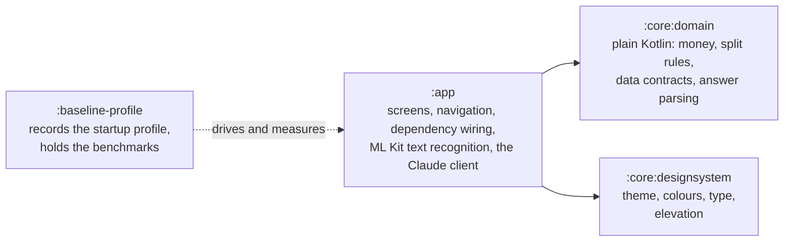
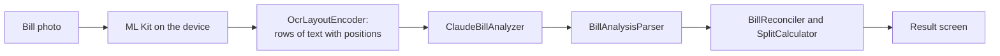

# Architecture

How the code is organised today, why, and which checks guard it. The product roadmap lives in
[the production plan](../plans/261114-0220-split-vibe-production/plan.md); this page describes
only what is in the repository now.

## Modules



| Module | Kind | Holds |
|---|---|---|
| `:app` | Android application | Compose screens, `AppNavHost`, the Koin module, `MlKitBillTextRecognizer`, `ClaudeBillAnalyzer`, settings storage |
| `:core:domain` | Kotlin JVM library | `Bill`, `BillCurrency`, `BillReconciler`, `SplitCalculator`, `SplitPlan`, `NameMatcher`, `Contact`, `OcrResult`, `OcrLayoutEncoder`, `BillAnalyzer`, `BillAnalysisParser` |
| `:core:designsystem` | Android library | `SplitVibeTheme` (Material 3 Expressive, violet palette, light and dark), the colour tokens, the text styles for amounts, the elevation levels |
| `:baseline-profile` | Android test module | `BaselineProfileGenerator`, `StartupBenchmark`, `SplitFlowBenchmark` |

`:core:domain` applies only the Kotlin JVM plugin, so it cannot import an Android class. Everything
that decides how much a person pays lives there and is tested without a device. The package names
are the same in both modules (`com.dantech.splitvibe.domain`, `.ocr`, `.llm`, `.data.contacts`), so
moving a file between them does not change any import.

`:core:designsystem` owns how the app looks. A screen wraps itself in nothing: `MainActivity` applies
`SplitVibeTheme` once, and screens read colours, type and elevation from it.
[design-system.md](design-system.md) lists the tokens and components. These rules in that module
are worth knowing before changing it:

- Every colour role takes a fixed lightness step of one of five ramps, so text and its background
  always differ enough to read. `ColorTokensTest` fails when a changed value breaks that.
- Depth is `SvElevation`. In the light theme a level is a soft violet-tinted shadow; in the dark
  theme it is a lighter surface and no shadow is drawn. The only part of a shadow that may be
  animated is its strength, which moves opacity and offset. The blur radius is fixed per level
  because changing it every frame is expensive.
- Screens decide nothing about the look themselves: no theme, no colour value, no shadow, no
  animation timing, and no experimental Expressive API outside this module.
  `DesignSystemBoundaryTest` fails when a screen does, and names the line.

## Inside the app

### Dependency wiring

`di/AppModule.kt` is one Koin module that lists every long-lived object and the view model.
`SplitVibeApp` starts Koin when the process starts. Screens get objects with `koinViewModel()` and
`koinInject()`.

Koin resolves the graph when the app runs, not when it compiles. `AppModuleTest` therefore resolves
every definition in a local test, and `AppStartupTest` starts the real application and activity.
A wiring mistake fails the checks instead of crashing a screen.

### Navigation

`ui/AppNavHost.kt` uses Navigation 3. The back stack is a list of keys (`HomeKey`, `SplitKey`,
`SettingsKey`) that the screen code owns directly:

- The keys are `@Serializable`, so the list is saved with the activity and the open screens come
  back after the system recreates it.
- A screen closes itself by name (`backStack.remove(SettingsKey)`) instead of popping whatever is on
  top. A double tap on a back arrow is therefore harmless.
- The system back gesture is handled by `NavDisplay`, which also draws the preview of the previous
  screen while the finger is down. The split screen grows out of the button that opens it and
  shrinks back into it during that preview (`Modifier.sharedSurface`). A screen that needs back for something else declares a
  `BackHandler`, and that one wins while it is enabled. `SplitScreen` uses this to cancel running
  work before it lets the user leave.
- Two decorators wrap every screen: one keeps `rememberSaveable` state per screen, the other gives
  each screen its own view model store. `SplitBillViewModel` is requested above `NavDisplay` on
  purpose, so a split in progress survives a visit to Settings.

To add a screen: declare a `@Serializable data object` (or data class) that implements `NavKey`, add
an `entry<ThatKey> { ... }` to the `entryProvider` block, and open it with `backStack.open(ThatKey)`.

### The split flow



The model reads the bill and reports what the instruction says about people. It never computes a
share: the arithmetic is done in `:core:domain`, in whole minor units of the bill's currency.
The [README](../README.md) describes each step in detail.

## Build variants

| Dimension | Values | Effect |
|---|---|---|
| Flavor `environment` | `dev`, `prod` | `dev` has the application id `com.dantech.splitvibe.dev`, so it installs next to the real app and never shares its data. `prod` is `com.dantech.splitvibe`. |
| Build type | `debug`, `release` | `release` is shrunk with R8. |
| Added by the baseline profile plugin | `nonMinifiedRelease`, `benchmarkRelease` | Used only to record the profile and to run the benchmarks. |

### Release signing

No key is stored in the repository. A release build is signed only when all four variables below
are set. With none of them set it comes out unsigned, which is what every check uses. With only some
of them set the build stops and names the missing ones, because that can only be a mistake in the
release setup. A blank value counts as not set.

| Variable | Meaning |
|---|---|
| `SPLITVIBE_UPLOAD_KEYSTORE_FILE` | Path of the keystore file |
| `SPLITVIBE_UPLOAD_KEYSTORE_PASSWORD` | Password of the keystore |
| `SPLITVIBE_UPLOAD_KEY_ALIAS` | Alias of the key inside it |
| `SPLITVIBE_UPLOAD_KEY_PASSWORD` | Password of that key |

Only a release workflow that a maintainer approves may set them. That workflow does not exist yet.

### Library versions worth knowing

- `compileSdk` is 37 because Compose 1.12 and material3 1.5 require it. `targetSdk` stays 36, so
  none of Android 17's behaviour changes apply.
- material3 is pinned to `1.5.0-rc01` beside the Compose BOM, because no BOM includes the release
  with the Material 3 Expressive components yet. Do not publish to production on a release candidate.

## Checks

Two workflows in `.github/workflows` run the checks, and every action in them is pinned to a commit.
A third, `checksums.yml`, is described under dependency checksums below.
`ci.yml` runs for every pull request, including one from a fork, and for every push to `main`. It
reads no secret and never signs or deploys, so untrusted code can run it safely.
`device-tests.yml` runs every night, on request, and when a push to this repository changes the
device tests, the profile module or the dependencies.

For the checks to guard `main`, the repository has to require them: in the branch protection of
`main`, require the status checks "Style, tests, lint and packages" and "Secret scan".

| Check | Command | What it guards |
|---|---|---|
| Code style | `./gradlew ktlintCheck` | The rules in `.editorconfig`. `./gradlew ktlintFormat` fixes most findings. |
| Unit tests | `./gradlew :core:domain:test :core:designsystem:testDebugUnitTest :app:testProdDebugUnitTest` | Split rules, parsing, the Claude client against a local server, the UI flow, app startup, navigation and back handling, text contrast of the palette |
| Screenshots | part of the unit tests | Every screen against the reference images in `app/src/test/screenshots` |
| Android Lint | `./gradlew :app:lintProdDebug :core:designsystem:lintDebug` | Platform and API misuse |
| Packages | `./gradlew :app:assembleProdDebug :app:assembleProdRelease :app:bundleProdRelease` | The debug package, the shrunk release package and the app bundle all build |
| Secret scan | gitleaks over the whole history | A key or token that was ever committed |
| Device tests | `./gradlew :app:pixel6Api34ProdDebugAndroidTest` | Starting the app, the keystore, ML Kit and the HTTP client on a real Android runtime. Nightly, and when those tests change. |
| Baseline profile | `./gradlew :app:generateProdReleaseBaselineProfile` | The recording still works. Nightly; the result is kept as a workflow artifact. |

### Secret scan

gitleaks reads every commit with its default rules. It is a net for accidents: a key pasted into a
file, a token left in a test. It honours a `.gitleaks.toml`, a `.gitleaksignore` and inline
`gitleaks:allow` markers in the repository, which is how a false positive is silenced. A pull
request that adds or changes any of those switches part of the scan off, so review such a change
like code.

### Screenshot tests

`ScreenGalleryTest` and `BackNavigationTest` draw the real screens on the build machine and compare
them with the reference images. Every screen has a light and a dark image, and the four main
screens have one more with text at twice its size, where nothing may be cut off.
`ComponentCatalogTest` does the same for the catalog of design system components, so a change to
a token or a component shows up even when no screen uses it yet.

A picture has to be the same on every run, so two things that move with real time are kept out of
it. Touch ripples are switched off in the gallery, because the platform draws them on its own clock.
And the working state, which shows an endless animation, is captured with the animation clock
stopped at a fixed moment. After an intended visual change, record new images and review them
in the pull request like code:

```bash
./gradlew :app:testProdDebugUnitTest -Pscreenshots=record
```

When a comparison fails, the test writes a side-by-side image of the old and the new version to
the `outputs/roborazzi` folder of the app's output directory. The workflow keeps those images in the
`reports` artifact of the failed run.

### Dependency checksums

`gradle/verification-metadata.xml` holds the SHA-256 of every library and plugin file. Gradle stops
the build when a downloaded file does not match, which catches a tampered or swapped artifact.

A version bump therefore needs new checksums. The workflow `checksums.yml` works them out on a
clean machine whenever the version catalog, the Gradle wrapper or a build file changes, also on the
branches Dependabot pushes, and on request. It commits nothing and keeps the new file as the
artifact `verification-metadata`. Download it, compare it with the file in the repository, and
commit it when the difference is only what the version change explains:

```bash
gh run download --name verification-metadata --dir gradle <run id>
```

The clean machine matters. With a filled cache Gradle skips parent and version-alignment files it
has already read, leaves them out of the list, and the next clean machine, such as the CI runner,
rejects them. The same can be done by hand with an empty Gradle home, which downloads everything
again:

```bash
GRADLE_USER_HOME="$(mktemp -d)" ./gradlew --write-verification-metadata sha256 ktlintCheck :core:domain:test :core:designsystem:testDebugUnitTest :app:testProdDebugUnitTest :app:lintProdDebug :core:designsystem:lintDebug :app:assembleProdDebug :app:assembleProdRelease :app:bundleProdRelease :app:assembleDevDebug :app:assembleProdDebugAndroidTest :baseline-profile:assembleProdNonMinifiedRelease
```

Three things to keep in mind. Source and documentation jars are exempt (`trusted-artifacts` at the
top of the file): only an IDE downloads them, and they are never compiled or run. The file lists the
Linux, macOS and Windows variants of the resource packaging tool for the current Android Gradle
Plugin; after a plugin upgrade each system's variant has to be recorded again on that system. And
the Android images that Robolectric downloads for the local UI tests are fetched by Robolectric
itself, outside Gradle's verification.

### Performance

The baseline profile lists the code that runs while the app starts and a split begins. A release
that ships it has those paths compiled at install time. The recording runs on a Gradle-managed
emulator, so its result does not depend on the machine.

The benchmarks measure time, and an emulator's timings say little about a phone. Run them on a
real device that is connected over adb:

```bash
./gradlew :baseline-profile:connectedProdBenchmarkReleaseAndroidTest
```

`StartupBenchmark` reports cold start with and without the profile. `SplitFlowBenchmark` reports
frame times for the first steps of a split.
