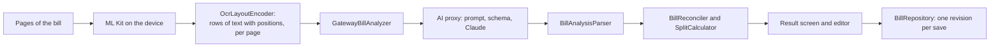
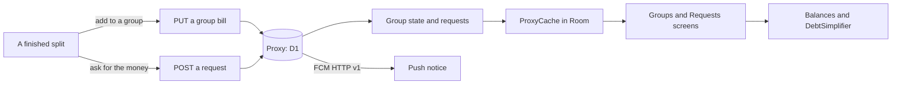
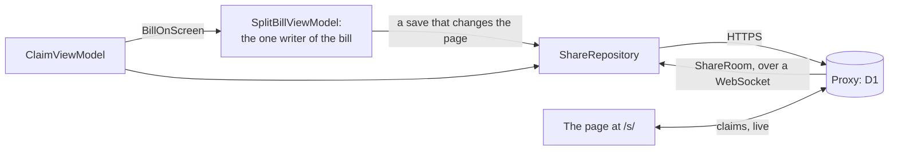

# Architecture

How the code is organised today, why, and which checks guard it. The product roadmap lives in
[the production plan](../plans/261114-0220-split-vibe-production/plan.md); this page describes
only what is in the repository now.

## Modules

```mermaid
flowchart LR
    app[":app<br/>screens, navigation, dependency wiring,<br/>ML Kit text recognition and scanning,<br/>the bills on the phone, the proxy client,<br/>groups, requests, push, bill links"]
    domain[":core:domain<br/>plain Kotlin: money, split rules,<br/>group balances, payment codes,<br/>data contracts, answer parsing"]
    design[":core:designsystem<br/>theme, tokens,<br/>components, motion"]
    profile[":baseline-profile<br/>records the startup profile,<br/>holds the benchmarks"]
    app --> domain
    app --> design
    profile -. drives and measures .-> app
    proxy["proxy/<br/>Cloudflare Worker:<br/>prompt, calls, limits, Claude,<br/>the day's exchange rates,<br/>groups and requests in D1, push,<br/>bill links and their live claims"]
    web["web/<br/>the pages a link opens:<br/>Vite, Preact, TypeScript"]
    app -. HTTPS and a WebSocket .-> proxy
    web -. built into .-> proxy
    design -. tokens.css .-> web
```

| Module | Kind | Holds |
|---|---|---|
| `:app` | Android application | Compose screens, `AppNavHost`, the Koin module, `MlKitBillTextRecognizer`, `DocumentScanner`, `GatewayBillAnalyzer` and `ProxyApi` (the proxy's routes over OkHttp), the bills kept on the phone (`SplitVibeDatabase`, `BillRepository`, `BillPages`), the people split with before (`PeopleRepository`, `ContactNames`), the exchange rates (`FxRepository`), the account (install id, encrypted session, Google sign-in through Credential Manager), settings storage, the ways to get paid (`PaymentMethodRepository`), groups and requests (`GroupRepository`, `RequestRepository`, `ProxyCache`), sharing (`QrCodes`, `ShareCardRenderer`), push (`Push`, `DeviceRegistrar`, `PushService`), app links (`AppLink`), bill links (`ShareRepository`, `ClaimViewModel`) |
| `:core:domain` | Kotlin JVM library | `Bill`, `BillCurrency`, `BillEditor`, `BillReconciler`, `ExchangeRate`, `Participant`, `Person`, `Payment`, `SplitMode`, `SplitCalculator`, `SplitPlan`, `NameMatcher`, `Balances`, `DebtSimplifier`, `GroupConversion`, `ClaimSplit`, `payments` (`PaymentMethod`, `PaymentRequestBuilder`, `EmvQr`, `VietQrBanks`), `OcrResult`, `OcrLayoutEncoder`, `BillAnalyzer`, `BillAnalysisParser` |
| `:core:designsystem` | Android library | `SplitVibeTheme` (Material 3 Expressive, violet palette, light and dark); the colour, type, spacing, shape and elevation tokens; the components (`Sv…`); the motion pieces (`SvAmount`, `SvSteps`, `sharedSurface` and others) |
| `:baseline-profile` | Android test module | `BaselineProfileGenerator`, `StartupBenchmark`, `SplitFlowBenchmark` |
| `proxy/` | Cloudflare Worker, TypeScript | the prompt and answer schema, the calls per install and per Google account, the limits per address, the daily spend caps, the Google ID token check and the proxy's own session, groups, payment requests, devices and their permissions in D1, push through FCM, App Links, bill links with what people claim on them and their live updates (`ShareRoom`), the web pages; described in [proxy.md](proxy.md) |
| `web/` | Web pages, TypeScript | the pages a bill link, a payment request link and a group invite open (`/s/`, `/r/`, `/g/`), with Vite and Preact; built into the Worker, so the proxy serves them from its own address; described in [web.md](web.md) |

`:core:domain` applies only the Kotlin JVM plugin, so it cannot import an Android class. Everything
that decides how much a person pays lives there and is tested without a device. The package names
are the same in both modules (`com.dantech.splitvibe.domain`, `.ocr`, `.llm`), so moving a file
between them does not change any import.

`:core:designsystem` owns how the app looks. A screen wraps itself in nothing: `MainActivity` applies
`SplitVibeTheme` once, and screens read colours, type and elevation from it.
[design-system.md](design-system.md) lists the tokens and components. These rules in that module
are worth knowing before changing it:

- Every colour role takes a fixed lightness step of one of five ramps, so text and its background
  always differ enough to read. `ColorTokensTest` fails when a changed value breaks that.
- Depth is `SvElevation`. In the light theme a level is a soft violet-tinted shadow; in the dark
  theme it is a lighter surface and no shadow is drawn. The only part of a shadow that may be
  animated is its strength, which moves opacity and offset. The blur radius is fixed per level
  because changing it every frame is expensive.
- Screens decide nothing about the look themselves: no theme, no colour value, no shadow, no
  animation timing, and no experimental Expressive API outside this module.
  `DesignSystemBoundaryTest` fails when a screen does, and names the line.

## Inside the app

### Dependency wiring

`di/AppModule.kt` is one Koin module that lists every long-lived object and the view models.
`SplitVibeApp` starts Koin when the process starts. Screens get objects with `koinViewModel()` and
`koinInject()`.

Koin resolves the graph when the app runs, not when it compiles. `AppModuleTest` therefore resolves
every definition in a local test, and `AppStartupTest` starts the real application and activity.
A wiring mistake fails the checks instead of crashing a screen.

### Navigation

`ui/AppNavHost.kt` uses Navigation 3. The back stack is a list of keys (`HomeKey`, `SplitKey`,
`HistoryKey`, `SettingsKey`, `PaymentMethodsKey`, `GroupsKey`, `GroupKey(id)`, `JoinGroupKey(token)`,
`RequestsKey`, `RequestLinkKey(token)`) that the screen code owns directly:

- The keys are `@Serializable`, so the list is saved with the activity and the open screens come
  back after the system recreates it.
- A screen closes itself by name (`backStack.remove(SettingsKey)`) instead of popping whatever is on
  top. A double tap on a back arrow is therefore harmless.
- The system back gesture is handled by `NavDisplay`, which also draws the preview of the previous
  screen while the finger is down. The split screen grows out of the button that opens it and
  shrinks back into it during that preview (`Modifier.sharedSurface`). A screen that needs back for something else declares a
  `BackHandler`, and that one wins while it is enabled. `SplitScreen` uses this to cancel running
  work before it lets the user leave.
- Inside the split screen the four steps (photo, editor, result, the request step) follow from the view
  model's state and fade into each other through `SvSteps`. Each step carries the state it shows,
  so a step that is being left is drawn unchanged while it fades out, and back always belongs to
  the step on screen. The button that sends the requests turns into the mark that confirms them.
- Two decorators wrap every screen: one keeps `rememberSaveable` state per screen, the other gives
  each screen its own view model store. `SplitBillViewModel` is requested above `NavDisplay` on
  purpose, so a split in progress survives a visit to Settings.
- A bill opened from Home or the list of bills opens the split screen on its result, and back
  returns to where it was opened from. Photos shared from another app open a new split with them
  (`MainActivity` takes them from the share intent).
- An invite link (`/g/#{token}`) or a request link (`/r/#{token}`) on the proxy's own address, and a
  tapped push notice, open their screen on top of Home (`AppLink` reads them from the intent; a link
  to any other address opens nothing). The token rides in the fragment, which a browser never sends,
  and the app sends it to the proxy in a request body, so no token appears in an address the proxy
  or Cloudflare could log. The links reach the app through Android App Links: the
  manifest's intent filter names the proxy's host, which the build takes from the proxy's address,
  and Android checks the proxy's `/.well-known/assetlinks.json` before it hands the app a link.

To add a screen: declare a `@Serializable data object` (or data class) that implements `NavKey`, add
an `entry<ThatKey> { ... }` to the `entryProvider` block, and open it with `backStack.open(ThatKey)`.

### The split flow



The model reads the bill and reports what the instruction says about people. It never computes a
share: the arithmetic is done in `:core:domain`, in whole minor units of the bill's currency.
`SplitBillViewModel` saves the bill a moment after each change. Each save writes the whole bill as
the next revision of the copy the screen descends from, and Room refuses it when that copy is no
longer the latest, so two writers never overwrite each other. Reading other photos or typing a bill
in by hand starts a new bill; only reading the same photos again replaces their bill. What was on
screen comes back from `SavedStateHandle` and the database after the system ends the app. The
proxy streams its answer as lines of JSON, and the app's error kinds follow the proxy's codes: free
reads used up, sign-in run out, AI switched off, app too old, busy, refused, too long.
The [README](../README.md) describes each step in detail.

### Groups, requests and push



- `GroupRepository` and `RequestRepository` call the proxy's signed-in routes through
  `ProxyApi.signedIn` and keep its answers in `ProxyCache`, a table of the Room database, so groups
  and requests can be read without a connection. The cache is emptied on every sign-in, sign-out and
  account deletion, and its generation moves on each time, so an answer to a call made before that
  is dropped however late it arrives: another account never sees them. A group is kept with each
  bill's name and amounts but not its whole document, so the copy stays small at any size, and it is
  read off the main thread. A session the proxy refuses turns into a sign-in to renew, as for reading
  bills.
- A request's id follows what it asks for: the bill and person (or the group and the two members),
  the amount and a hash of the payment method. Asking again for the same thing is the same request;
  a changed amount or a corrected account is a new one, and the open request it replaces is
  withdrawn. A payment back is recorded under one id per choice, so a retry records it once, and
  getting money that was asked for confirms that request rather than recording it again. A bill in a
  group is settled through the group and is not asked for person by person.
- A group bill is the member's `SavedBill` without its photos, read text, instruction and own rate,
  with the member each participant is (`GroupBillDocument`), and its amounts in the group's
  currency. `GroupConversion` converts the total once and divides the result by the largest
  remainder in proportion to the parts and, separately, the payments. The local bill remembers its
  group and the revision the proxy accepted (`GroupLink`), so a later change goes as the next
  revision and the proxy refuses it when someone else changed the group's copy first.
- `GroupState.balances` adds up the bills whose amounts check out and the payments back; a bill that
  does not, which only a broken or tampered copy can be, is left out whole, so the balances still
  add up to zero. `DebtSimplifier` pairs the largest debt with the largest credit until all are zero.
- Payment methods are kept in their own table and never leave the phone, except as the one copy a
  request carries. `PaymentRequestBuilder` turns a method, an amount and a note into a link, a QR
  payload or both, always with the details as text; `QrCodes` draws the code with ZXing, and
  `ShareCardRenderer` records a card drawn by the design system's components (`Modifier.shareCard`)
  and saves it for the share sheet through the `FileProvider`.
- Push goes through Firebase Cloud Messaging, started by hand from four `BuildConfig` values when
  they are all set (no Google services plugin and no `google-services.json`). `DeviceRegistrar` sends
  the install's token to the proxy once someone signs in, and takes it back on signing out;
  `PushService` shows a notice with words of the app's own for the kind of notice the proxy sent.

### Bill links and live claims



- A bill on a link keeps a `ShareLink`: the link's id, its address with the token after the `#`,
  when it was made and when it runs out, a fingerprint of what its page shows, whether the amounts
  on the page are settled, and who each claim is on the bill (`matches`, `added`). The token goes
  nowhere else: a group's copy of the bill leaves the link out.
- The page shows a `BillProjection` of the bill: its items, its charges (more than 20 are shown as
  19 and one line for the rest), its total and its participants, the user under their own name, all
  without control characters or the invisible formatting characters the proxy takes out (it keeps
  the zero-width joiner and non-joiner). `ShareRepository.fingerprint` hashes it together with the
  shares that settling would put on the page, so a save that changes neither, such as finishing the
  split, sends nothing.
- `SplitBillViewModel` stays the only writer of the bill. The link's screen reads and changes the
  bill through `BillOnScreen`: the bill on screen, its stored copy once the pending save is written,
  its link and its plan. After each save of a bill on a link, `ShareRepository.project` sends the
  page a copy when the fingerprint changed. Its writes go one at a time, and it never sends a
  revision older than one it sent before. A link the proxy no longer has, or one that ran out, is
  forgotten, and the user is told when a change took the settled amounts off the page.
- `ClaimViewModel` makes the link when the bill has none, and a new one when the old one ran out or
  is gone; a link made while another account was signed in can be replaced with a new one. It
  follows the link only while its screen shows: `ShareRepository.live` opens a WebSocket with the
  token as a `Sec-WebSocket-Protocol` value, reads the link as it is on each new connection, opens
  the connection again after 1, 2, 5, 10 and then 30 seconds, and drops one that stays silent
  through two pings.
- Each claim is suggested as the participant of the same name (`NameMatcher`) or as someone new.
  Closing the picking turns the claims into a split by item (`ClaimSplit`): an item several people
  picked is shared between them, one nobody picked stays shared by everyone, and someone new joins
  the bill as a participant who is never suggested for later bills. No more than 30 people end up
  on the bill, as many as its page shows.
- Sending the amounts finishes the split and puts the shares the phone saved on the page, with who
  paid (`paidBy`) and who each claim is on the bill (`matches`), so people find what they owe. The
  page asks people for money only when the user paid the whole bill and it is in no group, by the
  payment method chosen on the screen; when that method changes later, the screen offers to send the
  new details. `PaymentPayload` keeps a method's link, QR payload and details within what the proxy
  accepts, so a request and a link carry the same payment.
- The pages in `web/` are built into the Worker's bundle: `npm run build:web` in `proxy/` builds
  them, and `scripts/embed-web.mjs` writes `src/web-assets.generated.ts`, which is not committed.
  `npm run bundle -- <directory>` then writes the bundle a deploy uploads, and refuses to bundle
  without the pages.
  Their colours and type come from the design system: `WebTokensTest` writes `web/src/tokens.css`
  when run with `-PwebTokens=write`, and otherwise fails when the file no longer matches the tokens.
  [proxy.md](proxy.md#bill-links-and-the-web-pages) describes the routes, the limits and the pages.

## Build variants

| Dimension | Values | Effect |
|---|---|---|
| Flavor `environment` | `dev`, `prod` | `dev` has the application id `com.dantech.splitvibe.dev`, so it installs next to the real app and never shares its data. `prod` is `com.dantech.splitvibe`. |
| Build type | `debug`, `release` | `release` is shrunk with R8. |
| Added by the baseline profile plugin | `nonMinifiedRelease`, `benchmarkRelease` | Used only to record the profile and to run the benchmarks. |

### Release signing

No key is stored in the repository. A release build is signed only when all four variables below
are set. With none of them set it comes out unsigned, which is what every check uses. With only some
of them set the build stops and names the missing ones, because that can only be a mistake in the
release setup. A blank value counts as not set.

| Variable | Meaning |
|---|---|
| `SPLITVIBE_UPLOAD_KEYSTORE_FILE` | Path of the keystore file |
| `SPLITVIBE_UPLOAD_KEYSTORE_PASSWORD` | Password of the keystore |
| `SPLITVIBE_UPLOAD_KEY_ALIAS` | Alias of the key inside it |
| `SPLITVIBE_UPLOAD_KEY_PASSWORD` | Password of that key |

Only a release workflow that a maintainer approves may set them. That workflow does not exist yet.

### Library versions worth knowing

- `compileSdk` is 37 because Compose 1.12 and material3 1.5 require it. `targetSdk` stays 36, so
  none of Android 17's behaviour changes apply.
- material3 is pinned to `1.5.0-rc01` beside the Compose BOM, because no BOM includes the release
  with the Material 3 Expressive components yet. Do not publish to production on a release candidate.

## Checks

Two workflows in `.github/workflows` run the checks, and every action in them is pinned to a commit.
A third, `checksums.yml`, is described under dependency checksums below.
`ci.yml` runs for every pull request, including one from a fork, and for every push to `main`. It
reads no secret and never signs or deploys, so untrusted code can run it safely.
`device-tests.yml` runs every night, on request, and when a push to this repository changes the
device tests, the profile module or the dependencies.

For the checks to guard `main`, the repository has to require them: in the branch protection of
`main`, require the status checks "Style, tests, lint and packages", "AI proxy" and "Secret scan".

| Check | Command | What it guards |
|---|---|---|
| Code style | `./gradlew ktlintCheck` | The rules in `.editorconfig`. `./gradlew ktlintFormat` fixes most findings. |
| Unit tests | `./gradlew :core:domain:test :core:designsystem:testDebugUnitTest :app:testProdDebugUnitTest` | Split rules for every way to split, editing, exchange rates, parsing, the bills on the phone and their revisions, the proxy client and the account against a stand-in for the proxy, the UI flow, app startup, navigation and back handling, text contrast of the palette |
| Screenshots | part of the unit tests | Every screen against the reference images in `app/src/test/screenshots` |
| Android Lint | `./gradlew :app:lintProdDebug :core:designsystem:lintDebug` | Platform and API misuse |
| Packages | `./gradlew :app:assembleProdDebug :app:assembleProdRelease :app:bundleProdRelease` | The debug package, the shrunk release package and the app bundle all build, and none of them, nor the dev package, holds a class of `com.anthropic` |
| AI proxy | `npm ci`, `npm run bundle` (after `npm ci` in `web/`), `npm test` in `web/`, then `npm run typecheck` and `npm test` in `proxy/` | The Worker's routes, its calls, limits, holds and spend caps, the sign-in and the session, bill links with their claims and live updates, in the workers runtime against a fake model; the web pages' states, money, claims and live connection; and that the bundle a deploy uploads builds with the web pages in it |
| Secret scan | gitleaks over the whole history | A key or token that was ever committed |
| Device tests | `./gradlew :app:pixel6Api34ProdDebugAndroidTest` | Starting the app, the keystore, ML Kit and the HTTP client on a real Android runtime, and splitting the sample bill from the photo to the sent requests. Every tap also runs Android's accessibility checks on the screen it lands on. Nightly, and when those tests change. |
| Baseline profile | `./gradlew :app:generateProdReleaseBaselineProfile` | The recording still works. Nightly; the result is kept as a workflow artifact. |

### Secret scan

gitleaks reads every commit with its default rules. It is a net for accidents: a key pasted into a
file, a token left in a test. It honours a `.gitleaks.toml`, a `.gitleaksignore` and inline
`gitleaks:allow` markers in the repository, which is how a false positive is silenced. A pull
request that adds or changes any of those switches part of the scan off, so review such a change
like code.

### Screenshot tests

`ScreenGalleryTest` and `BackNavigationTest` draw the real screens on the build machine and compare
them with the reference images. Every screen has a light and a dark image, and the four main
screens have one more with text at twice its size, where nothing may be cut off.
`ComponentCatalogTest` does the same for the catalog of design system components, so a change to
a token or a component shows up even when no screen uses it yet.

A picture has to be the same on every run, so two things that move with real time are kept out of
it. Touch ripples are switched off in the gallery, because the platform draws them on its own clock.
And the working state, which shows an endless animation, is captured with the animation clock
stopped at a fixed moment. After an intended visual change, record new images and review them
in the pull request like code:

```bash
./gradlew :app:testProdDebugUnitTest -Pscreenshots=record
```

When a comparison fails, the test writes a side-by-side image of the old and the new version to
the `outputs/roborazzi` folder of the app's output directory. The workflow keeps those images in the
`reports` artifact of the failed run.

### Dependency checksums

`gradle/verification-metadata.xml` holds the SHA-256 of every library and plugin file. Gradle stops
the build when a downloaded file does not match, which catches a tampered or swapped artifact.

A version bump therefore needs new checksums. The workflow `checksums.yml` works them out on a
clean machine whenever the version catalog, the Gradle wrapper or a build file changes, also on the
branches Dependabot pushes, and on request. It commits nothing and keeps the new file as the
artifact `verification-metadata`. Download it, compare it with the file in the repository, and
commit it when the difference is only what the version change explains:

```bash
gh run download --name verification-metadata --dir gradle <run id>
```

The clean machine matters. With a filled cache Gradle skips parent and version-alignment files it
has already read, leaves them out of the list, and the next clean machine, such as the CI runner,
rejects them. The same can be done by hand with an empty Gradle home, which downloads everything
again:

```bash
GRADLE_USER_HOME="$(mktemp -d)" ./gradlew --write-verification-metadata sha256 ktlintCheck :core:domain:test :core:designsystem:testDebugUnitTest :app:testProdDebugUnitTest :app:lintProdDebug :core:designsystem:lintDebug :app:assembleProdDebug :app:assembleProdRelease :app:bundleProdRelease :app:assembleDevDebug :app:assembleProdDebugAndroidTest :baseline-profile:assembleProdNonMinifiedRelease
```

The AI proxy's packages need no such list: `proxy/package-lock.json` records the integrity hash of
every package, `npm ci` refuses a package that does not match it, and `package.json` pins each one to
an exact version. Dependabot opens the npm updates for `/proxy`, and the "AI proxy" job checks them.

Three things to keep in mind. Source and documentation jars are exempt (`trusted-artifacts` at the
top of the file): only an IDE downloads them, and they are never compiled or run. The file lists the
Linux, macOS and Windows variants of the resource packaging tool for the current Android Gradle
Plugin; after a plugin upgrade each system's variant has to be recorded again on that system. And
the Android images that Robolectric downloads for the local UI tests are fetched by Robolectric
itself, outside Gradle's verification.

### Performance

The baseline profile lists the code that runs while the app starts and a split begins. A release
that ships it has those paths compiled at install time. The recording runs on a Gradle-managed
emulator, so its result does not depend on the machine.

The benchmarks measure time, and an emulator's timings say little about a phone. Run them on a
real device that is connected over adb:

```bash
./gradlew :baseline-profile:connectedProdBenchmarkReleaseAndroidTest
```

`StartupBenchmark` reports cold start with and without the profile. `SplitFlowBenchmark` reports
frame times for the first steps of a split.
