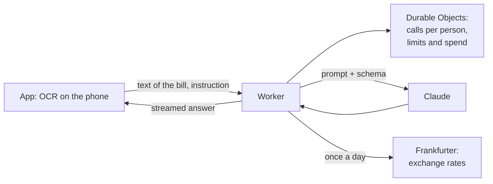

# AI proxy

The app never holds an Anthropic key. It sends the text it read from a bill to a small Cloudflare
Worker in [`proxy/`](../proxy), and the Worker asks Claude. The Worker holds the key, builds the
prompt and the answer schema, counts each person's calls, limits each network address, caps what
the whole service may spend in a day, and keeps nothing of the bill. It also hands the app the
day's exchange rates.



## What it does

| Route | Who calls it | What it answers |
|---|---|---|
| `POST /v1/bill-analysis` | the app, to read a bill | lines of JSON: `{"type":"wait"}` while the model works, then one `{"type":"result","answer":…,"usage":…}` or `{"type":"error","code":…}` |
| `POST /v1/session` | the app, after "Sign in with Google" | `{session, expiresAt, usage}`: a session the proxy signs, for 30 days |
| `GET /v1/usage` | Settings | `{usage, aiEnabled}`: the calls left and whether AI reading is on |
| `DELETE /v1/account` | Settings, "Delete account" | 204 once the account's counters are gone |
| `GET /v1/fx-rates` | the app, to convert between currencies | `{base, source, fetchedAt, rates}`: how much of each currency one euro buys, each rate with its day |

Every request names its install with `X-SplitVibe-Install` (a random id the app makes for itself) and
its version with `X-SplitVibe-Version`; only the exchange rates need neither. A signed-in app adds
`Authorization: Bearer <session>`. The body of a bill read is exactly
[`sample_bill_request.json`](../app/src/sharedTest/resources/fixtures/sample_bill_request.json) in
shape; the app's and the proxy's tests both use that file. A bill photographed in several pages is
still one `ocrDocument`: `<bill_ocr pages="N">` holds one `<page n="…" rows="…">` per photo, in
order, with rows numbered from 1 and coordinates from 0 to 1000 within each page. A one-page bill
stays `<bill_ocr rows="N">` with its rows directly inside. The full contract of the bill read,
the session, usage and account routes, with every error code, is in
[the Phase 3 plan](../plans/261114-0220-split-vibe-production/phase-03-cloudflare-ai-proxy.md); the
exchange rates and their one error are described [below](#exchange-rates).

### Calls and limits

The numbers live in [`proxy/src/policy.ts`](../proxy/src/policy.ts) and change with a deploy.

- An install that has not signed in gets 3 calls, once. A Google account gets 10 calls each calendar
  month, counted in UTC.
- A call is held while the model works and charged once the model has answered, whatever the answer
  says, also when the app hung up, as long as the answer comes within 25 seconds of the hang-up.
  A call that got no answer is given back. The same request id is charged once however often it
  runs (at most three times), and it can only be used again for the same bill.
- Each network address may send 10 bill reads a minute and 100 a day, whoever sends them. IPv6
  counts by its /64.
- Spend is capped over each 24 hours: $3 per caller, $6 per address and $20 for the whole proxy.
  Each call holds the most it could cost, then settles at what it did cost. Also set a monthly spend
  limit in the Anthropic console.

### Exchange rates

`GET /v1/fx-rates` hands out how much of each currency one euro buys, from version 2 of the
[Frankfurter](https://frankfurter.dev) API, which gathers the reference rates of the European
Central Bank and of other central banks. Version 1 has only some 30 currencies and no dong, so it
is not used. Only fiat currencies are kept, with the euro at 1; the crypto assets and metals
Frankfurter also lists are dropped. Each rate keeps the day the source gives it for, which can be a
day or two behind the others.

One Durable Object, `FxBook`, holds the latest snapshot and when it was fetched. A cron fetches it
every day at 16:30 UTC, after the European Central Bank publishes, and a request that finds no
snapshot, or one a day old, fetches it first. A fetch that fails, takes more than 10 seconds or
answers with anything unexpected never replaces the snapshot: the route hands out the last one, and
`fetchedAt` shows its age. After a failed fetch, requests are answered from what is held for five
minutes before the source is asked again, so an outage of the source does not slow every request;
the cron always asks. Only when there has never been a snapshot does a failed fetch answer 503
`fx_unavailable`. An answer may be cached for an hour.

### What it keeps

Durable Objects hold counters only: calls used per install or per account, request ids for a day,
requests and spend per address. One more holds the latest exchange rates, which are public.
Objects are named by salted hashes, never by an IP address or a Google id. A request id is kept
with a salted hash of what it asked, so that it cannot be reused for another bill. Nothing of a
bill, an instruction or a name is stored.

The Worker prints one log line per request: the outcome, whether the caller is an install or an
account, the model, the tokens, the cost and the time taken. Cloudflare's invocation logs are off in
`wrangler.jsonc`, because they record every request's headers, among them the session and the IP
address. Traces are on: they show how long each request, each call to Claude and each Durable
Object took, its outcome and its CPU time, with the country and city, the network and the user
agent, but no header values, no IP address and no body. Those CPU times tell whether the free plan's
limit is enough.

## Run it on a computer

Node 22 and npm. From `proxy/`:

```bash
npm ci
```

Make `proxy/.dev.vars`, which git ignores, with the three secrets the Worker needs:

```properties
ANTHROPIC_API_KEY=<your Anthropic key>
HASH_SALT=<at least 16 random characters>
SESSION_SIGNING_KEY=<at least 32 random characters>
```

`openssl rand -base64 32` makes a good salt or signing key. Then start it on port 8787:

```bash
npm run dev
```

A debug build of the app reaches it at `http://127.0.0.1:8787` once the phone or emulator forwards
that port to the computer:

```bash
adb reverse tcp:8787 tcp:8787
```

To sign in from a debug build, also put the web client ID (see below) into `GOOGLE_CLIENT_ID` in
`wrangler.jsonc` and into `local.properties`.

### Tests

```bash
npm run typecheck
```

```bash
npm test
```

The tests run the Worker and its Durable Objects in the workers runtime against a fake model that
streams the way the Messages API does and a fake Frankfurter, so they need no key and no network.
GitHub Actions runs both for every pull request.

## Deploy it

These steps need the owner's accounts.

1. **Google sign-in.** In Google Cloud, under Google Auth Platform, create an OAuth client of type
   *Web application*: its client ID is the app's web client ID. Create one of type *Android* for
   each key that signs the app, with the package name and the key's SHA-1: the debug key for
   `com.dantech.splitvibe.dev`, and for `com.dantech.splitvibe` the upload key (for release builds
   installed by hand) and the Play app signing key (for the app as Play delivers it).
2. **Cloudflare.** From `proxy/`, sign in with `npx wrangler login`. Put the web client ID into
   `GOOGLE_CLIENT_ID` in `wrangler.jsonc`; it is public. Set the three secrets, each of which asks
   for its value without echoing it:

   ```bash
   npx wrangler secret put ANTHROPIC_API_KEY
   ```

   ```bash
   npx wrangler secret put HASH_SALT
   ```

   ```bash
   npx wrangler secret put SESSION_SIGNING_KEY
   ```

3. Deploy:

   ```bash
   npx wrangler deploy
   ```

   The deploy also adds the `FxBook` class of Durable Objects (migration `v2`) and sets the daily
   cron in `triggers.crons` of `wrangler.jsonc`, which fetches the exchange rates. A new or changed
   cron can take up to 15 minutes to start; until it first runs, the first request for the rates
   fetches them.

4. **The app.** Put the Worker's address and the web client ID into `local.properties` before a
   release build. A release build refuses an address that is not https, and every build stops at
   a value with a placeholder such as `<your-subdomain>` still in it.

   ```properties
   splitvibe.aiProxyUrl=https://split-vibe-proxy.<your-subdomain>.workers.dev
   splitvibe.googleWebClientId=<web client ID>.apps.googleusercontent.com
   ```

The Workers free plan allows 10 ms of CPU time per request. A long answer may need more; if the
Worker's logs show CPU limit errors, move to the paid plan.

Never keep a secret in `wrangler.jsonc`, in `local.properties` that is committed, or in a workflow.
`HASH_SALT` must not change once the proxy is live: every count is named by it.

## Switches

Two variables in `wrangler.jsonc` change behaviour without a new app:

- `AI_ENABLED`: bill reading works only while it is exactly `"true"`. Anything else answers 503
  `ai_off`, and the app tells the person AI reading is switched off.
- `MIN_APP_VERSION`: an app with a lower version code gets 426 `update_required` on a bill read.
  Signing in, the calls left, the exchange rates and deleting the account keep working for old
  apps.

Change either in `wrangler.jsonc` and deploy, or under the Worker's settings in the Cloudflare
dashboard; a deploy from `wrangler.jsonc` sets them back to the file's values.

## Changing the prompt or the model

The prompt is [`proxy/src/prompt.ts`](../proxy/src/prompt.ts) and the answer schema
[`proxy/src/schema.ts`](../proxy/src/schema.ts). The app's `BillAnalysisParser` in `:core:domain`
reads that schema, so a field the parser does not know is ignored and a field it needs must stay.
The model, its effort and `max_tokens` are in `policy.ts`; a new model also needs its price in
`proxy/src/spend.ts`, or its calls are counted at the highest list price.
