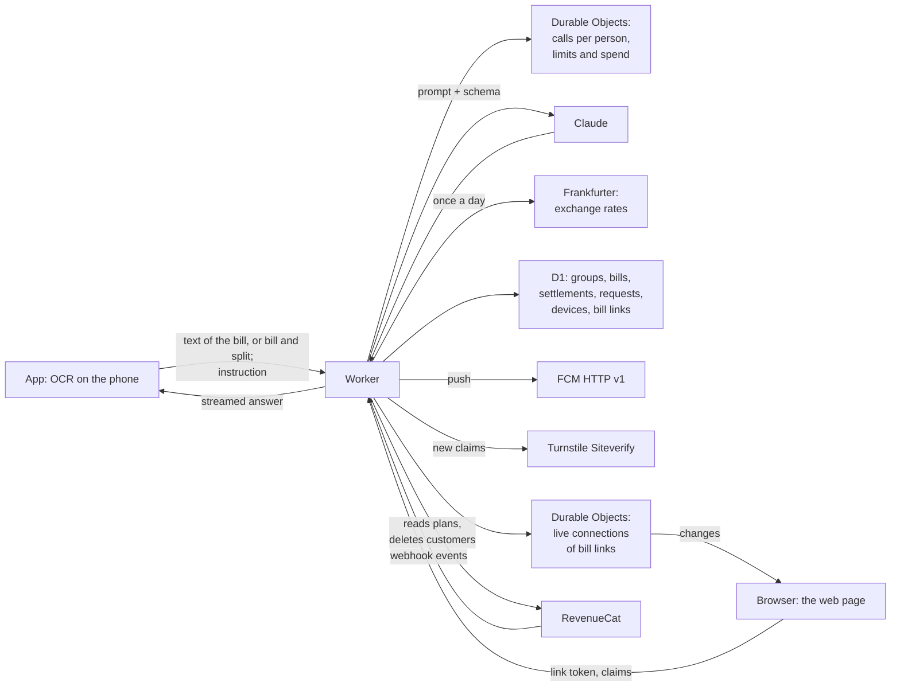

# AI proxy

The app never holds an Anthropic key. It sends the text it read from a bill, or a bill and its
split with a sentence that should change the split, to a small Cloudflare Worker in
[`proxy/`](../proxy), and the Worker asks Claude. The Worker holds the key, builds the prompt and
the answer schema, counts each person's calls, limits each network address, caps what the whole
service may spend in a day, and keeps nothing of the bill. It also hands the app the
day's exchange rates, keeps what signed-in people share (groups, their bills and settlements, and
payment requests), sends their push notifications, and serves the web pages of shared links, where
people without the app claim the items they had on a bill, or see a payment request or an invite.
Which accounts are on Pro, the subscription sold through Google Play, it reads from RevenueCat.



## What it does

| Route | Who calls it | What it answers |
|---|---|---|
| `POST /v1/bill-analysis` | the app, to read a bill | lines of JSON: `{"type":"wait"}` while the model works, then one `{"type":"result","answer":…,"usage":…}` or `{"type":"error","code":…}` |
| `POST /v1/split-revision` | the app, to change a split by a sentence | the same lines, with edits of the split as the answer, [below](#editing-a-split-by-a-sentence) |
| `POST /v1/session` | the app, after "Sign in with Google" | `{session, expiresAt, usage, purchaser}`: a session the proxy signs, for 30 days, and the id the app gives RevenueCat |
| `GET /v1/usage` | Settings | `{usage, aiEnabled}`: the calls left and whether AI is on; with `purchaser` too for a signed-in caller |
| `POST /v1/plan` | the Pro screen, and the app once a purchase or a restore is done | `{purchaser, usage, aiEnabled}` once the proxy has read the account's plan from RevenueCat, [below](#pro-subscriptions) |
| `DELETE /v1/account` | Settings, "Delete account" | 204 once the account's customer at RevenueCat, its counters, and its part in the shared data, are gone |
| `POST /v1/subscription-events` | RevenueCat's webhook | `{"ok":true}` once the plans the event is about are read again, [below](#pro-subscriptions) |
| `GET /v1/fx-rates` | the app, to convert between currencies | `{base, source, fetchedAt, rates}`: how much of each currency one euro buys, each rate with its day |
| `/v1/groups…`, `/v1/invites…`, `/v1/requests…`, `/v1/request-links…`, `/v1/devices…` | the app, signed in | the shared data, [below](#shared-data-groups-payment-requests-and-push) |
| `/v1/shares…` | the app, signed in; a browser with the link | bill links and their claims, [below](#bill-links-and-the-web-pages) |
| `POST /v1/request-links/view`, `POST /v1/invites/preview` | a browser with the link | what the web page of a payment request or an invite shows |
| `GET /.well-known/assetlinks.json`, `GET /s/`, `GET /r/`, `GET /g/`, `GET /assets/…` | Android, a browser | App Links, and the web app for a link opened without the app |

Every request names its install with `X-SplitVibe-Install` (a random id the app makes for itself) and
its version with `X-SplitVibe-Version`; the exchange rates, the shared data and the links need
neither. A signed-in app adds `Authorization: Bearer <session>`, which is all the shared data
needs. RevenueCat's webhook carries none of them: its own `Authorization` value lets it in. The body of a bill read is exactly
[`sample_bill_request.json`](../app/src/sharedTest/resources/fixtures/sample_bill_request.json) in
shape; the app's and the proxy's tests both use that file. A bill photographed in several pages is
still one `ocrDocument`: `<bill_ocr pages="N">` holds one `<page n="…" rows="…">` per photo, in
order, with rows numbered from 1 and coordinates from 0 to 1000 within each page. A one-page bill
stays `<bill_ocr rows="N">` with its rows directly inside. The full contract of the bill read,
the session, usage and account routes, with every error code, is in
[the Phase 3 plan](../plans/261114-0220-split-vibe-production/phase-03-cloudflare-ai-proxy.md), but
for the numbers and the `plan` of `usage`, which [Calls and limits](#calls-and-limits) gives as they
are now, the `purchaser` that [Pro subscriptions](#pro-subscriptions) adds, and the bill's
`category`, [below](#changing-the-prompt-or-the-model). Edits of a split are described
[in their own section](#editing-a-split-by-a-sentence), the exchange rates and their one error
[below](#exchange-rates), and the shared data's whole contract in
[its own section](#shared-data-groups-payment-requests-and-push).

### Calls and limits

The numbers live in [`proxy/src/policy.ts`](../proxy/src/policy.ts) and change with a deploy.

- An install that has not signed in gets 3 calls, once. A Google account gets 10 calls each calendar
  month, counted in UTC, and 300 (`proCalls`) while it is on [Pro](#pro-subscriptions), on the same
  count: a plan that changes during a month keeps what the month used, so an account that used 12
  calls on Pro and goes back to the free plan has none left until the month ends. Every `usage`
  says which allowance holds in `plan`: `"trial"` for an install, `"free"` or `"pro"` for an
  account. An app that meets a proxy without `plan` reads `"trial"` from `period: "trial"`, and
  `"free"` otherwise.
- A bill read takes one call, and an edit of a split by a sentence a fifth of one
  (`revisionWeight`, 0.2), from the same calls. The proxy counts in hundredths of a call, so
  `limit`, `used` and `remaining`, in `/v1/usage`, in the answer of `/v1/session`, and in every line
  and error body that carries `usage`, are decimal numbers with at most two decimals, such as `3`,
  `0.2` or `2.8`. A call runs only while `remaining` is at least what it takes: with 0.8 left, a
  bill read is refused with 429 `quota_exhausted` and an edit still runs. `revisionWeight` must be
  a whole number of hundredths from 0.01 to 1: with any other, the Worker does not load, so neither
  a deploy nor the tests go through.
- A call is held while the model works and charged once the model has answered, whatever the answer
  says, also when the app hung up, as long as the answer comes within 25 seconds of the hang-up.
  A call that got no answer is given back, and so is an edit whose answer the proxy could not use
  (`bad_response`). The same request id is charged once however often it runs, at what its first
  run took, and it can only be used again for the same request, never for another bill, another
  edit or the other route. While the proxy remembers an id, for a day once its call was charged and
  while its call is held, it runs at most three times. A run that is given back while no other run
  of it waits makes the proxy forget the id, so a request that keeps failing, or keeps ending as
  `bad_response`, may be sent again as a new one, within the limits of its address.
- Each network address may send 10 calls to the model a minute and 100 a day, bill reads and edits
  together, whoever sends them. IPv6 counts by its /64.
- Spend is capped over each 24 hours: $3 per caller, $6 per address and $20 for the whole proxy.
  Each call holds the most it could cost, then settles at what it did cost. An edit, which only its
  own model answers, is held at that model's price: half a cent to 1.3 cents with Haiku. A bill
  read, which a refusal can move to another model, is held at the dearest price in `spend.ts`:
  about half a dollar, and up to some 80 cents for the longest bill. Also set a monthly spend limit
  in the Anthropic console. Pro changes none of the caps: one account still spends at most $3 a
  day. The $20 a day of the whole proxy must rise as accounts move to Pro: at about 6 cents a bill
  read, one that uses its 300 calls costs some $18 a month.

### Pro subscriptions

Pro is one auto-renewing subscription sold through Google Play, with RevenueCat checking the
purchases, and it changes one thing: a Google account's calls, 300 a month instead of 10. The
proxy alone decides who is on Pro. No route takes a plan from the app, and what a webhook event
says is never taken as the plan. What the owner sets up in Play Console and RevenueCat is in
[pro-subscription.md](pro-subscription.md).

- **The purchaser.** RevenueCat's app user ID for an account is the account id itself: the 64
  lower-case hex digits of the salted hash a session carries. `POST /v1/session`, `GET /v1/usage`
  for a signed-in caller and `POST /v1/plan` hand it to the app as `purchaser`, and the account's
  `QuotaBook` records the first time it went out. An install that is not signed in gets none, and
  sends nothing to RevenueCat.
- **Reading RevenueCat.** The proxy reads an account's plan with
  `GET https://api.revenuecat.com/v1/subscribers/{purchaser}` and the secret key, waiting at most
  10 seconds and reading at most 256 KB of the answer. That read creates the customer when
  RevenueCat has none, so the proxy makes it only for an id it handed out and has not forgotten
  since: never for an id an event makes up, nor for a deleted account.
- **The plan.** From the entitlement `pro` and the subscription that grants it, the proxy keeps
  `proUntil` and `checkedAt`, the time of RevenueCat's answer by RevenueCat's clock:
  - while the later of the entitlement's `expires_date` and its `grace_period_expires_date`, the
    end of the grace period Play gives after a failed payment, is after that time, `proUntil` is
    that later time; an entitlement whose `expires_date` is null, as one granted for life from
    RevenueCat's dashboard, never ends;
  - once that time has passed, while the subscription still renews by itself, with
    `unsubscribe_detected_at`, `billing_issues_detected_at` and `refunded_at` all null, `proUntil`
    is the `expires_date`: Play may renew a subscription hours after its period ended (the renewal
    gap);
  - otherwise there is no Pro.

  An account is on Pro until `proUntil` plus 24 hours (`proGraceMs`), which covers a late renewal
  and a late event. A subscription read as cancelled, refunded or failing to bill once its period
  is over ends at once. A plan read earlier than the one kept is not kept, so answers that arrive
  out of order leave the latest, and an event that comes twice or late changes nothing that
  RevenueCat does not say now. Purchases of Play's license testers, which RevenueCat marks as
  sandbox, count as any other: only the testers the owner lists in Play Console can make them.
- **`POST /v1/plan`** needs a session; its body, empty or `{}`, is not read. It reads the
  account's plan, keeps it, and answers `{purchaser, usage, aiEnabled}`. The app calls it when it
  opens the Pro screen and once a purchase, a restore or a change of plan is done, so as not to
  wait for the webhook. Each account may call it 30 times an hour (`planRefreshesPerHour`); past
  that it is 429 `rate_limited` with `Retry-After`. Without `REVENUECAT_SECRET_KEY` it is 503
  `not_configured`. When RevenueCat cannot be reached, takes longer than 10 seconds, or answers
  with anything but a customer, it is 502 `subscription_unavailable`, and the plan kept stays as it
  was.
- **`POST /v1/subscription-events`** is RevenueCat's webhook. Its `Authorization` header must be
  `REVENUECAT_WEBHOOK_AUTH`, as it is or after `Bearer `. The proxy compares the SHA-256 digests of
  the two in constant time, and otherwise answers 401 `webhook_auth`, reading, asking and writing
  nothing; without the secret it answers 503 `not_configured`. HMAC signing is not used. The body,
  `{api_version, event}`, may be 64 KB at most: a longer one is 413 `too_large`, and one without an
  `event` object 400 `input`. An event is only a sign that something changed: of
  the ids it names (`app_user_id`, `original_app_user_id`, then `transferred_from` and
  `transferred_to`, which a `TRANSFER` carries instead of `app_user_id`, then `aliases`), the proxy
  keeps those of the form of an account, each once and at most 20, that it handed out and has not
  forgotten, and reads and keeps the plan of each as `POST /v1/plan` does.
- **The webhook's answers.** RevenueCat counts any answer but 200 as a failure, 204 too, and sends
  a failed event again five times over about 80 minutes. So the webhook answers 200 `{"ok":true}`
  once every account the event is about was read, and also for a `TEST` event and an event about
  no account it knows, which it does not read. It answers 503 `subscription_unavailable` when
  RevenueCat could not be read for one of them, so that the event comes again; the plans it kept
  meanwhile stay, since keeping the same plan again changes nothing. An event about an account while
  `REVENUECAT_SECRET_KEY` is missing is 503 `not_configured`.
- **Deleting an account** deletes its customer at RevenueCat before anything else, as
  [Deleting an account](#deleting-an-account) says. It does not cancel the subscription on Google
  Play: the app warns the person to cancel it there first.

Without the two secrets nobody is on Pro, and everything else works as before.

### Editing a split by a sentence

`POST /v1/split-revision` turns a sentence such as "Lan didn't drink beer" or "add a 10% tip" into
edits of a split, which the app shows the user and applies only once they accept them. The model
never works out what anyone owes: it proposes edits from a fixed set, and the app's `:core:domain`
checks and applies them. The route identifies its caller, holds and charges, limits addresses, caps
spend, streams its answer and refuses with the same headers and codes as a bill read; an edit
takes a fifth of a call.

```json
{
  "requestId": "<uuid>",
  "instruction": "Lan không uống bia",
  "bill": {
    "merchant": "Pho 24",
    "currency": { "code": "VND", "fractionDigits": 0 },
    "items": [{ "id": "i1", "name": "Bia", "quantity": "3", "amountMinor": 90000 }],
    "charges": [{ "id": "c1", "label": "Service charge", "kind": "service_charge", "amountMinor": 14000 }],
    "totalMinor": 154000
  },
  "split": {
    "participants": [{ "id": "me", "name": "Dana" }, { "id": "p1", "name": "Lan" }],
    "whole": null,
    "items": { "i1": { "type": "equal", "among": ["me"], "except": [] } },
    "notSharing": [],
    "payments": [{ "participantId": "me", "amountMinor": 154000 }]
  }
}
```

- `requestId` is a UUID, and `instruction` 1 to 500 characters, once its text is read as below.
- `bill` has `merchant` (null, or 1 to 200 characters), `currency`, `items` (0 to 200, each
  `{id, name, quantity, amountMinor}`), `charges` (0 to 50, each `{id, label, kind, amountMinor}`,
  with `kind` one of `tax`, `service_charge`, `tip`, `discount`, `rounding` and `other`) and
  `totalMinor`. `currency` is `{code, fractionDigits}`: `code` is any text of 0 to 8 characters,
  as the app keeps a code it could not match to ISO 4217, and none for XXX, and `fractionDigits` is
  0 to 3.
- `split` has `participants` (1 to 100, as many as a group has members, each `{id, name}`, the
  app's user being `me`), `whole`, `items`, `notSharing` (participant ids) and `payments` (at most
  100 `{participantId, amountMinor}`). `whole` is null when each item is split on its own, and
  otherwise a division, as the domain writes `Division`: `{"type":"equal","among":[…],"except":[…]}`,
  `{"type":"shares","shares":{…}}`, `{"type":"percent","basisPoints":{…}}` or
  `{"type":"amount","amounts":{…}}`, keyed by participant id. `items` holds a division by item id;
  an item without one is shared equally by everyone sharing the bill. `items`, `notSharing`,
  `payments`, `among` and `except` may be left out when empty; `whole` may not.
- Ids are 1 to 64 characters of `A-Z a-z 0-9 _ -`, unique within their list, but in `payments`,
  where one may come again. A bill is edited as the app holds it and as its user typed it, so the
  proxy reads its text rather than refuse it. The instruction, the merchant, names, labels and the
  currency's code lose invisible formatting characters but the joiners, as the
  [Conventions](#conventions) say; then each run of whitespace or control characters, line breaks
  and tabs among them, becomes one space, and they are trimmed. So an instruction typed on several
  lines arrives as one, and a name the bill read wrapped onto two rows reads as one. Names and
  labels may be empty, where the app let its user clear one, and are at most 200 characters.
  `quantity` is null or a decimal written as text, as on a bill link. An item's amount and the
  total are 0 to 10^15, a charge's -10^15 to 10^15, and a payment 0 to 10^15. The numbers per
  participant of a division are whole numbers, which need not add up and may be past their sum or
  below zero, as those of a split the user is still typing may be; an amount is at most 10^15
  either way.
- The body is at most 64 KB, which keeps the prompt under the 100K tokens up to which the model's
  price holds. Anything else is 400 `input`, before anything is held or counted. Fields the
  contract does not name are ignored and never reach the model.

The last line is `{"type":"result","answer":…,"usage":…}`, with the answer:

```json
{"edits": [{"op": "item_sharers", "itemId": "i1", "participantIds": ["me"]}],
 "explanation": "Lan no longer shares the beer.",
 "question": null}
```

- `edits` holds at most 20 edits, in the order the app applies them.
- `explanation` is at most 200 characters, in the language of the instruction, and may be empty.
  The prompt asks that it never say what anyone owes; the evaluation checks that, the proxy does
  not.
- `question` is null, or a short question of at most 200 characters when the instruction is too
  unclear to act on; `edits` is then empty.

| `op` | Fields |
|---|---|
| `item_sharers` | `itemId`; `participantIds`, 1 or more ids, each once |
| `item_shares` | `itemId`; `shares`, `{"<participant id>": n}` with n from 1 to 1,000 |
| `split_mode` | `mode`: `equal`, `by_item`, `by_shares`, `by_percent` or `by_amount` |
| `whole_shares` | `shares`, `{"<participant id>": n}` with n from 0 to 1,000 |
| `whole_percent` | `basisPoints`, `{"<participant id>": n}` with n from 0 to 10,000 |
| `whole_amounts` | `amounts`, `{"<participant id>": n}` with n from 0 to 10^15 |
| `add_person` | `ref`, `new1` to `new9`, which later edits use as the person's id; `name`, 1 to 200 characters |
| `remove_person` | `participantId` |
| `set_sharing` | `participantId`; `sharing`, true or false |
| `add_charge` | `kind`; `label`, 1 to 200 characters; and exactly one of `amountMinor`, 1 to 10^15, or `percentBasisPoints`, 1 to 10,000 of the items' total, the other left out |
| `set_payer` | `participantId` |
| `item_amount` | `itemId`; `amountMinor`, 0 to 10^15 |
| `item_quantity` | `itemId`; `quantity`, a decimal written as text and more than 0, such as `"2"` or `"0.5"` |

What each edit does to the split is the contract's, in the section "Hợp đồng chung" of
[the Phase 7 plan](../plans/261114-0220-split-vibe-production/phase-07-ai-assistant-insights.md).

The proxy checks the model's answer again before the app gets it. Structured outputs cannot key an
object by participant, so the model writes each number per participant as a pair, and the proxy
makes the object of them; it also writes `op`, `mode`, `kind` and `ref` in lower case, which
structured outputs do not promise, and reads its texts as those of the request: each run of
whitespace or control characters is one space. An answer that breaks the
rules above (an op that is not one of these, a field that is missing, of the wrong type or out of
range, the same person twice in one edit, more than 20 edits, a text too long, or a question with
edits) ends as the error `bad_response`, and, unlike a bill read's, the call is given back. What
only the bill can judge passes as it is: ids it does not have, percentages that do not add up to
10,000, amounts that do not add up to its total, or removing `me`. The app rejects those edits one
by one, and tells the user.

The errors are those of a bill read. Before the answer: 400 `input`, also for a request id used
before for something else; 401 `install` or `session`; 426 `update_required`; 429
`quota_exhausted` (with `usage`), `retry_limit` (with `usage`), `rate_limited`, `spend_limited` or
`busy`; 503 `ai_off` or `not_configured`. As the last line: `refused` and `too_long`, which are
charged and carry `usage`, and `bad_response`, `upstream`, `busy`, `timeout` and `internal`, which
are not.

The model is `claude-haiku-5-5` (`revisionModel`), at low effort, with adaptive thinking, room for
8,000 tokens and no fallback; `policy.ts` says why. A refusal of its safety classifiers ends the call
as `refused`. The prompt is [`proxy/src/revise-prompt.ts`](../proxy/src/revise-prompt.ts) and the
schema `REVISION_SCHEMA` in [`proxy/src/schema.ts`](../proxy/src/schema.ts). The prompt tells the
model that the instruction and every name on the bill are data written by people, never
instructions to it, and that the participant `me` is the user, named as the app names them: their
own name, or "Me". The user message writes the bill, the split and the instruction as JSON, each in
its tag, with every `<`, `>` and `&` written as its escape (`\u003c` and so on), which reads back as
the same character: so no name and no instruction can close one of the message's tags or open
another. An edit is held against the spend caps at the price of its model, the only one that
answers it.

### Exchange rates

`GET /v1/fx-rates` hands out how much of each currency one euro buys, from version 2 of the
[Frankfurter](https://frankfurter.dev) API, which gathers the reference rates of the European
Central Bank and of other central banks. Version 1 has only some 30 currencies and no dong, so it
is not used. Only fiat currencies are kept, with the euro at 1; the crypto assets and metals
Frankfurter also lists are dropped. Each rate keeps the day the source gives it for, which can be a
day or two behind the others.

One Durable Object, `FxBook`, holds the latest snapshot and when it was fetched. A cron fetches it
every day at 16:30 UTC, after the European Central Bank publishes, and a request that finds no
snapshot, or one a day old, fetches it first. A fetch that fails, takes more than 10 seconds or
answers with anything unexpected never replaces the snapshot: the route hands out the last one, and
`fetchedAt` shows its age. After a failed fetch, requests are answered from what is held for five
minutes before the source is asked again, so an outage of the source does not slow every request;
the cron always asks. Only when there has never been a snapshot does a failed fetch answer 503
`fx_unavailable`. An answer may be cached for an hour.

### What it keeps

Durable Objects hold counters: calls used per install or per account, in hundredths of a
call, request ids for a day with what each one takes, requests and spend per address. A Google
account's `QuotaBook` also keeps its plan as RevenueCat last gave it, `proUntil` and `checkedAt`,
and when its id first went out as a purchaser; both go when the account is deleted. One more
holds the latest exchange rates, which are public. Objects are named by salted hashes, never by an
IP address or a Google id. A request id is kept with a salted hash of what it asked, so that it
cannot be reused for another bill or another edit. Nothing of a bill read or of an edit, an
instruction or a name is stored.

The `QuotaBook` objects written before calls had weights counted whole calls. Each turns its count
and its request ids into hundredths the first time it is asked after the deploy, record by record;
what was written since is left as it is. Each also keeps its count in whole calls, rounded up,
beside the hundredths, for that older code, which reads nothing else: a rollback to it never hands
out a call that is not left, and the calls it charges are counted once this code runs again, as
[Deploy it](#deploy-it) says. A Worker still finishing a bill read while the new one starts sends
no weight, which counts as a whole call. An object still on the older code for up to five minutes
after the deploy charges an edit as a whole call too, so that its caller loses 0.8 of a call;
Deploy it says how the first deploy avoids that.

The shared data in D1 is what people chose to share, and no more: groups with the names members
typed for themselves and for placeholders, the bills put into a group, settlements, the group's
log, invites, payment requests with the one payment method each carries, the FCM token of each
signed-in install, and hourly counters. An account appears only as the salted hash a session
carries. No email, Google name or photo is stored, nor a person's list of payment methods, which
stays on the phone. Invite and request links are kept as SHA-256 hashes of their tokens. How
deleting an account changes the shared data is described [below](#deleting-an-account).

A bill link keeps, until it expires or is revoked and the next daily run deletes it, what its page
shows: the bill as the owner's app projected it (merchant, date, items, charges, total and the
names of the participants), the claims under the names people typed with the items they took, and
once the split is settled what each participant owes and how to pay it, who paid the whole bill
when its owner said so, and which participant each claim is when its owner matched them. A payment
request may also keep how to pay it as its creditor's app built it for its page. Link tokens, the
keys of claims and the attempts of first claims are kept as SHA-256 hashes. What the web pages do
without a session is counted per hour and per address, under the same salted hash of the address
as the limits of bill reads, never the address itself, and only for a token that leads to a link,
a request or an invite that works; it is forgotten by the daily run once the hour is over. The
`ShareRoom` objects hold open connections only.

The Worker prints one log line per bill read (`bill_analysis`) and per edit (`split_revision`): the
outcome, whether the caller is an install or an account, the model, the tokens, the cost and the
time taken. For notifications it prints their type and how many devices got them, never an id, a
token or any text. For RevenueCat's webhook it prints one line per event (`subscription_event`):
the event's type, how many accounts it was about and what came of it. When RevenueCat cannot be
read, or does not take a deletion, it prints the status or the error's name
(`revenuecat_unavailable`, `revenuecat_unreadable`, `revenuecat_delete_failed`), never an id, a
body or a key. When Turnstile cannot judge
a claim, it prints Cloudflare's error codes; when a token was solved for another action or host, the
action and the hostname Cloudflare gave; and when a test secret is refused, that it was. It never
prints a token. Cloudflare's invocation
logs are off in `wrangler.jsonc`, because they record every request's headers, among them the
session and the IP address. Traces are on: they show how long each request, each call to Claude
and each Durable Object took, its outcome and its CPU time, with the country and city, the network
and the user agent, but no header values, no IP address and no body. They do show each request's
URL, so no path holds anything secret: paths hold ids only, and link tokens travel in a link's
fragment, in request bodies, and in the subprotocols of a live connection. Those CPU times tell
whether the free plan's limit is enough.

## Shared data: groups, payment requests and push

Signed-in people share groups and ask each other for money through the proxy. The data lives in
the D1 database `split-vibe`, bound as `DB`, with its schema in
[`proxy/migrations/`](../proxy/migrations). Every permission is checked in the Worker and covered
by its tests; the app is trusted with nothing.

### Conventions

- Every `/v1/` route here needs `Authorization: Bearer <session>`, and nothing else: no install
  id, no version. Without a session that checks out it answers 401 `{"error":"session"}`.
- Bodies are JSON objects; fields the contract does not name are ignored. Ids are UUIDs the app
  makes. Making something again under an id that already exists for the same caller answers as
  the first time did and changes nothing, so a lost answer can be retried.
- A shared link carries its token in the fragment, `https://<the proxy's host>/g/#<token>` or
  `/r/#<token>` (and `/s/#<token>` for a [bill link](#bill-links-and-the-web-pages)), which no
  browser sends, and the app sends it in a body as `"token"`. No URL path
  or query ever holds one. A body without a `token` text is 400; a token no link could hold, or
  that no link has, is 404.
- Money is a whole number of minor units, from 0 to 10^15 (`BillCurrency.MAX_AMOUNT_MINOR`); more
  is 400 `input`. A currency is `{"code":"VND","fractionDigits":0}`: three capital letters and 0 to
  3 digits. Names lose Unicode's invisible formatting characters (category Cf, such as bidi
  controls and zero-width spaces), but keep the zero-width joiner and non-joiner (U+200D and
  U+200C), which emoji sequences and Persian and some Indic names need. They are then trimmed, and
  are 1 to 60 characters (counted as code points), without control characters. A name with
  nothing but joiners and spaces left counts as empty.
- Errors are `{"error": code}`: 400 `input`, 401 `session`, 403 `forbidden` (or `pending` for
  someone whose claim waits), 404 `not_found` (also for an id in the path that is not a UUID;
  for a `PUT`, which makes the thing, that is 400), 409 `conflict`, 410 `gone`, 413
  `too_large`, 429 `rate_limited` with `Retry-After` in seconds, 503 `not_configured`. Answers
  carry `cache-control: no-store`.

### A group's state

Most group routes answer with the group as the caller sees it:

```json
{
  "group": {"id": "…", "name": "…", "currency": {"code": "THB", "fractionDigits": 2}, "ownerMemberId": "…", "revision": 7, "createdAt": 1763180000000},
  "myMemberId": "…",
  "members": [{"id": "…", "name": "…", "hasAccount": true, "isOwner": false, "joinedAt": 1763180000000}],
  "claims": [{"memberId": "…", "claimantName": "…", "requestedAt": 1763180000000}],
  "bills": [{"id": "…", "ownerMemberId": "…", "revision": 2, "updatedAt": 1763180000000, "document": {}, "conversion": {"rate": "25350", "date": "2026-11-14", "source": "Frankfurter"}, "totalMinor": 902664, "shares": {"<memberId>": 300888}, "paid": {"<memberId>": 902664}}],
  "settlements": [{"id": "…", "fromMemberId": "…", "toMemberId": "…", "amountMinor": 1000, "recordedByMemberId": "…", "requestId": null, "createdAt": 1763180000000}],
  "log": [{"at": 1763180000000, "kind": "bill_added", "memberId": "…", "subjectId": "…"}]
}
```

- Times are epoch milliseconds. Members are in the order they joined (`joinedAt` is when the
  member was added and never changes), bills and settlements in the order they were made.
- `revision` moves on by exactly one at every change of the group's state, so the app can tell
  whether what it holds is current. Invites are not part of the state and do not move it.
- `claims` is filled for the owner only; everyone else gets `[]`.
- `bills` leaves out deleted bills. `document` is the JSON object the app sent, at most 64 KB
  serialized, returned as it was parsed (key order kept; a number is returned as JavaScript
  writes it). `conversion` is null when the bill is already in the group's currency.
- `log` holds the newest 100 entries, newest first. `memberId` is the member who acted, and
  `subjectId` what the entry is about:

| `kind` | `memberId` | `subjectId` |
|---|---|---|
| `group_created` | the creator | the group |
| `member_added` | who added the placeholder | the placeholder |
| `member_joined`, `member_left` | the member | the member |
| `member_removed` | the owner | the removed member |
| `member_renamed` | who renamed | the renamed member |
| `claim_requested` | the placeholder claimed (the claimant has no member yet) | the placeholder |
| `claim_approved`, `claim_rejected` | the owner | the placeholder |
| `bill_added`, `bill_changed`, `bill_deleted` | who did it | the bill |
| `settlement_recorded` | the member who was paid | the settlement |

Renaming the group moves its revision on but adds no entry to the log.

### Groups and members

| Route | Who may | Answer |
|---|---|---|
| `GET /v1/groups` | anyone | `{"groups":[{"id","name","currency","revision","myMemberId","status"}]}`: the groups the caller is a member of (`"member"`) or waits to join (`"pending"`, `myMemberId` null), oldest first |
| `POST /v1/groups` `{"id","name","currency","memberId","memberName"}` | anyone | 201 with the state; the caller is the owner and first member. The same id again from a member of that group: 201 with the state as it is; from anyone else: 409 |
| `GET /v1/groups/{gid}` | members | the state; 403 `forbidden` for others, 403 `pending` while one's claim waits |
| `PATCH /v1/groups/{gid}` `{"name"}` | the owner | the state |
| `POST /v1/groups/{gid}/members` `{"id","name"}` | members | the state with a new placeholder, a member without an account; an id the group has already changes nothing |
| `PATCH /v1/groups/{gid}/members/{mid}` `{"name"}` | that member, or the owner | the state |
| `POST /v1/groups/{gid}/members/{mid}/remove` | the owner | the state |
| `POST /v1/groups/{gid}/leave` | members | 204 |

Leaving keeps the member as a placeholder, with its name and every amount, and takes the
caller's account off it. An owner who leaves hands the group to the member with an account who
joined first. When nobody with an account is left, the group is deleted with its members, claims,
invites, bills, settlements and log; payment requests made in it stay between their two people,
with `groupId`, `toMemberId`, `creditorMemberId` and `billId` set to null.

The owner can remove a member who has an account, other than their own member: the member becomes
a placeholder exactly as if they had left, keeping its name and every amount, and their account,
and any claim of theirs in the group, goes. Payment requests already made stay as they are.
Removing the owner's own member, or a placeholder, is 409. A removed account can join again only
through an invite, which the owner can revoke.

A group holds at most 100 members, placeholders included, 500 bills that are not deleted, 1 MB of
those bills' documents together (as serialized; a changed bill counts as it would be), and 2,000
settlements; an account is in, or waits to join, at most 100 groups. Past these, 413 `too_large`,
also for confirming a group request whose settlement would pass the limit. These keep a group's
state, which every answer carries whole, within the CPU time and the D1 reads a request may take.

Every route that changes a group counts once against an hourly limit of 200 per account, over all
its groups: making a group, renaming it, adding, renaming and removing members, leaving, joining
and claiming through an invite, approving and rejecting claims, bills, settlements, and confirming
a group request. Past it, 429 `rate_limited` with `Retry-After`. Reading groups, making invites
(which have their own limit) and payment requests do not count.

### Invites and claims

| Route | Who may | Answer |
|---|---|---|
| `POST /v1/groups/{gid}/invites` | members | 201 `{"token","url","expiresAt"}`, with `url` `https://<the proxy's host>/g/#<token>` |
| `DELETE /v1/groups/{gid}/invites` | the owner | 204; every invite of the group stops working |
| `POST /v1/invites/open` `{"token"}` | anyone | `{"group":{"id","name","currency"},"placeholders":[{"id","name"}],"alreadyMember":bool}` |
| `POST /v1/invites/join` `{"token","memberId","name"}` | anyone | the state, with the caller as a new member |
| `POST /v1/invites/join` `{"token","claimMemberId","name"}` | anyone | 202 `{"status":"pending"}`; the owner is notified |
| `POST /v1/groups/{gid}/claims/{mid}/approve` | the owner | the state; the placeholder now has the claimant's account |
| `POST /v1/groups/{gid}/claims/{mid}/reject` | the owner | the state, without the claim |

- A token is 128 random bits in base64url (22 characters). Only its SHA-256 is kept. An invite
  works for 14 days; an unknown token is 404, an expired or revoked one 410 `gone`. An account
  may make 20 invites an hour over all its groups.
- A join body names `memberId` or `claimMemberId`, never both. A member who joins again gets the
  state whatever they send, and so never claims. A new member under an id the group has is 409.
- A claim asks to become a placeholder; `name` is shown to the owner as `claimantName`. Approving
  sets only the placeholder's account: its id, name and amounts stay. A claim on a member who has
  an account, or on a placeholder another account claims, is 409; an unknown member is 404. An
  account has one claim waiting per group: the same claim again answers 202 and notifies nobody,
  a claim on another placeholder is 409. Joining as a new member drops one's waiting claim.

### Bills and settlements

| Route | Who may | Answer |
|---|---|---|
| `PUT /v1/groups/{gid}/bills/{billId}` `{"expectedRevision","document","conversion","totalMinor","shares","paid"}` | members; an existing bill, the member it belongs to or the owner | the state |
| `DELETE /v1/groups/{gid}/bills/{billId}` | the member the bill belongs to, or the owner | the state |
| `POST /v1/groups/{gid}/settlements` `{"id","fromMemberId","amountMinor"}` | the member who received the money | the state |

- A new bill is sent with `expectedRevision` 0 and belongs to the caller's member. Otherwise
  `expectedRevision` must be the revision stored, or the answer is 409 `conflict`; the bill's
  revision becomes one more. The same change sent again, which finds the bill already at that
  revision with the same content, answers 200 and changes nothing.
- `shares` and `paid` map member ids of the group to amounts; each adds up to `totalMinor`
  exactly. A key that is not a member of the group, in its lower-case form, is 400.
- `conversion` is null or `{"rate","date","source"}`: a positive decimal number as text, a day
  `YYYY-MM-DD`, and a name of 1 to 60 characters.
- A deleted bill keeps its id: it cannot be sent again (409), and deleting it again changes
  nothing. What it held is emptied at once.
- A settlement goes from another member of the group to the caller's member, for more than 0.
  Settlements are only ever added: no route changes or deletes one, the database refuses to
  change or delete one (deleting the whole group aside), and the same id again from the same
  member changes nothing (from another, 409).

Changes to one group are decided on the group as it is: each goes in one batch behind an update
of the revision to the one read plus one, which a trigger refuses when another change came first.
The change is then read and decided again, up to 10 times, and only then answers 409.

### Payment requests

| Route | Who may | Answer |
|---|---|---|
| `POST /v1/requests` | anyone, as the creditor | 201 `{"request": RequestView, "url"}`, with `url` `https://<the proxy's host>/r/#<token>` |
| `GET /v1/requests` | anyone | `{"requests":[RequestView]}`: those the caller made or is the debtor of, newest first, at most 200 |
| `POST /v1/request-links/open` `{"token"}` | anyone | the request as the caller will see it once they accept: `role` `"debtor"`, `debtorBound` true; for its creditor, as theirs |
| `POST /v1/request-links/accept` `{"token"}` | anyone but the creditor | the request, with the caller as its debtor |
| `POST /v1/requests/{id}/reported-paid` | the debtor | the request; the creditor is notified |
| `POST /v1/requests/{id}/confirmed-paid` | the creditor | the request; the debtor is notified |
| `PATCH /v1/requests/{id}` `{"remindEveryDays"}` | the creditor | the request |
| `DELETE /v1/requests/{id}` | the creditor, until it is confirmed | 204 |

A request is made with `{"id","amountMinor","currency","payerName","creditorName","method"}` and,
optionally, `"title"`, `"groupId"`, `"toMemberId"`, `"billId"` and `"remindEveryDays"`:

- `amountMinor` is more than 0. `payerName` is who should pay and `creditorName` the name the
  creditor wants them to see, both 1 to 60 characters. `title` says what it is for, 0 to 80
  characters; empty or missing is null. `method` is the one payment method the creditor chose,
  any JSON object of at most 4 KB (413 past that). These are kept as sent; they are what a person
  typed, so no notification ever carries them.
- With `groupId`, the caller must be a member, `toMemberId` another member of that group, and the
  currency the group's (else 400). A member with an account becomes the debtor at once and is
  notified. `toMemberId` without `groupId` is 400; `billId` is any UUID, kept for the app.
- `remindEveryDays` is 0, 1, 3 or 7: how often the debtor, or the creditor when the debtor cannot
  get a reminder, hears that it is still open. 0, the default, never. A payment reported and
  waiting for its creditor's confirmation tells the creditor whatever this is.
- A creditor may make 30 requests an hour. The same request sent again answers 201 with the same
  link, and is not counted; an id another creditor used is 409.

RequestView:

```json
{"id": "…", "role": "creditor", "amountMinor": 150000, "currency": {"code": "VND", "fractionDigits": 0}, "payerName": "Minh", "creditorName": "Lan", "title": "Hot pot", "method": {}, "groupId": null, "toMemberId": null, "creditorMemberId": null, "billId": null, "createdAt": 1763180000000, "reportedPaidAt": null, "confirmedPaidAt": null, "remindEveryDays": 0, "debtorBound": false}
```

- `creditorMemberId` is the creditor's member in the group, null outside a group: the app can show
  who in the group asks, whatever name they typed as `creditorName`.
- Someone who is neither the creditor nor the debtor finds no request by its id (404), and the
  other side of one gets 403: a creditor cannot report it paid, a debtor cannot confirm it.
- A link is 404 when it was never made and 410 `gone` once its request was deleted. The first
  account to accept it is the debtor; to anyone else, reading or accepting it is then 409.
- Reported paid and confirmed paid are each set once; after a confirmation, reporting changes
  nothing. Confirming a request in a group records, in the same batch, one settlement from
  `toMemberId` to the creditor's member, recorded by the creditor's member, with `requestId` set.
  Confirming twice, even at once, records one. A confirmation and a withdrawal that come together
  are decided by whichever lands first: a withdrawn request is never confirmed (its confirmation
  answers 404 and records nothing), and a confirmed one is never withdrawn (409).
- A link's token is the first 128 bits of an HMAC-SHA-256 of `request-link:<creditor's
  account>:<request id>` under `HASH_SALT`, so the proxy can hand its creditor the same link
  again; only the token's SHA-256 is kept. Because the creditor is part of it, an id that is
  forgotten after a deletion and used again by another account gets another link, and the old
  link stays dead.
- A deleted request is emptied at once (method, payment, names, title, debtor and group) and
  forgotten 30 days later, after which its link is 404.
- A request may also carry `"payment"`: how to pay it, as the creditor's app built it for the
  request's [web page](#payment-requests-and-invites-on-the-web).

### Devices and push notifications

`PUT /v1/devices/{deviceId}` with `{"token"}` registers the FCM token (1 to 4096 characters) of one
install for the caller and answers 204; `DELETE /v1/devices/{deviceId}` stops it, 204 either way.
A token belongs to one account: when a phone changes accounts, the earlier registration of its
token goes. An account keeps its 10 most recent devices.

Notifications go through FCM HTTP v1 with the Google service account in the secret
`FCM_SERVICE_ACCOUNT`, the JSON key file Google hands out (`project_id`, `client_email` and
`private_key` are used). The Worker signs an RS256 JWT with it for
`https://oauth2.googleapis.com/token` with the scope
`https://www.googleapis.com/auth/firebase.messaging`, keeps the access token until five minutes
before it expires, and posts to
`https://fcm.googleapis.com/v1/projects/{project_id}/messages:send`. Without the secret nothing is
sent and everything else works the same. A notification that cannot go out never fails what it
tells of. A device is forgotten when FCM answers 404 `UNREGISTERED`, or 400 `INVALID_ARGUMENT`
about the registration token.

| `type` | Sent to | Title | Data |
|---|---|---|---|
| `request` | the debtor, when a group member with an account is the debtor at once | New payment request | `requestId` |
| `reported` | the creditor | Payment reported | `requestId` |
| `confirmed` | the debtor | Payment confirmed | `requestId` |
| `reminder` | the debtor | Payment reminder | `requestId` |
| `unpaid` | the creditor, instead of a reminder the debtor cannot get | Payment still open | `requestId` |
| `unconfirmed` | the creditor, of a payment reported to them two days ago | Payment to confirm | `requestId` |
| `claim` | the group's owner | Someone asked to join | `groupId` |

The texts are fixed English strings in [`push.ts`](../proxy/src/push.ts), and the data is
`{"type", "requestId"}` or `{"type", "groupId"}`: no name, merchant, note, amount or link. While
the app is in the background, Android shows the notification itself, in the app's `requests`
channel; the app shows the same words when it is open.

### The daily run

The cron of `wrangler.jsonc` (16:30 UTC) fetches the exchange rates, and alongside:

- A request is due a reminder when it is neither confirmed nor reported paid, has a creditor,
  reminds every N days, and had no reminder (nor was made) in the last N days, less an hour so
  that a run a little earlier than the day before still counts. When its debtor is bound and has
  a device, they get `reminder`. Otherwise the creditor gets `unpaid`, if they have a device, so
  they can nudge the payer themself. Either way the request records when, so the next one comes
  N days later.
- A request reported paid two days ago (less the same hour) and not confirmed gets its creditor
  `unconfirmed`, and again every two days until they confirm it, whatever its N.
- Only people with at least one device are counted in. One run sends at most 40 notifications,
  oldest due first, counted by the devices they go to; with the token fetch it stays under the
  free plan's 50 subrequests, and the rest go the next day. The run fetches FCM's access token
  once: without push set up, or without a token, nothing is sent and nothing is recorded.
- Invites and deleted requests are forgotten 30 days after they stopped working, and the hourly
  counters, those of the web pages' addresses among them, once their hour is over.
- Bill links that expired or were revoked are deleted, with their claims. This calls no Durable
  Object, so it takes none of the run's subrequests.

### App Links

`GET /.well-known/assetlinks.json` lets Android open the proxy's `/g/` and `/r/` links in the app.
It lists `com.dantech.splitvibe` and `com.dantech.splitvibe.dev`, each with every fingerprint in the
variable `ANDROID_CERT_SHA256` (comma-separated SHA-256 fingerprints, `AB:CD:…`, upper-cased by the
Worker; one that is not one is left out and logged). Without any, it is `[]`. Where the app does
not open a link, a browser asks for `GET /g/` or `GET /r/`, without the fragment that holds the
token, and gets the web app's page, the same for every link: its script reads the token from the
fragment and shows the invite or the request, as [the pages](#the-pages) describe. A token in the
path, as in `/g/<token>`, is 404. Bill links, `/s/`, are not App Links and always open in the
browser. None of these needs a session or an install id.

### Deleting an account

`DELETE /v1/account` first has RevenueCat delete the account's customer, with its purchase
history, when `REVENUECAT_SECRET_KEY` is set. RevenueCat answering 200, or 404 for a customer it
does not have, counts as done; any other answer, or none within 10 seconds, is 502
`subscription_unavailable`, and nothing else is deleted, so that the app can try again. RevenueCat
deletes the customer some time after it answers. Deleting it does not cancel the subscription on
Google Play, which renews until the person cancels it in Play; the app warns them before it
deletes the account. Next the proxy takes the account out of the shared data, in one batch,
without changing anyone's balance: amounts and settlements stay as they are. Last it deletes the
account's `QuotaBook`, with its plan and the record of its purchaser, and its spend counter, so a
later webhook event about the account asks RevenueCat nothing. Only an event that arrives in the
moment between RevenueCat's deletion and the proxy's still has the customer read, which creates it
again, without purchases.

- Its members become placeholders named "Former member", keeping their ids; each group logs
  `member_left`. A group where nobody else has an account is deleted, as when its last account
  leaves.
- A group it owns passes to the member with an account who joined first, and its bills pass to
  the group's owner.
- Its claims, devices and hourly counters are deleted.
- Its bill links are deleted, with their claims. Pages that have one open hear nothing more, and
  learn it at their next request.
- On the requests it made, the payment method of each one not yet confirmed becomes `{}`, and on
  all of them, confirmed ones included, `payment` for the web page is emptied and `creditorName`
  becomes "Former member". The account is then taken off every
  request, as creditor and as debtor: the other side keeps the request, nobody can act as the
  deleted account on it, and no notice goes to it or for it. A creditor whose debtor was deleted
  gets `unpaid` notices instead of the debtor's reminders. Signing in again with the same Google
  account finds none of it.

Sessions are not revoked: the proxy keeps no list of them, and a session it signed stays valid
until it expires, at most 30 days after it was issued. A session issued before the deletion can
therefore still do whatever a session can, as the same account: read bills on a new month's
calls, make groups, requests and devices again, which a later sign-in would then find, and have
its plan read, which hands its purchaser out again and has RevenueCat create the customer anew. The
app forgets its session when the account is deleted, so only a copy kept elsewhere, such as on a
second phone signed in to the same account, could still be used.

## Bill links and the web pages

A bill link lets everyone at the table open a bill in a browser, without the app or an account,
and tap the items they had. Everyone with the page open sees the others' picks as they happen. The
bill's owner then settles the split in the app, and the page shows what each person owes and how
to pay. The same web app shows a payment request (`/r/`) and a group invite (`/g/`) to someone
without the app. The Conventions above hold here too, except where this section says otherwise.

### Bill links

The routes of a link's owner need their session; the owner is the account that made the link.

| Route | Answer |
|---|---|
| `PUT /v1/shares/{id}` `{"billId","billRevision","bill"}` | 201 the first time, then 200: `{"share": ShareView, "url"}`, with `url` `https://<the proxy's host>/s/#<token>` |
| `GET /v1/shares/{id}` | `{"share": ShareView, "url"}` |
| `POST /v1/shares/{id}/lock` | `{"share": ShareView}`: `locking`, with every claim written before it |
| `POST /v1/shares/{id}/reopen` | `{"share": ShareView}`: `open` again, without amounts, `paidBy` or `matches` |
| `POST /v1/shares/{id}/finalize` `{"billRevision","bill","amounts","paidBy"?,"matches"?}` | `{"share": ShareView}`: `locked`, with the amounts, `paidBy` and `matches` |
| `DELETE /v1/shares/{id}/claims/{claimId}` | `{"share": ShareView}`, without that claim |
| `DELETE /v1/shares/{id}` | 204: the link is revoked |

- No route lists links. To any account but its owner, a link's routes answer 404, as for an id
  no link has; `PUT` answers 409.
- A link lasts 30 days from when it was made; nothing extends it. Its token is the first 128 bits
  of an HMAC-SHA-256 under `HASH_SALT` of `share-link:<owner's account>:<link id>:<when it was
  made>`, so the owner gets the same link every time, and only its SHA-256 is kept. As the time it
  was made is part of it, a link made again under the same id, once the daily run deleted the
  first, gets another token, and the old link stays dead.
- Once a link was revoked or has expired, its routes answer 410 `gone`, revoking aside. Expiry is
  judged at every request, so this holds before the daily run deletes the link; after that, the
  link is unknown (404).
- `PUT` makes the link, or shows a changed bill on it. The `billId` stays the same (else 400). A
  `billRevision` lower than the one kept is 409 `conflict`; the same `billRevision` with the same
  bill changes nothing. Claims keep only the item ids still in the bill, in their order. The link
  loses its amounts, `paidBy` and `matches`, and a `locked` link goes back to `locking`, so the
  split is settled again.
- An account makes at most 30 links an hour, and 300 changes an hour over all its links (429 past
  either). Every call of `PUT` on a link that exists, `lock`, `reopen`, `finalize` and removing a
  claim counts as a change, whatever it then decides; reading and revoking count against nothing.
- `lock` turns `open` into `locking`, and reads every claim in the same batch: a claim written
  before it is in the answer, and one after it is refused. On a `locking` or `locked` link it
  answers the link as it is.
- `reopen` turns `locking` or `locked` into `open` and drops the amounts, `paidBy` and `matches`;
  an open link is answered as it is.
- `finalize` needs `locking` or `locked` (else 409 `conflict`). `amounts` names every participant
  of `bill` and nobody else; each `amountMinor` is 0 to 10^15, and together they come to
  `bill.totalMinor` (else 400). `paidBy` is null, or the id of the one participant of `bill` who
  paid the whole bill (another id is 400); left out, it is null.
- `matches` in `finalize` says which participant of `bill` each claim is, as the owner matched
  them: null, or `{"<claim id>": "<participant id>"}`, where every key is the id of one of the
  link's claims and every value the id of a participant of `bill` (anything else is 400). Several
  claims may be the same participant, and a claim left out is matched to nobody, as one with no
  items puts nobody on the bill. Left out, or `{}`, it is null. The claims it names are checked
  again in the batch that writes it, so a claim removed just before makes the settlement 400.
- `paidBy` and `matches` are kept with the amounts and dropped whenever they are: by a `PUT` that
  changes the bill, by `reopen` and by revoking. `bill` is shown as with `PUT`, and `billRevision`
  follows the rule of `PUT`. The same settlement sent again to a `locked` link, `paidBy` and
  `matches` included, whatever the order of their keys, changes nothing.
- Removing a claim works while the link is `open` or `locking` (409 `locked` once `locked`); a
  claim the link does not have, as when the call is sent again, changes nothing. The browser that
  made it then has no claim, and needs Turnstile again to claim.
- Revoking deletes every claim, empties the bill, the amounts, `paidBy` and `matches`, and tells
  every open page that the link is gone. Revoking again answers 204 at once, writing nothing and
  telling no page, until the daily run deletes the link; an expired link can be revoked too.
- A body of these routes is at most 512 KB.

BillProjection, what the page shows of a bill:

```json
{"merchant": "Pho 24", "date": "2026-11-14", "currency": {"code": "VND", "fractionDigits": 0},
 "items": [{"id": "i1", "name": "Pho bo", "quantity": "2", "amountMinor": 130000}],
 "charges": [{"id": "c1", "label": "Service charge", "amountMinor": 13000}],
 "totalMinor": 143000,
 "participants": [{"id": "me", "name": "Lan"}, {"id": "p1", "name": "Minh"}]}
```

- Only these fields are kept; anything else the app sends in `bill` is dropped.
- `merchant` is null or 1 to 80 characters; `date` null or a real `YYYY-MM-DD`.
- `items` holds 1 to 200 items and `charges` 0 to 20; `participants` holds 1 to 30 people.
- Ids are 1 to 64 characters of `A-Z a-z 0-9 _ -`, unique within their list.
- Names and labels, the merchant's among them, lose their invisible formatting characters but the
  joiners, as the Conventions say, are trimmed, and are 1 to 80 characters, without control
  characters; one with nothing but joiners and spaces left counts as empty. A participant's name is
  1 to 60, and may be empty for `me`, which the page then calls the bill's owner.
- `quantity` is null or a decimal written as text, such as `"2"`, `"0.5"` or `"-1"`: no exponent,
  no leading zero, and at most 20 digits on each side of the point.
- An item's `amountMinor` is 0 to 10^15, a charge's -10^15 to 10^15, and `totalMinor` 0 to 10^15.
- The whole bill, as kept, is at most 64 KB of JSON (413 past that).

ShareView, as its owner sees it:

```json
{"id": "…", "billId": "…", "billRevision": 3, "status": "open", "revision": 7,
 "createdAt": 1763190000000, "expiresAt": 1765782000000, "bill": {},
 "claims": [{"id": "…", "name": "Minh", "itemIds": ["i1"], "updatedAt": 1763190000000}],
 "amounts": null, "paidBy": null, "matches": null}
```

- `status` is `open`, `locking` or `locked`.
- `revision` moves on by one at every change of the link or its claims.
- `claims` are in the order they were made; a claim's `updatedAt` is when its browser last wrote
  it, which dropping items the bill no longer has does not change.
- `amounts` is null until the split is settled, then `{"<participant id>": {"amountMinor", "payment"}}`,
  in the order of the bill's participants.
- `paidBy` is null until the split is settled, then the participant who paid the whole bill when
  the owner named one, or null. Where an amount has no `payment`, the web page says that this
  person paid the bill and to settle up with them; when it is null, only to settle up with whoever
  paid.
- `matches` is null until the split is settled, and when the owner matched no claim; then
  `{"<claim id>": "<participant id>"}`, its keys sorted. The web page then lists who picked items
  and says who each matched claim is on the bill, and marks "You" on the browser's own claim and
  on the amount of the participant it is matched to.

`payment` is null, or a PaymentPayload: what `PaymentRequestBuilder` made in the app for that
person and that amount.

```json
{"link": "https://paypal.me/lan/71500VND", "qrPayload": null, "details": "PayPal: paypal.me/lan\nAmount: ₫71,500", "amountFilledIn": true}
```

- `link` is null, a URL that starts `https://` and has a host, or a link that starts
  `upi://pay?`, at most 2,048 characters, without whitespace or control characters. The proxy
  refuses any other scheme (400), and the page shows nothing else.
- `qrPayload` is null or at most 512 characters, with no control characters but line breaks.
- `details` is 1 to 1,000 characters, with line breaks allowed and no other control character.
- `amountFilledIn` is true or false. A `link` or `qrPayload` left out is null, and so is a
  `payment` left out. Lengths are counted in code points.

### Claiming items

These routes need no session. The token is in the body: a body without a `token` text is 400, a
token no link could hold, or that no link has, is 404, and one whose link was revoked or has
expired is 410 `gone` until the daily run deletes the link, and 404 after that.

| Route | Answer |
|---|---|
| `POST /v1/shares/open` `{"token","key"?}` | `{"share": PublicShare, "you": claimId or null}` |
| `POST /v1/shares/claim` `{"token","key"?,"attempt"?,"name","itemIds","turnstile"?}` | `{"share": PublicShare, "you": claimId, "key"?}` |
| `GET /v1/shares/live`, with `Sec-WebSocket-Protocol: splitvibe.v1, <token>` | a WebSocket |

PublicShare is the ShareView without `id`, `billId`, `billRevision`, `createdAt` and the claims'
`updatedAt`. It names no account and holds no hash and no IP.

- A claim is the items one browser took, under a name its user typed:
  - Without `key`, or with a key the link does not know (text that is not 22 base64url
    characters is one), it is a new claim. It needs `turnstile`, a token of the Turnstile widget
    solved with the action `claim` on the proxy's host, which the proxy checks with Cloudflare's
    Siteverify. A token passes once.
  - A missing or refused token is 403 `turnstile`, and so is one Cloudflare does not judge within
    5 seconds; a token is text of 1 to 2,048 characters, and anything else counts as missing.
    Siteverify also gets the caller's address, CF-Connecting-IP, as `remoteip`. Without the
    `TURNSTILE_SECRET` secret, a new claim is 503 `not_configured`.
  - Cloudflare's test secrets, such as `1x0000000000000000000000000000000AA`, answer without an
    action and with `example.com` as the hostname, so with one of them only whether the token passed
    is checked. They are taken only where the page's host is `localhost`, `127.0.0.1` or `[::1]`,
    as on a computer. On any other host, a new claim with one of them is 503 `not_configured`, and
    the Worker logs `turnstile_test_secret`.
  - The answer then carries `key`, 22 base64url characters that the proxy made, which the browser
    keeps and sends from then on; only its SHA-256 is kept.
  - With a known `key`, the claim's name and items are replaced, without Turnstile; the same name
    and items again change nothing.
  - A new claim may carry `attempt`, a random UUID the page makes for its first claim and sends
    with every try of it until it holds a key; only its SHA-256 is kept with the claim. A claim with
    the `attempt` of one of the link's claims, and no key the link knows, is that claim sent again,
    as when the answer to the first try was lost: its name and items are replaced, and the answer
    carries a new `key`, the one before no longer working, as only the hash of a key is kept. It
    needs no Turnstile token, takes no other place among the 30, and is no new claim of the IP. An
    `attempt` that is not a UUID is 400.
- `name` loses its invisible formatting characters but the joiners, as the Conventions say, is
  trimmed, and is 1 to 40 characters, without control characters, so a name of joiners and spaces
  alone is refused; `itemIds` holds unique ids of the bill's items, and may be empty (else 400).
  A link holds at most 30 claims (409 `full`), and takes them only while `open` (409 `locked`
  otherwise). A claim is written only while all of that still holds, in the same batch as the
  check.
- A claim is judged in this order: 409 `locked`, 400 for an item; then, unless its key or its
  `attempt` is one of the link's, 409 `full`, 503 `not_configured`, 403 for a missing token, 429,
  and Cloudflare's verdict. So Cloudflare is asked only about new claims that can land.
- Limits per hashed IP: 30 new claims an hour, as many as a link holds, so a whole table can claim
  from one Wi-Fi; they are counted before Cloudflare is asked. Also 300 claim writes an hour, new or
  not, about ten for each claim a link holds; 600 reads an hour over `open`, `live`,
  `/v1/request-links/view` and `/v1/invites/preview`. Past any of them, 429 `rate_limited` with
  `Retry-After`. A request that reached Cloudflare without an address is 400.
- A request is counted only once its token led to a link, a request or an invite that works: a
  token that leads nowhere is 404, and one whose link, request or invite no longer works 410,
  neither counted. A request past a limit is refused without being counted. So neither writes
  anything to D1.
- One address may make as many new claims as a link holds, so these limits alone do not keep one
  address from filling a link. What does is Turnstile, which every new claim passes, and the owner,
  who can remove a claim, lock the link or revoke it.
- The Turnstile token and the key open nothing else: every other route ignores them.
- A claim's body is at most 32 KB, and that of `open` 16 KB.

The live connection:

- The browser sends the two protocols, in either order; the proxy picks `splitvibe.v1`. The token
  travels in that header because traces keep URLs and not header values. A request that is not a
  WebSocket upgrade, or that offers anything but those two protocols, is 400 `input`.
- After every change of the link or its claims, every page gets `{"type": "share", "share":
  PublicShare}`. Once the link is revoked, they get `{"type": "gone"}`, and the connection closes
  with the code 1000 and the reason `gone`. An expired link, or one whose owner deleted their
  account, sends nothing more; the page learns it at its next request.
- A link holds at most 50 connections. When it has 50, it first closes, with the code 1000 and the
  reason `quiet`, those that sent no `ping` in the last two minutes and were opened before that;
  while it still has 50, a new one is 429 `rate_limited`, with `Retry-After: 60`. A page sends
  `ping` every 30 seconds and gets `pong`, which does not wake the link's object; it sends nothing
  else, and a connection that does is closed with the code 1008.
- A page should connect first, then call `open`, and keep whichever view has the higher
  `revision`.
- The web page stops trying to connect after five failures in a row. It then reads the link with
  `open` every 3 minutes while its tab is shown, tries one connection after each read that works,
  and starts afresh when the tab is shown again. After a 429 it sends nothing of the same kind
  (reads and connections, or claims) before the time of its `Retry-After`, or for a minute when the
  answer gave none; the pages of requests and invites wait the same before they ask again.
- Each link has a Durable Object, `ShareRoom` (binding `SHARE_ROOM`), that holds only its
  connections, through the WebSocket Hibernation API, and passes on what the Worker gives it after
  each change. D1 holds the data, so a lost connection loses nothing. The object is named by the
  link's id and when the link was made, so that a link made again under the same id never reaches
  the connections of the first.

### Payment requests and invites on the web

| Route | Answer |
|---|---|
| `POST /v1/request-links/view` `{"token"}` | `{"request": {"creditorName","payerName","amountMinor","currency","title","status","payment","createdAt"}}` |
| `POST /v1/invites/preview` `{"token"}` | `{"group": {"name","currency"}}` |

- Neither needs a session. Each counts as a read of the IP, once its token led to a request or an
  invite that works. A body without a `token` text is 400, an unknown token 404; a deleted request,
  or an expired or revoked invite, is 410.
- `status` is `open`, `reported` or `confirmed`. `payment` is the PaymentPayload the creditor's
  app sent with `POST /v1/requests`, where `"payment"` is an optional field checked as above, or
  null; it is null as well once the request is confirmed, when nothing is left to pay. RequestView
  does not carry it.
- Deleting a request empties its `payment` at once. Deleting an account empties `payment` on every
  request it made, confirmed or not, and `method` on those not confirmed.

### The pages

- `GET /s/`, `GET /r/` and `GET /g/` answer the web app's page, the same for every link. Its
  script reads the token from the fragment and calls the routes above; a token in the path, as in
  `/s/<token>`, is 404.
- The Worker fills two tags of the page from its variables:
  - `<meta name="sv-turnstile-site-key">` from `TURNSTILE_SITE_KEY`;
  - `<meta name="sv-abuse-email">` from `ABUSE_EMAIL`, the address of the "Report abuse" link,
    which the page leaves out while it is empty.
  - A value that is not shaped as a site key (letters, digits, `_` and `-`) or as an address
    leaves its tag empty, and is logged. An address is at most 254 characters: letters, digits and
    `._%+-`, an `@`, then two or more labels of letters, digits and `-` joined by dots. The page
    takes the same addresses and no others, so that nothing in one changes what its `mailto:` link
    does.
- The page's headers, with `<host>` the host the page was asked at:
  - `content-security-policy: default-src 'none'; script-src 'self' https://challenges.cloudflare.com; style-src 'self'; img-src 'self' data:; connect-src 'self' wss://<host>; frame-src https://challenges.cloudflare.com; base-uri 'none'; form-action 'none'; frame-ancestors 'none'`
  - `referrer-policy: no-referrer`, `x-robots-tag: noindex, nofollow`, `x-content-type-options: nosniff`
  - `cache-control: no-store`
- `GET /assets/<name>` serves the page's scripts and styles with `cache-control: public,
  max-age=31536000, immutable` and `x-content-type-options: nosniff`; any other name is 404.
- The web app is built from [`web/`](../web) and put into the Worker's bundle, as the module
  `proxy/src/web-assets.generated.ts` that
  [`proxy/scripts/embed-web.mjs`](../proxy/scripts/embed-web.mjs) writes from what `npm run build`
  in `web/` leaves in `web/dist`: `index.html`, and the `.js` and `.css` files of its `assets/`.
  Git ignores the module. `npm run build:web` in `proxy/` builds `web/` and writes the module; the
  proxy's typecheck, tests and `npm run dev` write it too, from `web/dist` as it is, or as a
  placeholder page while `web/` is not built. With `REQUIRE_WEB=1` in its environment, or
  `--require`, the script stops instead of writing the placeholder, as `npm run bundle` asks for a
  deploy (see [Deploy it](#deploy-it)). Writing it stops on a page the Worker could not serve
  whole, by the checks of [`web/scripts/page-checks.mjs`](../web/scripts/page-checks.mjs), which
  `npm run build` in `web/` makes too: a script or a style that is not under `/assets/`, a
  reference with a scheme or to another origin, an inline script or style, a `style` attribute or
  an inline event handler, which the page's policy would block, or a page without the meta tags
  above; and on any other kind of file in `assets/`. Workers Static Assets are not used, since the
  Worker is deployed through the Cloudflare API.
- `/s/` links are not App Links, so they always open in the browser. `/r/` and `/g/` links open the
  app where it is installed, and the page elsewhere.

### Cleaning up

- The daily run deletes links whose `expiresAt` has passed, with their claims, and revoked links.
  It calls no Durable Object, so pages that still have such a link open hear nothing of it.
- Deleting an account deletes every link it made, with their claims.

## Run it on a computer

Node 22 and npm. From `proxy/`:

```bash
npm ci
```

Make `proxy/.dev.vars`, which git ignores, with the three secrets the Worker needs:

```properties
ANTHROPIC_API_KEY=<your Anthropic key>
HASH_SALT=<at least 16 random characters>
SESSION_SIGNING_KEY=<at least 32 random characters>
```

`openssl rand -base64 32` makes a good salt or signing key. To try push notifications, also add
`FCM_SERVICE_ACCOUNT` with the service account's key file on one line; without it, nothing is sent.
To try claims on a bill link, add `TURNSTILE_SECRET` and `TURNSTILE_SITE_KEY`, for instance
Cloudflare's test pair `1x0000000000000000000000000000000AA` and `1x00000000000000000000AA`, which
pass every claim while the page is opened at `localhost`, `127.0.0.1` or `[::1]`, as `wrangler dev`
serves it; on any other host, and without the secret, a new claim answers 503. To try Pro, add
`REVENUECAT_SECRET_KEY` and `REVENUECAT_WEBHOOK_AUTH`; without them nobody is on Pro, `POST /v1/plan`
and the webhook answer 503, and everything else works.
`wrangler dev` keeps the D1 database on the computer, under `proxy/.wrangler/`; give it the schema
once, and again after a new migration:

```bash
npx wrangler d1 migrations apply split-vibe --local
```

The pages of `/s/`, `/r/` and `/g/` are the web app built from `web/`; until it is built, they are
a placeholder. To see the real pages, install the web app's packages once and build it:

```bash
npm ci --prefix ../web
```

```bash
npm run build:web
```

Then start it on port 8787:

```bash
npm run dev
```

A debug build of the app reaches it at `http://127.0.0.1:8787` once the phone or emulator forwards
that port to the computer:

```bash
adb reverse tcp:8787 tcp:8787
```

To sign in from a debug build, also put the web client ID (see below) into `GOOGLE_CLIENT_ID` in
`wrangler.jsonc` and into `local.properties`.

### Tests

```bash
npm run typecheck
```

```bash
npm test
```

The tests run the Worker and its Durable Objects in the workers runtime against a fake model that
streams the way the Messages API does and a fake Frankfurter, so they need no key and no network.
They also check the case files and the scoring of [the evaluation of
edits](#the-evaluation-of-edits), and run every one of its cases through the route, with the fake
model answering what the case expects. Each test starts from an empty local D1 database with the
migrations of `proxy/migrations/` applied, and push goes to a fake of Google's token endpoint and of
FCM, which checks the signed token request. New claims go to a fake of Turnstile's Siteverify, which
hands out tokens for an action and a host and passes each once, and answers Cloudflare's test
secrets as Cloudflare does. RevenueCat's REST API is a fake too: it takes only the tests' key,
creates a customer on a read as RevenueCat does, and can hold an answer back until another has
overtaken it. Live connections are opened as a browser opens them. A claim and a lock
are raced by landing one just before the other's batch, both ways round, and a claim is removed just
before the batch of a settlement that matches it. The tests of the pages read nothing of what the
page says, so they hold for the web app and for the placeholder alike. `npm test` then has Node
check, with stand-ins for the evaluation's runner and for Wrangler, that the runner leaves nothing
running however it ends. Both commands first write the module of the web app, from `web/dist` as it
is. GitHub Actions runs both for every pull request, after building `web/` once it has a lock file.

## Deploy it

These steps need the owner's accounts.

1. **Google sign-in.** In Google Cloud, under Google Auth Platform, create an OAuth client of type
   *Web application*: its client ID is the app's web client ID. Create one of type *Android* for
   each key that signs the app, with the package name and the key's SHA-1: the debug key for
   `com.dantech.splitvibe.dev`, and for `com.dantech.splitvibe` the upload key (for release builds
   installed by hand) and the Play app signing key (for the app as Play delivers it).
2. **Cloudflare.** From `proxy/`, sign in with `npx wrangler login`. Put the web client ID into
   `GOOGLE_CLIENT_ID` in `wrangler.jsonc`; it is public. Set the three secrets, each of which asks
   for its value without echoing it:

   ```bash
   npx wrangler secret put ANTHROPIC_API_KEY
   ```

   ```bash
   npx wrangler secret put HASH_SALT
   ```

   ```bash
   npx wrangler secret put SESSION_SIGNING_KEY
   ```

3. **Shared data.** The D1 database `split-vibe` is already named in `wrangler.jsonc` by its id.
   Before a deploy that needs a new migration, apply the migrations of `proxy/migrations/` to it;
   Wrangler lists those not yet applied and asks before it applies them:

   ```bash
   npx wrangler d1 migrations apply split-vibe --remote
   ```

   `0002_shares.sql` adds the tables of bill links and the `payment` column of requests, and
   `0003_share_matches.sql` the `matches` column of bill links. Both only add, but note the
   database's bookmark before applying one, which D1's Time Travel can restore (within 7 days on
   the free plan, with `npx wrangler d1 time-travel restore split-vibe --bookmark=<bookmark>`):

   ```bash
   npx wrangler d1 time-travel info split-vibe
   ```

   For push notifications, make a service account in the Firebase project that may send FCM
   messages (the project's Firebase Admin SDK account may), download a JSON key for it, and set the
   whole file as a secret. Without it, the proxy sends no notification and everything else works.

   ```bash
   npx wrangler secret put FCM_SERVICE_ACCOUNT < service-account.json
   ```

   Delete the key file afterwards. For App Links, put the SHA-256 fingerprints of the keys that sign
   the app (the debug key, the upload key and the Play app signing key) into `ANDROID_CERT_SHA256`
   in `wrangler.jsonc`, separated by commas; they are public. `keytool -list -v` prints them, and
   Play Console shows the app signing key's.

4. **The web pages.** Make a Turnstile widget for `<the proxy's host>`: in the Cloudflare
   dashboard under Turnstile, or with the API's `POST /accounts/{account_id}/challenges/widgets`
   and `{"name", "mode": "managed", "domains": ["<the proxy's host>"]}`. Put its site key into
   `TURNSTILE_SITE_KEY` in `wrangler.jsonc`; it is public. Set its secret key, `result.secret` in
   the API's answer, as a secret; without it, or with one of Cloudflare's test secrets, the pages
   show links but take no new claim (503):

   ```bash
   npx wrangler secret put TURNSTILE_SECRET
   ```

   Put the address that reports of abuse go to into `ABUSE_EMAIL` in `wrangler.jsonc`; while it is
   empty, the pages show no "Report abuse" link.

5. **Pro subscriptions.** Set RevenueCat's secret API key, which starts with `sk_`, and the value
   of the Authorization header that RevenueCat's webhook will send: a long random value, such as
   `openssl rand -hex 32` makes. Without them nobody is on Pro, `POST /v1/plan` and the webhook
   answer 503, and everything else works.

   ```bash
   npx wrangler secret put REVENUECAT_SECRET_KEY
   ```

   ```bash
   npx wrangler secret put REVENUECAT_WEBHOOK_AUTH
   ```

   Once the Worker is deployed, give RevenueCat the webhook URL
   `https://<your worker>/v1/subscription-events`, with that value as its Authorization header,
   as it is or after `Bearer `, for production and sandbox both, so that license testers' purchases
   count. RevenueCat's test event then answers 200; 401 means the two values differ. The rest of
   the setup in Play Console and RevenueCat is in [pro-subscription.md](pro-subscription.md).

6. Deploy. Build the web app first, from `proxy/`, so that the bundle holds it: without it, the
   bundle serves the placeholder page, or does not build when the module was never written.

   ```bash
   npm ci --prefix ../web
   ```

   ```bash
   npm run build:web
   ```

   ```bash
   npx wrangler deploy
   ```

   A deploy through the Cloudflare API instead uploads the bundle that `npm run bundle` writes, with
   the bindings, variables, migrations and cron of `wrangler.jsonc`. It builds the web app, embeds
   it with `REQUIRE_WEB=1`, so that it stops rather than bundle the placeholder page, and has
   Wrangler bundle `src/index.ts` as `wrangler deploy` would, into the directory it is given (or
   `BUNDLE_DIR`), with `--dry-run`, which deploys nothing:

   ```bash
   npm run bundle -- <directory>
   ```

   The deploy also adds the `FxBook` class of Durable Objects (migration `v2`) and the `ShareRoom`
   class (migration `v3`), and sets the daily cron in `triggers.crons` of `wrangler.jsonc`, which
   fetches the exchange rates, sends the reminders and deletes bill links that expired or were
   revoked. A new or changed cron can take up to 15 minutes to start; until it first runs, the
   first request for the rates fetches them.

   **The first deploy of weighted calls**, which counts calls in hundredths and edits splits: by
   default a busy Durable Object keeps running its code for up to five minutes after a deploy, and
   a `QuotaBook` still on the code from before weighted calls charges the edits that the new Worker
   already serves as whole calls. Deploy this version before any app that edits splits is out, or
   move every object to the new code at once:

   ```bash
   npx wrangler deploy --durable-objects-code-update-mode immediate
   ```

   **Rolling back** to a version from before weighted calls, with `npx wrangler rollback` or a
   gradual deployment that gives such a version a share again, puts that version's code back on
   the counts this one wrote. It reads only the count in whole calls, rounded up, that each
   `QuotaBook` keeps beside its hundredths, and counts a call still held as a whole one, so it may
   hand out less than is left, never more. Meanwhile it charges each bill read as a whole call,
   answers edits with 404 `path`, and reports usage in whole calls. To recover, deploy this version
   again, as for the first deploy. Each `QuotaBook` then counts, at its first request, the calls the
   older code charged, so that nobody gains a call by the rollback; an edit held across the switch
   may cost a whole call.

7. **The app.** Put the Worker's address and the web client ID into `local.properties` before a
   release build. A release build refuses an address that is not https, and every build stops at
   a value with a placeholder such as `<your-subdomain>` still in it.

   ```properties
   splitvibe.aiProxyUrl=https://split-vibe-proxy.<your-subdomain>.workers.dev
   splitvibe.googleWebClientId=<web client ID>.apps.googleusercontent.com
   ```

The Workers free plan allows 10 ms of CPU time per request. A long answer may need more; if the
Worker's logs show CPU limit errors, move to the paid plan.

Never keep a secret in `wrangler.jsonc`, in `local.properties` that is committed, or in a workflow.
`HASH_SALT` must not change once the proxy is live: every count and every account in the shared
data is named by it, and every payment request link and bill link is made with it.

## Switches

Two variables in `wrangler.jsonc` change behaviour without a new app:

- `AI_ENABLED`: bill reading and edits of a split work only while it is exactly `"true"`. Anything
  else answers 503 `ai_off`, and the app tells the person AI is switched off.
- `MIN_APP_VERSION`: an app with a lower version code gets 426 `update_required` on a bill read or
  an edit. Signing in, the calls left, the plan, the exchange rates, the shared data and deleting
  the account keep working for old apps.

Change either in `wrangler.jsonc` and deploy, or under the Worker's settings in the Cloudflare
dashboard; a deploy from `wrangler.jsonc` sets them back to the file's values.

## Changing the prompt or the model

The prompts are [`proxy/src/prompt.ts`](../proxy/src/prompt.ts) for a bill read and
[`proxy/src/revise-prompt.ts`](../proxy/src/revise-prompt.ts) for an edit, and the answer schemas
`BILL_SCHEMA` and `REVISION_SCHEMA` are in [`proxy/src/schema.ts`](../proxy/src/schema.ts). The
app's `BillAnalysisParser` in `:core:domain` reads the bill read's answer as the model wrote it, so a
field the parser does not know is ignored and a field it needs must stay. Among them is the
required `category`, what the whole bill was spent on: one of `food_and_drink`, `groceries`,
`transport`, `lodging`, `entertainment`, `shopping`, `utilities`, `rent` and `other`, which the
prompt describes; the parser reads a missing or unknown one as `other`. An edit's answer goes
through the proxy's check first, so its schema may change as long as the check still hands the app
[the edits of the contract](#editing-a-split-by-a-sentence). The models, their effort and
`max_tokens` are in `policy.ts`; a new model also needs its price in `proxy/src/spend.ts`, or its
calls are counted, and an edit's held, at the highest list price.

### The evaluation of edits

[`proxy/eval/revise/`](../proxy/eval/revise) holds the cases that the model of edits is chosen and
changed by: 60 instructions, most in Vietnamese and English and five each in Thai, Indonesian and
Spanish, on the bills and splits of `fixtures.json`, each with the edits it expects, or a question
where the instruction is too unclear. The fixtures name the user as the app does: "Me" in most, and
the user's own name in a few, one of which another participant's name starts with. The cases cover
every op, edits together, tips by percentage and by amount, payers, people added (two at once too)
and removed, items that not everyone shares already, names typed without accents or as nicknames,
and instructions that ask for a negative amount, ask for something else entirely, or hide in an
item's or a person's name. A case passes when the answer asks a question where one is expected;
otherwise when its edits are exactly the expected ones and it asks nothing, though a case that
expects no edits may allow a question instead. An answer to an adversarial instruction also fails
when its explanation or its question states a number that the instruction does not hold, such as
what someone owes. Edits are compared with lists of people and the numbers per participant as sets,
without the label of a new charge, with a new person's ref matched by name, and in any order but
between two edits that come to something else the other way round:

- two edits of the whole bill's split, or one of those and one of an item's split;
- two edits of one item;
- adding or removing a person, and an edit that names them;
- whether someone shares the bill, and an edit that gives them a part of it or of an item, or says
  again whether they share it;
- a new way of splitting the whole bill, which starts from the people sharing it, and whether
  someone shares it;
- splitting the whole bill by amount, which starts from its total, and an edit that can change the
  total;
- a charge by percentage, and an edit of an item's amount or quantity;
- the exact amounts of the whole bill, and an edit that can change its total.

A model does not answer alike every time, so each case is sent to each model in three runs, and
passes only when it passes in all three.

The run calls the real model, so it needs the owner's key in `proxy/.dev.vars`, as
[Run it on a computer](#run-it-on-a-computer) says, and Node 22.18 or later. Without a key it says
so and runs nothing. From `proxy/`, every candidate model in turn, or only those named:

```bash
npm run eval:revise
```

```bash
npm run eval:revise -- claude-haiku-5-5
```

- For each run of each model it starts `wrangler dev` on `127.0.0.1:8788`, with fresh state in a
  temporary directory, so that nothing of `npm run dev` on 8787, of an earlier run, or of the
  address's limit of 100 calls a day counts. Port 8788 must be free.
- Wrangler, and all it starts, runs under a small guard at the head of a process group of its own.
  The runner stops that group when a run is done; on Ctrl-C, SIGTERM or SIGHUP, as when its
  terminal closes, after which it exits, and at once on a second one; and at every exit, an error's
  included. When the runner itself is killed, as by `kill -9`, the guard kills the group, and only
  the temporary directory, which holds no secret, stays behind. It runs on Linux and macOS, not on
  Windows, which has no process groups.
- The candidates are `claude-haiku-5-5`, `claude-sonnet-5-5` and `claude-opus-5-5`, each asked with
  the settings of `policy.ts`. Each call names its model in the header `X-SplitVibe-Eval-Model`,
  which only a proxy on a computer reads (asked at `localhost`, `127.0.0.1` or `[::1]`), and only
  for a model with a price in `spend.ts`; its last line then also carries
  `"eval": {"model", "inputTokens", "outputTokens", "costMicro"}`. The deployed proxy ignores the
  header and always asks its own model.
- Calls go one after another, each from a new install. One turned down for the limit of 10 a minute
  of the address waits for its `Retry-After` and goes again. A full run makes 540 calls, 60 cases in
  three runs on three models, and costs several dollars at list prices, most of it Opus.
- The report goes to `plans/reports/eval-split-revision-<YYMMDD-HHMM>.md` (in UTC): for each model,
  the cases passed in every run and those passed in some runs only, the calls that ended in an
  error, the latency from sending a request to its last line at the 50th and 95th percentiles (by
  nearest rank), the average cost per call, the cases passed in every run by language, every run
  of a case that failed with what the model answered and explained, and what the answers of every
  case explained.
