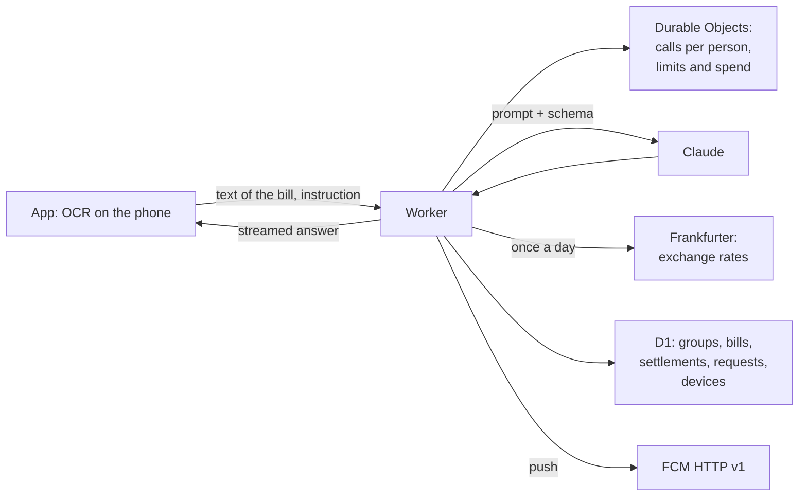

# AI proxy

The app never holds an Anthropic key. It sends the text it read from a bill to a small Cloudflare
Worker in [`proxy/`](../proxy), and the Worker asks Claude. The Worker holds the key, builds the
prompt and the answer schema, counts each person's calls, limits each network address, caps what
the whole service may spend in a day, and keeps nothing of the bill. It also hands the app the
day's exchange rates, keeps what signed-in people share (groups, their bills and settlements, and
payment requests) and sends their push notifications.



## What it does

| Route | Who calls it | What it answers |
|---|---|---|
| `POST /v1/bill-analysis` | the app, to read a bill | lines of JSON: `{"type":"wait"}` while the model works, then one `{"type":"result","answer":…,"usage":…}` or `{"type":"error","code":…}` |
| `POST /v1/session` | the app, after "Sign in with Google" | `{session, expiresAt, usage}`: a session the proxy signs, for 30 days |
| `GET /v1/usage` | Settings | `{usage, aiEnabled}`: the calls left and whether AI reading is on |
| `DELETE /v1/account` | Settings, "Delete account" | 204 once the account's counters, and its part in the shared data, are gone |
| `GET /v1/fx-rates` | the app, to convert between currencies | `{base, source, fetchedAt, rates}`: how much of each currency one euro buys, each rate with its day |
| `/v1/groups…`, `/v1/invites…`, `/v1/requests…`, `/v1/request-links…`, `/v1/devices…` | the app, signed in | the shared data, [below](#shared-data-groups-payment-requests-and-push) |
| `GET /.well-known/assetlinks.json`, `GET /g/{token}`, `GET /r/{token}` | Android, a browser | App Links, and a page for a link opened without the app |

Every request names its install with `X-SplitVibe-Install` (a random id the app makes for itself) and
its version with `X-SplitVibe-Version`; the exchange rates, the shared data and the links need
neither. A signed-in app adds `Authorization: Bearer <session>`, which is all the shared data
needs. The body of a bill read is exactly
[`sample_bill_request.json`](../app/src/sharedTest/resources/fixtures/sample_bill_request.json) in
shape; the app's and the proxy's tests both use that file. A bill photographed in several pages is
still one `ocrDocument`: `<bill_ocr pages="N">` holds one `<page n="…" rows="…">` per photo, in
order, with rows numbered from 1 and coordinates from 0 to 1000 within each page. A one-page bill
stays `<bill_ocr rows="N">` with its rows directly inside. The full contract of the bill read,
the session, usage and account routes, with every error code, is in
[the Phase 3 plan](../plans/261114-0220-split-vibe-production/phase-03-cloudflare-ai-proxy.md); the
exchange rates and their one error are described [below](#exchange-rates), and the shared data's
whole contract in [its own section](#shared-data-groups-payment-requests-and-push).

### Calls and limits

The numbers live in [`proxy/src/policy.ts`](../proxy/src/policy.ts) and change with a deploy.

- An install that has not signed in gets 3 calls, once. A Google account gets 10 calls each calendar
  month, counted in UTC.
- A call is held while the model works and charged once the model has answered, whatever the answer
  says, also when the app hung up, as long as the answer comes within 25 seconds of the hang-up.
  A call that got no answer is given back. The same request id is charged once however often it
  runs (at most three times), and it can only be used again for the same bill.
- Each network address may send 10 bill reads a minute and 100 a day, whoever sends them. IPv6
  counts by its /64.
- Spend is capped over each 24 hours: $3 per caller, $6 per address and $20 for the whole proxy.
  Each call holds the most it could cost, then settles at what it did cost. Also set a monthly spend
  limit in the Anthropic console.

### Exchange rates

`GET /v1/fx-rates` hands out how much of each currency one euro buys, from version 2 of the
[Frankfurter](https://frankfurter.dev) API, which gathers the reference rates of the European
Central Bank and of other central banks. Version 1 has only some 30 currencies and no dong, so it
is not used. Only fiat currencies are kept, with the euro at 1; the crypto assets and metals
Frankfurter also lists are dropped. Each rate keeps the day the source gives it for, which can be a
day or two behind the others.

One Durable Object, `FxBook`, holds the latest snapshot and when it was fetched. A cron fetches it
every day at 16:30 UTC, after the European Central Bank publishes, and a request that finds no
snapshot, or one a day old, fetches it first. A fetch that fails, takes more than 10 seconds or
answers with anything unexpected never replaces the snapshot: the route hands out the last one, and
`fetchedAt` shows its age. After a failed fetch, requests are answered from what is held for five
minutes before the source is asked again, so an outage of the source does not slow every request;
the cron always asks. Only when there has never been a snapshot does a failed fetch answer 503
`fx_unavailable`. An answer may be cached for an hour.

### What it keeps

Durable Objects hold counters only: calls used per install or per account, request ids for a day,
requests and spend per address. One more holds the latest exchange rates, which are public.
Objects are named by salted hashes, never by an IP address or a Google id. A request id is kept
with a salted hash of what it asked, so that it cannot be reused for another bill. Nothing of a
bill read, an instruction or a name is stored.

The shared data in D1 is what people chose to share, and no more: groups with the names members
typed for themselves and for placeholders, the bills put into a group, settlements, the group's
log, invites, payment requests with the one payment method each carries, the FCM token of each
signed-in install, and hourly counters. An account appears only as the salted hash a session
carries. No email, Google name or photo is stored, nor a person's list of payment methods, which
stays on the phone. Invite and request links are kept as SHA-256 hashes of their tokens. How
deleting an account changes the shared data is described [below](#deleting-an-account).

The Worker prints one log line per bill read: the outcome, whether the caller is an install or an
account, the model, the tokens, the cost and the time taken. For notifications it prints their
type and how many devices got them, never an id, a token or any text. Cloudflare's invocation
logs are off in `wrangler.jsonc`, because they record every request's headers, among them the
session and the IP address. Traces are on: they show how long each request, each call to Claude
and each Durable Object took, its outcome and its CPU time, with the country and city, the network
and the user agent, but no header values, no IP address and no body. Those CPU times tell whether
the free plan's limit is enough.

## Shared data: groups, payment requests and push

Signed-in people share groups and ask each other for money through the proxy. The data lives in
the D1 database `split-vibe`, bound as `DB`, with its schema in
[`proxy/migrations/`](../proxy/migrations). Every permission is checked in the Worker and covered
by its tests; the app is trusted with nothing.

### Conventions

- Every `/v1/` route here needs `Authorization: Bearer <session>`, and nothing else: no install
  id, no version. Without a session that checks out it answers 401 `{"error":"session"}`.
- Bodies are JSON objects; fields the contract does not name are ignored. Ids are UUIDs the app
  makes. Making something again under an id that already exists for the same caller answers as
  the first time did and changes nothing, so a lost answer can be retried.
- Money is a whole number of minor units, from 0 to 10^15 (`BillCurrency.MAX_AMOUNT_MINOR`); more
  is 400 `input`. A currency is `{"code":"VND","fractionDigits":0}`: three capital letters and 0 to
  3 digits. Names are trimmed and 1 to 60 characters (counted as code points), without control
  characters.
- Errors are `{"error": code}`: 400 `input`, 401 `session`, 403 `forbidden` (or `pending` for
  someone whose claim waits), 404 `not_found` (also for an id in the path that is not a UUID;
  for a `PUT`, which makes the thing, that is 400), 409 `conflict`, 410 `gone`, 413
  `too_large`, 429 `rate_limited` with `Retry-After` in seconds, 503 `not_configured`. Answers
  carry `cache-control: no-store`.

### A group's state

Most group routes answer with the group as the caller sees it:

```json
{
  "group": {"id": "…", "name": "…", "currency": {"code": "THB", "fractionDigits": 2}, "ownerMemberId": "…", "revision": 7, "createdAt": 1763180000000},
  "myMemberId": "…",
  "members": [{"id": "…", "name": "…", "hasAccount": true, "isOwner": false, "joinedAt": 1763180000000}],
  "claims": [{"memberId": "…", "claimantName": "…", "requestedAt": 1763180000000}],
  "bills": [{"id": "…", "ownerMemberId": "…", "revision": 2, "updatedAt": 1763180000000, "document": {}, "conversion": {"rate": "25350", "date": "2026-11-14", "source": "Frankfurter"}, "totalMinor": 902664, "shares": {"<memberId>": 300888}, "paid": {"<memberId>": 902664}}],
  "settlements": [{"id": "…", "fromMemberId": "…", "toMemberId": "…", "amountMinor": 1000, "recordedByMemberId": "…", "requestId": null, "createdAt": 1763180000000}],
  "log": [{"at": 1763180000000, "kind": "bill_added", "memberId": "…", "subjectId": "…"}]
}
```

- Times are epoch milliseconds. Members are in the order they joined (`joinedAt` is when the
  member was added and never changes), bills and settlements in the order they were made.
- `revision` moves on by exactly one at every change of the group's state, so the app can tell
  whether what it holds is current. Invites are not part of the state and do not move it.
- `claims` is filled for the owner only; everyone else gets `[]`.
- `bills` leaves out deleted bills. `document` is the JSON object the app sent, at most 64 KB
  serialized, returned as it was parsed (key order kept; a number is returned as JavaScript
  writes it). `conversion` is null when the bill is already in the group's currency.
- `log` holds the newest 100 entries, newest first. `memberId` is the member who acted, and
  `subjectId` what the entry is about:

| `kind` | `memberId` | `subjectId` |
|---|---|---|
| `group_created` | the creator | the group |
| `member_added` | who added the placeholder | the placeholder |
| `member_joined`, `member_left` | the member | the member |
| `member_renamed` | who renamed | the renamed member |
| `claim_requested` | the placeholder claimed (the claimant has no member yet) | the placeholder |
| `claim_approved`, `claim_rejected` | the owner | the placeholder |
| `bill_added`, `bill_changed`, `bill_deleted` | who did it | the bill |
| `settlement_recorded` | the member who was paid | the settlement |

Renaming the group moves its revision on but adds no entry to the log.

### Groups and members

| Route | Who may | Answer |
|---|---|---|
| `GET /v1/groups` | anyone | `{"groups":[{"id","name","currency","revision","myMemberId","status"}]}`: the groups the caller is a member of (`"member"`) or waits to join (`"pending"`, `myMemberId` null), oldest first |
| `POST /v1/groups` `{"id","name","currency","memberId","memberName"}` | anyone | 201 with the state; the caller is the owner and first member. The same id again from a member of that group: 201 with the state as it is; from anyone else: 409 |
| `GET /v1/groups/{gid}` | members | the state; 403 `forbidden` for others, 403 `pending` while one's claim waits |
| `PATCH /v1/groups/{gid}` `{"name"}` | the owner | the state |
| `POST /v1/groups/{gid}/members` `{"id","name"}` | members | the state with a new placeholder, a member without an account; an id the group has already changes nothing |
| `PATCH /v1/groups/{gid}/members/{mid}` `{"name"}` | that member, or the owner | the state |
| `POST /v1/groups/{gid}/leave` | members | 204 |

Leaving keeps the member as a placeholder, with its name and every amount, and takes the
caller's account off it. An owner who leaves hands the group to the member with an account who
joined first. When nobody with an account is left, the group is deleted with its members, claims,
invites, bills, settlements and log; payment requests made in it stay between their two people,
with `groupId`, `toMemberId` and `billId` set to null.

A group has at most 100 members, placeholders included, and 1,000 bills that are not deleted; an
account is in, or waits to join, at most 100 groups. Past these, 413 `too_large`.

### Invites and claims

| Route | Who may | Answer |
|---|---|---|
| `POST /v1/groups/{gid}/invites` | members | 201 `{"token","url","expiresAt"}`, with `url` `https://<the proxy's host>/g/{token}` |
| `DELETE /v1/groups/{gid}/invites` | the owner | 204; every invite of the group stops working |
| `GET /v1/invites/{token}` | anyone | `{"group":{"id","name","currency"},"placeholders":[{"id","name"}],"alreadyMember":bool}` |
| `POST /v1/invites/{token}/join` `{"memberId","name"}` | anyone | the state, with the caller as a new member |
| `POST /v1/invites/{token}/join` `{"claimMemberId","name"}` | anyone | 202 `{"status":"pending"}`; the owner is notified |
| `POST /v1/groups/{gid}/claims/{mid}/approve` | the owner | the state; the placeholder now has the claimant's account |
| `POST /v1/groups/{gid}/claims/{mid}/reject` | the owner | the state, without the claim |

- A token is 128 random bits in base64url (22 characters). Only its SHA-256 is kept. An invite
  works for 14 days; an unknown token is 404, an expired or revoked one 410 `gone`. An account
  may make 20 invites an hour over all its groups.
- A join body names `memberId` or `claimMemberId`, never both. A member who joins again gets the
  state whatever they send, and so never claims. A new member under an id the group has is 409.
- A claim asks to become a placeholder; `name` is shown to the owner as `claimantName`. Approving
  sets only the placeholder's account: its id, name and amounts stay. A claim on a member who has
  an account, or on a placeholder another account claims, is 409; an unknown member is 404. An
  account has one claim waiting per group: the same claim again answers 202 and notifies nobody,
  a claim on another placeholder is 409. Joining as a new member drops one's waiting claim.

### Bills and settlements

| Route | Who may | Answer |
|---|---|---|
| `PUT /v1/groups/{gid}/bills/{billId}` `{"expectedRevision","document","conversion","totalMinor","shares","paid"}` | members; an existing bill, the member it belongs to or the owner | the state |
| `DELETE /v1/groups/{gid}/bills/{billId}` | the member the bill belongs to, or the owner | the state |
| `POST /v1/groups/{gid}/settlements` `{"id","fromMemberId","amountMinor"}` | the member who received the money | the state |

- A new bill is sent with `expectedRevision` 0 and belongs to the caller's member. Otherwise
  `expectedRevision` must be the revision stored, or the answer is 409 `conflict`; the bill's
  revision becomes one more. The same change sent again, which finds the bill already at that
  revision with the same content, answers 200 and changes nothing.
- `shares` and `paid` map member ids of the group to amounts; each adds up to `totalMinor`
  exactly. A key that is not a member of the group, in its lower-case form, is 400.
- `conversion` is null or `{"rate","date","source"}`: a positive decimal number as text, a day
  `YYYY-MM-DD`, and a name of 1 to 60 characters.
- A deleted bill keeps its id: it cannot be sent again (409), and deleting it again changes
  nothing. What it held is emptied at once.
- A settlement goes from another member of the group to the caller's member, for more than 0.
  Settlements are only ever added: no route changes or deletes one, the database refuses to
  change or delete one (deleting the whole group aside), and the same id again from the same
  member changes nothing (from another, 409).

Changes to one group are decided on the group as it is: each goes in one batch behind an update
of the revision to the one read plus one, which a trigger refuses when another change came first.
The change is then read and decided again, up to 10 times, and only then answers 409.

### Payment requests

| Route | Who may | Answer |
|---|---|---|
| `POST /v1/requests` | anyone, as the creditor | 201 `{"request": RequestView, "url"}`, with `url` `https://<the proxy's host>/r/{token}` |
| `GET /v1/requests` | anyone | `{"requests":[RequestView]}`: those the caller made or is the debtor of, newest first, at most 200 |
| `GET /v1/request-links/{token}` | anyone | the request as the caller will see it once they accept: `role` `"debtor"`, `debtorBound` true; for its creditor, as theirs |
| `POST /v1/request-links/{token}/accept` | anyone but the creditor | the request, with the caller as its debtor |
| `POST /v1/requests/{id}/reported-paid` | the debtor | the request; the creditor is notified |
| `POST /v1/requests/{id}/confirmed-paid` | the creditor | the request; the debtor is notified |
| `PATCH /v1/requests/{id}` `{"remindEveryDays"}` | the creditor | the request |
| `DELETE /v1/requests/{id}` | the creditor, until it is confirmed | 204 |

A request is made with `{"id","amountMinor","currency","payerName","creditorName","method"}` and,
optionally, `"title"`, `"groupId"`, `"toMemberId"`, `"billId"` and `"remindEveryDays"`:

- `amountMinor` is more than 0. `payerName` is who should pay and `creditorName` the name the
  creditor wants them to see, both 1 to 60 characters. `title` says what it is for, 0 to 80
  characters; empty or missing is null. `method` is the one payment method the creditor chose,
  any JSON object of at most 4 KB (413 past that). These are kept as sent; they are what a person
  typed, so no notification ever carries them.
- With `groupId`, the caller must be a member, `toMemberId` another member of that group, and the
  currency the group's (else 400). A member with an account becomes the debtor at once and is
  notified. `toMemberId` without `groupId` is 400; `billId` is any UUID, kept for the app.
- `remindEveryDays` is 0, 1, 3 or 7; 0, the default, never reminds.
- A creditor may make 30 requests an hour. The same request sent again answers 201 with the same
  link, and is not counted; an id another creditor used is 409.

RequestView:

```json
{"id": "…", "role": "creditor", "amountMinor": 150000, "currency": {"code": "VND", "fractionDigits": 0}, "payerName": "Minh", "creditorName": "Lan", "title": "Hot pot", "method": {}, "groupId": null, "toMemberId": null, "billId": null, "createdAt": 1763180000000, "reportedPaidAt": null, "confirmedPaidAt": null, "remindEveryDays": 0, "debtorBound": false}
```

- Someone who is neither the creditor nor the debtor finds no request by its id (404), and the
  other side of one gets 403: a creditor cannot report it paid, a debtor cannot confirm it.
- A link is 404 when it was never made and 410 `gone` once its request was deleted. The first
  account to accept it is the debtor; to anyone else, reading or accepting it is then 409.
- Reported paid and confirmed paid are each set once; after a confirmation, reporting changes
  nothing. Confirming a request in a group records, in the same batch, one settlement from
  `toMemberId` to the creditor's member, recorded by the creditor's member, with `requestId` set.
  Confirming twice, even at once, records one. A confirmation and a withdrawal that come together
  are decided by whichever lands first: a withdrawn request is never confirmed (its confirmation
  answers 404 and records nothing), and a confirmed one is never withdrawn (409).
- A link's token is the first 128 bits of an HMAC-SHA-256 of `request-link:<creditor's
  account>:<request id>` under `HASH_SALT`, so the proxy can hand its creditor the same link
  again; only the token's SHA-256 is kept. Because the creditor is part of it, an id that is
  forgotten after a deletion and used again by another account gets another link, and the old
  link stays dead.
- A deleted request is emptied at once (method, names, title, debtor and group) and forgotten 30
  days later, after which its link is 404.

### Devices and push notifications

`PUT /v1/devices/{deviceId}` with `{"token"}` registers the FCM token (1 to 4096 characters) of one
install for the caller and answers 204; `DELETE /v1/devices/{deviceId}` stops it, 204 either way.
A token belongs to one account: when a phone changes accounts, the earlier registration of its
token goes. An account keeps its 10 most recent devices.

Notifications go through FCM HTTP v1 with the Google service account in the secret
`FCM_SERVICE_ACCOUNT`, the JSON key file Google hands out (`project_id`, `client_email` and
`private_key` are used). The Worker signs an RS256 JWT with it for
`https://oauth2.googleapis.com/token` with the scope
`https://www.googleapis.com/auth/firebase.messaging`, keeps the access token until five minutes
before it expires, and posts to
`https://fcm.googleapis.com/v1/projects/{project_id}/messages:send`. Without the secret nothing is
sent and everything else works the same. A notification that cannot go out never fails what it
tells of. A device is forgotten when FCM answers 404 `UNREGISTERED`, or 400 `INVALID_ARGUMENT`
about the registration token.

| `type` | Sent to | Title | Data |
|---|---|---|---|
| `request` | the debtor, when a group member with an account is the debtor at once | New payment request | `requestId` |
| `reported` | the creditor | Payment reported | `requestId` |
| `confirmed` | the debtor | Payment confirmed | `requestId` |
| `reminder` | the debtor | Payment reminder | `requestId` |
| `claim` | the group's owner | Someone asked to join | `groupId` |

The texts are fixed English strings in [`push.ts`](../proxy/src/push.ts), and the data is
`{"type", "requestId"}` or `{"type", "groupId"}`: no name, merchant, note, amount or link. While
the app is in the background, Android shows the notification itself, in the app's `requests`
channel; the app shows the same words when it is open.

### The daily run

The cron of `wrangler.jsonc` (16:30 UTC) fetches the exchange rates, and alongside:

- A request is due a reminder when it is neither confirmed nor reported paid, has a debtor and a
  creditor, reminds every N days, and had no reminder (nor was made) in the last N days, less an
  hour so that a run a little earlier than the day before still counts. Its debtor is notified
  and the request records when. One run sends at most 40 notifications, oldest due first, which
  keeps it under the free plan's 50 subrequests; the rest go the next day. Without push set up,
  nothing is sent or recorded.
- Invites and deleted requests are forgotten 30 days after they stopped working, and the hourly
  counters once their hour is over.

### App Links

`GET /.well-known/assetlinks.json` lets Android open the proxy's `/g/` and `/r/` links in the app.
It lists `com.dantech.splitvibe` and `com.dantech.splitvibe.dev`, each with every fingerprint in the
variable `ANDROID_CERT_SHA256` (comma-separated SHA-256 fingerprints, `AB:CD:…`, upper-cased by the
Worker; one that is not one is left out and logged). Without any, it is `[]`. `GET /g/{token}` and
`GET /r/{token}` answer, where the app does not open, the same short page for every link, saying to
open it on a phone with Split Vibe installed; it never looks the token up, so it shows nothing of
the group or the request. These three need no session and no install id.

### Deleting an account

`DELETE /v1/account` also takes the account out of the shared data, in one batch, without
changing anyone's balance: amounts and settlements stay as they are.

- Its members become placeholders named "Former member", keeping their ids; each group logs
  `member_left`. A group where nobody else has an account is deleted, as when its last account
  leaves.
- A group it owns passes to the member with an account who joined first, and its bills pass to
  the group's owner.
- Its claims, devices and hourly counters are deleted.
- On the requests it made, the payment method of each one not yet confirmed becomes `{}`, and
  `creditorName` becomes "Former member" on all of them. The account is then taken off every
  request, as creditor and as debtor: the other side keeps the request, nobody can act as the
  deleted account on it, and no reminder goes out for it. Signing in again with the same Google
  account finds none of it.

Sessions are not revoked: the proxy keeps no list of them, and a session it signed stays valid
until it expires, at most 30 days after it was issued. A session issued before the deletion can
therefore still do whatever a session can, as the same account: read bills on a new month's
calls, and make groups, requests and devices again, which a later sign-in would then find. The
app forgets its session when the account is deleted, so only a copy kept elsewhere, such as on a
second phone signed in to the same account, could still be used.

## Run it on a computer

Node 22 and npm. From `proxy/`:

```bash
npm ci
```

Make `proxy/.dev.vars`, which git ignores, with the three secrets the Worker needs:

```properties
ANTHROPIC_API_KEY=<your Anthropic key>
HASH_SALT=<at least 16 random characters>
SESSION_SIGNING_KEY=<at least 32 random characters>
```

`openssl rand -base64 32` makes a good salt or signing key. To try push notifications, also add
`FCM_SERVICE_ACCOUNT` with the service account's key file on one line; without it, nothing is sent.
`wrangler dev` keeps the D1 database on the computer, under `proxy/.wrangler/`; give it the schema
once, and again after a new migration:

```bash
npx wrangler d1 migrations apply split-vibe --local
```

Then start it on port 8787:

```bash
npm run dev
```

A debug build of the app reaches it at `http://127.0.0.1:8787` once the phone or emulator forwards
that port to the computer:

```bash
adb reverse tcp:8787 tcp:8787
```

To sign in from a debug build, also put the web client ID (see below) into `GOOGLE_CLIENT_ID` in
`wrangler.jsonc` and into `local.properties`.

### Tests

```bash
npm run typecheck
```

```bash
npm test
```

The tests run the Worker and its Durable Objects in the workers runtime against a fake model that
streams the way the Messages API does and a fake Frankfurter, so they need no key and no network.
Each test starts from an empty local D1 database with the migrations of `proxy/migrations/`
applied, and push goes to a fake of Google's token endpoint and of FCM, which checks the signed
token request. GitHub Actions runs both for every pull request.

## Deploy it

These steps need the owner's accounts.

1. **Google sign-in.** In Google Cloud, under Google Auth Platform, create an OAuth client of type
   *Web application*: its client ID is the app's web client ID. Create one of type *Android* for
   each key that signs the app, with the package name and the key's SHA-1: the debug key for
   `com.dantech.splitvibe.dev`, and for `com.dantech.splitvibe` the upload key (for release builds
   installed by hand) and the Play app signing key (for the app as Play delivers it).
2. **Cloudflare.** From `proxy/`, sign in with `npx wrangler login`. Put the web client ID into
   `GOOGLE_CLIENT_ID` in `wrangler.jsonc`; it is public. Set the three secrets, each of which asks
   for its value without echoing it:

   ```bash
   npx wrangler secret put ANTHROPIC_API_KEY
   ```

   ```bash
   npx wrangler secret put HASH_SALT
   ```

   ```bash
   npx wrangler secret put SESSION_SIGNING_KEY
   ```

3. **Shared data.** The D1 database `split-vibe` is already named in `wrangler.jsonc` by its id.
   Before a deploy that needs a new migration, apply the migrations of `proxy/migrations/` to it;
   Wrangler lists those not yet applied and asks before it applies them:

   ```bash
   npx wrangler d1 migrations apply split-vibe --remote
   ```

   For push notifications, make a service account in the Firebase project that may send FCM
   messages (the project's Firebase Admin SDK account may), download a JSON key for it, and set the
   whole file as a secret. Without it, the proxy sends no notification and everything else works.

   ```bash
   npx wrangler secret put FCM_SERVICE_ACCOUNT < service-account.json
   ```

   Delete the key file afterwards. For App Links, put the SHA-256 fingerprints of the keys that sign
   the app (the debug key, the upload key and the Play app signing key) into `ANDROID_CERT_SHA256`
   in `wrangler.jsonc`, separated by commas; they are public. `keytool -list -v` prints them, and
   Play Console shows the app signing key's.

4. Deploy:

   ```bash
   npx wrangler deploy
   ```

   The deploy also adds the `FxBook` class of Durable Objects (migration `v2`) and sets the daily
   cron in `triggers.crons` of `wrangler.jsonc`, which fetches the exchange rates and sends the
   reminders. A new or changed cron can take up to 15 minutes to start; until it first runs, the
   first request for the rates fetches them.

5. **The app.** Put the Worker's address and the web client ID into `local.properties` before a
   release build. A release build refuses an address that is not https, and every build stops at
   a value with a placeholder such as `<your-subdomain>` still in it.

   ```properties
   splitvibe.aiProxyUrl=https://split-vibe-proxy.<your-subdomain>.workers.dev
   splitvibe.googleWebClientId=<web client ID>.apps.googleusercontent.com
   ```

The Workers free plan allows 10 ms of CPU time per request. A long answer may need more; if the
Worker's logs show CPU limit errors, move to the paid plan.

Never keep a secret in `wrangler.jsonc`, in `local.properties` that is committed, or in a workflow.
`HASH_SALT` must not change once the proxy is live: every count and every account in the shared
data is named by it, and every payment request link is made with it.

## Switches

Two variables in `wrangler.jsonc` change behaviour without a new app:

- `AI_ENABLED`: bill reading works only while it is exactly `"true"`. Anything else answers 503
  `ai_off`, and the app tells the person AI reading is switched off.
- `MIN_APP_VERSION`: an app with a lower version code gets 426 `update_required` on a bill read.
  Signing in, the calls left, the exchange rates, the shared data and deleting the account keep
  working for old apps.

Change either in `wrangler.jsonc` and deploy, or under the Worker's settings in the Cloudflare
dashboard; a deploy from `wrangler.jsonc` sets them back to the file's values.

## Changing the prompt or the model

The prompt is [`proxy/src/prompt.ts`](../proxy/src/prompt.ts) and the answer schema
[`proxy/src/schema.ts`](../proxy/src/schema.ts). The app's `BillAnalysisParser` in `:core:domain`
reads that schema, so a field the parser does not know is ignored and a field it needs must stay.
The model, its effort and `max_tokens` are in `policy.ts`; a new model also needs its price in
`proxy/src/spend.ts`, or its calls are counted at the highest list price.
