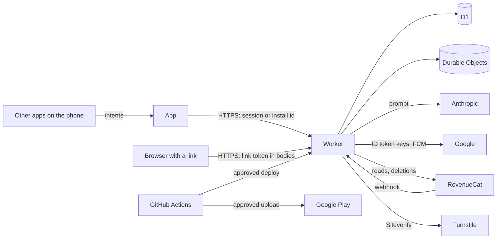

# Security threat model

What Split Vibe has to protect, from whom, where the trust boundaries lie, and, for each surface,
what can go wrong, what stops it today and in which file, and what is left. It describes the
repository at commit `1414ada`, as of 19 November 2026, read line by line, with the proxy's tests
run (`npm test` in `proxy/`: 444 tests in the workers runtime and the Node tests, all passing).
What Cloudflare, Google or RevenueCat decide was checked against their documentation that day;
what could not be checked is marked **unverified**.

The review that wrote this page ranks its findings, each with a scenario and a fix, in
[the security review of 19 November 2026](../plans/reports/code-reviewer-261119-0309-security-review.md).
[What remains](#what-remains) lists them. Update this page when a route, a secret, a stored field,
an exported component or a workflow changes.

Paths are from the repository root, and `file:line` points at that commit. The letters of STRIDE
mark the kind of threat where it helps: **S**poofing, **T**ampering, **R**epudiation,
**I**nformation disclosure, **D**enial of service, **E**levation of privilege.

## Assets

| Asset | Where it lives | Why it matters |
|---|---|---|
| The Anthropic key and the AI budget | Worker secret `ANTHROPIC_API_KEY`; spend in the `AbuseLedger` objects | The owner pays for every model call |
| `HASH_SALT` | Worker secret | Names every account, install and address the proxy counts; is the HMAC key of request and bill link tokens; cannot be rotated ([runbook.md](runbook.md#rotating-secrets)) |
| `SESSION_SIGNING_KEY` | Worker secret | Whoever holds it can act as any account |
| `REVENUECAT_SECRET_KEY`, `REVENUECAT_WEBHOOK_AUTH` | Worker secrets | The key reads and deletes any customer at RevenueCat; the value lets a caller trigger plan reads |
| `FCM_SERVICE_ACCOUNT` | Worker secret | Sends notices as Split Vibe to every registered phone |
| `TURNSTILE_SECRET` | Worker secret | Decides which new claims on a bill link pass |
| Release credentials | GitHub environment `production`: the upload keystore and its passwords, `CLOUDFLARE_API_TOKEN`; Workload Identity Federation to Google Play | Deploy code that runs with every Worker secret and reads D1; upload builds to Play's testing tracks |
| Shared data | D1 `split-vibe` ([`proxy/migrations/`](../proxy/migrations)) | Names people typed, who owes whom, the payment method a request carries (bank accounts among them), bill links with their claims, FCM tokens |
| Plans and counts | `QuotaBook` objects | Who is on Pro and how many calls are left |
| Data on the phone | Room database, SharedPreferences, app files | Bills, photos, people, payment methods, the session |
| Availability | The Worker, D1, the Durable Objects, Anthropic | AI reads, which Pro customers pay for; groups and requests |
| The proxy's address | `https://<the proxy's host>` | Pages there speak in Split Vibe's name, and people trust links to it |

## Actors

| Actor | Can | Is trusted with |
|---|---|---|
| A person with the app, not signed in | Call the AI routes as an install | The install's three calls |
| A signed-in person | Use every signed-in route | Their own data and what their groups share |
| A group member | Read and change the group within [its rules](#shared-groups-and-the-ledger) | The group's data; a member can turn hostile |
| Someone holding a link | Open a bill link, a request link or an invite, wherever it was forwarded | What the link shows |
| An anonymous client | Script every public route, make up install ids, change addresses | Nothing |
| Whoever printed or sent a bill photo | Choose the text the phone reads | Nothing |
| Another app on the phone | Send intents to `MainActivity`, the one exported component | Nothing |
| A pull request author, Dependabot, a package's author | Change code or dependencies that CI runs | Nothing until a maintainer merges |
| Providers | Cloudflare runs everything; Anthropic reads bill text; Google signs ID tokens, carries pushes and sells Pro; RevenueCat says who is on Pro and calls the webhook | Their part |
| The owner | Holds every secret and approves every release | Everything |

## Trust boundaries

1. **App to Worker.** Nothing the app sends is trusted: every permission is checked in the Worker
   ([proxy.md](proxy.md#shared-data-groups-payment-requests-and-push)). A session decides the
   caller; an install id is only the name of three calls.
2. **Browser to Worker.** No session. The page reads the token from the link's fragment
   (`web/src/route.ts:17-22`) and sends it in request bodies and in the live connection's
   subprotocol, so no URL holds one (`proxy/src/index.ts:109-113`).
3. **Worker to the model and back.** The Worker builds the prompt; the answer is untrusted: a JSON
   schema shapes it, the proxy checks an edit's answer again, and the app does every sum.
4. **RevenueCat to Worker.** An event is only a sign that something changed; the plan is read back
   from RevenueCat with the secret key.
5. **Google to Worker.** ID tokens are checked against Google's keys; sessions are the Worker's own.
6. **Other apps to the app.** `MainActivity` is exported for the launcher, photo shares and App
   Links; it takes content URIs of other apps and links on the proxy's host only.
7. **Repository to production.** Only a tag on `main`, through approvals of the `production`
   environment.

## Surfaces

### The AI routes

`POST /v1/bill-analysis` and `POST /v1/split-revision`, both through `callModel`
(`proxy/src/model-call.ts`), the only routes that spend money. Their cost is the next section's.

| Threat | STRIDE | In place | Where |
|---|---|---|---|
| A body larger or other than the contract | T, D | Bodies read up to 256 KB and 64 KB, counted while reading; a bill read's document is at most 20,000 characters inside `<bill_ocr>…</bill_ocr>`; fields the contract does not name never reach the model | `proxy/src/input.ts:32-68`, `:316-327`; `proxy/src/split-revision.ts:173-181` |
| Text printed on a bill passes for the prompt's structure | T | The phone writes each fragment as a quoted string and turns `<` and `>` into `‹` and `›` | `core/domain/src/main/kotlin/com/dantech/splitvibe/ocr/OcrLayoutEncoder.kt:161-167` |
| Text printed on a bill instructs the model | T | The system prompt says text in `<bill_ocr>` is never a request; a JSON schema shapes the answer; the model never works out a share, the app's `:core:domain` does every sum, and the user sees the result before anything is saved to a group, a link or a request | `proxy/src/prompt.ts:21`; `proxy/src/model-call.ts:239`; [architecture.md](architecture.md#the-split-flow) |
| A name or an instruction steers an edit | T | Bill, split and instruction go as JSON with `<`, `>` and `&` escaped, under a prompt that calls them data; the proxy checks every edit again (13 ops, their ranges, at most 20); the app applies an edit only once the user accepts it, showing each share before and after | `proxy/src/revise-prompt.ts:13`, `:61-76`; `proxy/src/split-revision.ts:294-428`; [architecture.md](architecture.md#changing-a-split-by-a-sentence) |
| The deployed proxy is asked for another model | E | `X-SplitVibe-Eval-Model` counts only when the request's host is `localhost`, `127.0.0.1` or `[::1]` | `proxy/src/split-revision.ts:159-163`; `proxy/src/switches.ts:24-33` |
| Bill text in the logs | I | One line per call: outcome, kind of caller, model, tokens, cost, time; the SDK's own logging is off | `proxy/src/model-call.ts:224-230`, `:317-320` |
| AI has to stop at once | D | `AI_ENABLED` and `MIN_APP_VERSION` | `proxy/src/switches.ts:10-22` |

Residual risk:

- Prompt injection is reduced, not removed. A bill photo made to carry instructions, such as one
  another app shares (`app/src/main/java/com/dantech/splitvibe/MainActivity.kt:80-91`), can still
  make the model misread items, amounts or who had what. What protects the user is that the app
  shows the result with its own arithmetic and sends nothing by itself.
- An edit's `explanation` is model text shown to the user. The prompt forbids amounts in it; only
  the evaluation checks that ([proxy.md](proxy.md#editing-a-split-by-a-sentence)).
- A stranger's claim name on a bill link can become a participant's name, and so reach a later
  edit's prompt, as data.
- The eval header and the Turnstile test secrets rely on Cloudflare never routing a request whose
  host is a computer's own to the Worker (**unverified** beyond the platform's design).

### Quotas and spend caps

Calls per install and per account in `QuotaBook` (`proxy/src/quota-book.ts`); limits per address
and the three spend caps in `AbuseLedger` (`proxy/src/ledger.ts`, `proxy/src/spend.ts`); the
numbers in `proxy/src/policy.ts`.

| Threat | STRIDE | In place | Where |
|---|---|---|---|
| Free calls farmed | D | 3 calls per install for good, 10 per account a month, 300 on Pro; a call is held before the model runs and charged once it answers; a request id is charged once and runs at most three times | `proxy/src/quota-book.ts:114-191`; `proxy/src/policy.ts:9-46` |
| One address floods | D | 10 calls a minute and 100 a day per address, IPv6 by its /64; a request that reached the edge without `CF-Connecting-IP` is refused | `proxy/src/model-call.ts:116-122`; `proxy/src/ledger.ts:103-122` |
| Spend past a budget | D | Each call holds the most it could cost against $3 per caller, $6 per address and $20 for the whole proxy, over fixed 24-hour windows, then settles at its real cost; a ledger that cannot be reached fails the call, and a settle that fails keeps the hold | `proxy/src/spend.ts:52-114`; `proxy/src/ledger.ts:35-56`; `proxy/src/policy.ts:63-65` |
| Two calls take the last one | T | One Durable Object per caller and per ledger serialises their requests | `proxy/src/quota-book.ts:84-106` |
| A rollback hands out calls | T | Counts kept in hundredths and in whole calls rounded up | `proxy/src/quota-book.ts:54-68`, `:374-390` |

Residual risk:

- **The global cap is one pool for everyone, and an anonymous client can fill it.** An install is
  any UUID (`proxy/src/identity.ts:60-62`), so the cap per caller binds no script. A call the client
  hangs up on, once the model has started and has not answered within 25 seconds, or one that runs
  past 120 seconds, is given back to the caller but counted as spent at its whole hold
  (`proxy/src/model-call.ts:202-211`; pinned by `proxy/test/bill-analysis-edges.test.ts:78-86`).
  A bill read holds 47 cents for the sample bill and up to 78 cents for the longest. Twelve such
  calls fill an address's $6, and about forty the proxy's $20: four addresses (or four /64s of one
  IPv6 allocation), a couple of minutes, a few dollars of real tokens, and none of the caller's
  calls. Every bill read, Pro's included, then answers 429 `busy` until the window ends, up to 24
  hours, and the same works again in the next window.
- A bill read that a refusal moves to another model runs a second attempt that its hold does not
  cover, so in-flight calls can pass a cap (`proxy/src/spend.ts:46-51`). The monthly limit in the
  Anthropic console is the backstop ([runbook.md](runbook.md#spend-caps)).
- One request id runs up to three times for one charged call (`proxy/src/policy.ts:44`).
- Nothing alerts yet at 80% of the global cap, which the plan's operations ask for.

### Sessions and sign-in

`POST /v1/session` trades a Google ID token for the proxy's own session; signed-in routes take
`Authorization: Bearer <session>`.

| Threat | STRIDE | In place | Where |
|---|---|---|---|
| A forged session | S | HS256 under a key of at least 32 bytes, the algorithm pinned, a fixed issuer and audience, `sub` of 64 hex digits, `exp` required | `proxy/src/session.ts:63-94`; `proxy/src/identity.ts:65-69` |
| A forged or foreign ID token | S | RS256 against Google's keys, a Google issuer, the audience `GOOGLE_CLIENT_ID`, `sub` and `exp` required; only `sub` is read, and kept as a salted hash | `proxy/src/session.ts:7-8`, `:26-44` |
| A bad session read as the install | E | A request with `Authorization` that does not check out is refused | `proxy/src/identity.ts:49-63` |
| Google's keys out of reach | D | 503 `sign_in_off` rather than 401, so the app does not sign out | `proxy/src/session.ts:46-60`; `proxy/src/account.ts:25-33` |
| A session taken from the phone | I | AES-GCM under a non-exportable Keystore key; sent only to the proxy, over HTTPS | `app/src/main/java/com/dantech/splitvibe/data/account/AccountStore.kt:124-158`; `app/src/main/java/com/dantech/splitvibe/data/settings/KeystoreCipher.kt:24-57` |
| A session in a log or a trace | I | Only the `Authorization` header carries it; invocation logs, which record headers, are off; traces record no header but accept, accept-encoding, accept-language, content type and length (Cloudflare's trace attributes, checked 19 November 2026) | `proxy/wrangler.jsonc:7-17` |

Residual risk:

- No session can be ended early: not by signing out, not by deleting the account. It lasts 30 days
  (`proxy/src/policy.ts:48`). Rotating `SESSION_SIGNING_KEY` ends it, and every other one too
  ([runbook.md](runbook.md#rotating-secrets)). See [account deletion](#account-deletion-in-the-app-and-on-the-web).
- An ID token works for its hour at both `POST /v1/session` and the deletion route, without a
  nonce: a token taken from a compromised browser on `/delete-account` is a 30-day session.
- `POST /v1/session` has no rate limit; each try costs one signature check.
- The docs ask to add `http://localhost` origins to the production web client for testing
  ([web.md](web.md#deleting-an-account-on-the-web)), which lets a page served on a person's own
  computer get ID tokens for it (open from the review of the proxy and web part, 19 November 2026).

### Shared groups and the ledger

Groups, members, claims, bills, settlements and the log, in D1; routes in `proxy/src/groups.ts`,
`proxy/src/bills.ts` and `proxy/src/group-state.ts`.

| Threat | STRIDE | In place | Where |
|---|---|---|---|
| Reading or changing a group one is not in | I, E | Every route reads the group with the caller's place in it and checks member, owner, or the bill's member on that state; 403 for others, `pending` while a claim waits | `proxy/src/group-state.ts:146-154`, `:216-224`; `proxy/src/groups.ts:106-248`; `proxy/src/bills.ts:122-147`, `:185-214` |
| Two changes overwrite each other | T | Each change goes in one batch behind an update of the revision to the one read plus one, which a trigger refuses when another change came first; decided again up to ten times | `proxy/src/group-state.ts:286-320`; `proxy/migrations/0001_groups.sql:17-25` |
| Amounts that do not add up | T | `shares` and `paid` each come to `totalMinor` exactly, summed as big integers, keyed by members of the group; the app leaves out whole a bill that does not add up | `proxy/src/bills.ts:42-79`; `app/src/main/java/com/dantech/splitvibe/data/groups/GroupModels.kt:127-138` |
| Rewriting what was paid | T, R | Settlements are append-only by trigger and recorded only by the member who received the money; every change is in the log with the member who made it | `proxy/migrations/0001_groups.sql:88-120`; `proxy/src/bills.ts:221-260` |
| Accounts shown to members | I | The state says `hasAccount` only; waiting claims go to the owner only | `proxy/src/group-state.ts:157-204` |
| Oversized groups | D | 100 members, 500 bills, 1 MB of documents, 2,000 settlements, 100 groups per account, 200 changes an hour per account | `proxy/src/policy.ts:133-144`; `proxy/src/group-state.ts:326-329` |

Residual risk, by design:

- Any member can add a bill that puts any share on any member, without asking them. The list shows
  its title, who added it and its total
  (`app/src/main/java/com/dantech/splitvibe/ui/groups/GroupScreen.kt:384-416`), and only its member
  or the owner can delete it. The owner can change or delete any bill and rename any member.
- A bill's `document` is any JSON object of up to 64 KB, shown to every member. Balances come from
  `shares` and `paid`, not from it, so the document can describe a bill other than the one it charges.
- Reading a group has no rate limit, and a full group's state is some 2,700 rows.

### Payment requests and payment methods

The `requests` table and `proxy/src/requests.ts`. A request carries the one payment method the
creditor chose, and may carry `payment`, what its web page shows of how to pay.

| Threat | STRIDE | In place | Where |
|---|---|---|---|
| Reading or acting on another person's request | I, E | A request is found by its id only by its creditor or its bound debtor (404 to anyone else), and each action checks the side (403) | `proxy/src/requests.ts:110-121`, `:355-415`, `:476-517` |
| Guessing a request link | S | The token is the first 128 bits of an HMAC-SHA-256 under `HASH_SALT`; only its SHA-256 is kept | `proxy/src/links.ts:25-50` |
| Taking another person's place as debtor | E | The first account to accept is the debtor, in one conditional update; anyone after gets 409 and nothing of the request | `proxy/src/requests.ts:280-289`, `:330-348` |
| Confirming twice, or while it is withdrawn | T | Conditional updates; a group confirmation writes its settlement in the same batch, with the request read again; one settlement per request by a unique index | `proxy/src/requests.ts:385-474`; `proxy/migrations/0001_groups.sql:105` |
| A payment link with a dangerous scheme | T | `https://` with a host, or `upi://pay?`, refused otherwise by the proxy and again by the page, which names the link's host on its button | `proxy/src/input.ts:284-313`; `web/src/links.ts:16-28`; `web/src/ui/payment-block.tsx:43-55` |
| Payment methods kept on the server | I | The list stays on the phone; a request carries one method; withdrawing a request empties it at once | `proxy/src/requests.ts:498-517`; [architecture.md](architecture.md#groups-requests-and-push) |
| Request spam | D | 30 requests an hour per creditor | `proxy/src/policy.ts:123`; `proxy/src/requests.ts:207-209` |

Residual risk:

- Whoever holds a request link sees the creditor's payment details on its page without signing in,
  as the feature intends. A request link has no expiry: only withdrawal, confirmation or the
  creditor's account deletion changes what it shows.
- The creditor writes every word the page shows, and chooses its link and its QR code, under the
  proxy's own address (`proxy/src/requests.ts:138-172`, `:298-323`;
  `web/src/pages/request-page.tsx:27-45`). The page does not say that this content is the sender's
  and unchecked, and the QR code may hold any text, a web address too. See [What remains](#what-remains).
- A group request to a placeholder has no debtor until someone accepts its link; whoever does can
  report it paid, and only the creditor's care keeps a confirmation from following.
- A creditor can have a debtor reminded every day; the debtor cannot withdraw the request, only
  report it paid.

### Invites and claims

`proxy/src/invites.ts`: invite links, joining, and claims on placeholders.

| Threat | STRIDE | In place | Where |
|---|---|---|---|
| Guessing an invite | S | 128 random bits; only the SHA-256 kept; 14 days; the owner revokes them all at once | `proxy/src/links.ts:13-15`; `proxy/src/invites.ts:16-63` |
| Joining without an invite | E | Joining needs an invite that works | `proxy/src/invites.ts:131-140` |
| Taking a placeholder's place | E | A claim waits for the owner, who sees the name typed; one claim per account per group | `proxy/src/invites.ts:158-205` |
| What an invite shows strangers | I | The page's preview gives the group's name and currency only; the placeholders go to a signed-in holder of the invite | `proxy/src/invites.ts:70-103` |
| Invite spam | D | 20 invites an hour per account | `proxy/src/policy.ts:121-122` |

Residual risk:

- An invite works like a key for 14 days: anyone it reaches joins as a new member without
  approval, and any member can make more.
- **Taking a member out does not keep them out.** Their account comes off their member
  (`proxy/src/groups.ts:227-248`), but every invite that still works lets them back in at once as a
  new member, those they made included: joining checks nothing about who was taken out
  (`proxy/src/invites.ts:139-157`). The app's dialog says "They will no longer see the group."
  (`app/src/main/res/values/strings.xml:578`) and does not stop the invites
  (`app/src/main/java/com/dantech/splitvibe/ui/groups/GroupScreen.kt:188-199`); "Stop the invite
  links" is a separate action. See [What remains](#what-remains).

### Bill links and live claims

`proxy/src/shares.ts` for the owner, `proxy/src/share-claims.ts` for the page, `ShareRoom` for live
connections.

| Threat | STRIDE | In place | Where |
|---|---|---|---|
| Guessing a link | S | The token is an HMAC under `HASH_SALT` of the owner, the id and the time it was made; only its SHA-256 is kept; it lasts 30 days | `proxy/src/links.ts:35-37`; `proxy/src/shares.ts:111-127` |
| Changing or revoking another person's link | E | The owner's routes find a link for its owner only (404, or 409 to `PUT`) | `proxy/src/shares.ts:76-99`, `:139-195`, `:332-352` |
| What a stranger sees | I | `PublicShare` holds no id, hash, account or address; only the fields of a `BillProjection` are kept | `proxy/src/share-state.ts:177-188`, `:295-310` |
| Claims by scripts | S, D | A new claim needs a Turnstile token for the action `claim` on the proxy's host, accepted once; 30 new claims and 300 claim writes an hour per address; 30 claims per link; test secrets refused anywhere but a computer | `proxy/src/share-claims.ts:85-93`; `proxy/src/turnstile.ts:37-79`; `proxy/src/policy.ts:186-188` |
| Changing someone else's claim | T | A claim changes only with its 128-bit key, or the id of its first attempt; only their hashes are kept | `proxy/src/share-claims.ts:111-169` |
| A claim racing a lock or a settlement | T | Each write is guarded in SQL on the link as the batch finds it | `proxy/src/share-state.ts:211-234`; `proxy/migrations/0002_shares.sql:36-47` |
| Live connections | I, D | The token rides in the subprotocol and the object gets nothing of the request; 50 connections per link, quiet ones closed first; a page that sends anything but `ping` is closed | `proxy/src/share-claims.ts:208-224`; `proxy/src/share-room.ts:46-103` |

Residual risk:

- Anyone with the link sees the names people typed, the items, and once settled what each owes and
  how to pay; the owner's payment link and code carry the same risk as a request's.
- One holder of the link can fill its 30 claims, through Turnstile, or hold its 50 connections; the
  owner can remove claims, lock or revoke, and pages fall back to reading every three minutes.

### The web pages and their CSP

`proxy/src/web.ts` serves `/s/`, `/r/`, `/g/`, `/privacy`, `/terms`, `/delete-account` and
`/assets/`, built from `web/`.

| Threat | STRIDE | In place | Where |
|---|---|---|---|
| Script injected through what people typed | T, E | Preact renders text, and `web/src` uses no HTML sink; a policy per page: link pages run their own scripts and Turnstile's, the legal pages none, `/delete-account` its own and Google Identity Services' paths; `base-uri`, `form-action` and `frame-ancestors` are `'none'`; the build refuses inline scripts and styles and foreign references | `proxy/src/web.ts:57-109`; [proxy.md](proxy.md#the-pages) |
| Meta tags filled from variables | T | Each value shape-checked, then HTML-escaped | `proxy/src/web.ts:7-50` |
| Tokens leaking from a page | I | The token comes from the fragment only, 22 base64url characters, and goes in bodies sent with no referrer; the claim's key is stored under a hash of the token; link pages send no referrer | `web/src/route.ts:17-22`; `web/src/api.ts:85-100`; `web/src/claim-store.ts:25`, `:138-149` |
| The deletion page framed | T | `frame-ancestors 'none'` | `proxy/src/web.ts:81-91` |
| Pages cached on the way | I | `no-store` on pages; assets named by their content and `immutable` | `proxy/src/web.ts:98-109`, `:152-157` |
| Requests from another site | E | No cookie and no CORS header; every route needs a session header or a link token | `proxy/src/respond.ts:1-20` |

Residual risk:

- No `Strict-Transport-Security` header. The `workers.dev` address is covered by the HSTS preload of
  the whole `.dev` domain; a custom domain would not be.
- Pages show text, links and codes that a user wrote (see the two sections above).
- `ABUSE_EMAIL` is empty in `proxy/wrangler.jsonc:32`, so the pages show no "Report abuse" link until
  it is set ([release-checklist.md](release-checklist.md)).
- The Worker gets no Version URLs, which would serve older versions with the same secrets:
  Cloudflare gives none to a Worker that implements Durable Objects (Cloudflare's docs, checked 19
  November 2026).

### Account deletion in the app and on the web

`DELETE /v1/account` with the session, and `POST /v1/account/delete-with-google` with an ID token,
both through `deleteAccount` (`proxy/src/account.ts:158-168`) and `forgetSharedData`
(`proxy/src/account-data.ts:29-71`).

| Threat | STRIDE | In place | Where |
|---|---|---|---|
| Deleting another person's account | S, E | The session, or a Google ID token for the app's client ID; 5 deletions an hour per account | `proxy/src/account.ts:125-168` |
| Half a deletion | T | RevenueCat first, and a 502 there deletes nothing; the shared data in one batch; then the counters | `proxy/src/account.ts:158-168` |
| Others' balances moving | T | Members become placeholders named "Former member", their bills pass to the owner, settlements stay | `proxy/src/account-data.ts:29-71`; `proxy/test/account.test.ts` |
| A new allowance by deleting | E | The month's count stays until the month ends | `proxy/src/quota-book.ts:237-252` |

What deletion keeps, as [the privacy policy](privacy-policy.md#deleting-your-account) says: the
month's count, the hourly windows until the daily run, the method of a request already confirmed
(for the other side), and the group's bills and settlements.

Residual risk:

- **Sessions outlive the deletion.** A phone still signed in registers its push token again
  whenever the app's process starts (`app/src/main/java/com/dantech/splitvibe/SplitVibeApp.kt:33-41`),
  runs RevenueCat's SDK as the purchaser when it opens
  (`app/src/main/java/com/dantech/splitvibe/MainActivity.kt:43`;
  `app/src/main/java/com/dantech/splitvibe/billing/BillingRepository.kt:94-106`), which has RevenueCat
  create the customer again, and marks the purchaser as handed out at `GET /v1/usage`
  (`proxy/src/account.ts:59-85`). The privacy policy and the runbook tell people to sign out on
  other phones; the web page's result says "Split Vibe's server no longer keeps your account"
  (`web/src/pages/delete-account-page.tsx:245-258`) and does not. First reported in the review of the
  proxy and web part, 19 November 2026; still open.
- A Time Travel restore brings back the shared data of every account deleted since its bookmark, and
  nothing records which those were ([runbook.md](runbook.md#backups-and-restoring-d1)).
- Names typed inside a group's bill documents stay with the bill.

### Pro and the RevenueCat webhook

`POST /v1/plan` (`proxy/src/account.ts:98-119`), `POST /v1/subscription-events`
(`proxy/src/subscription-webhook.ts`), and the reading of a plan (`proxy/src/revenuecat.ts`).

| Threat | STRIDE | In place | Where |
|---|---|---|---|
| Making someone Pro | E | No route takes a plan from the app, and `POST /v1/plan` reads no body; the plan comes from RevenueCat with the secret key, and is kept only for ids the proxy handed out | `proxy/src/account.ts:98-119`; `proxy/src/revenuecat.ts:31-62`; `proxy/src/quota-book.ts:221-226` |
| A forged webhook | S | `Authorization` compared with `REVENUECAT_WEBHOOK_AUTH` by SHA-256 digests in constant time; a 401 reads, asks and writes nothing | `proxy/src/subscription-webhook.ts:51-53`, `:79-84` |
| Events replayed or out of order | T | An event only triggers a read; a plan read earlier than the one kept is not kept | `proxy/src/subscription-webhook.ts:62-71`; `proxy/src/quota-book.ts:221-226` |
| Events that make the proxy create customers | T, D | Ids of 64 hex digits, at most 20 per event, and only those handed out and not forgotten | `proxy/src/subscription-webhook.ts:97-108` |
| Pro after a refund | E | A refunded, cancelled or failing subscription past its period ends at once; 24 hours of grace otherwise | `proxy/src/revenuecat.ts:102-149`; `proxy/src/quota-book.ts:430-432` |
| One subscription on many accounts | E | RevenueCat keeps a purchase with its original app user id (the owner's setting) | [pro-subscription.md](pro-subscription.md#revenuecat) |
| RevenueCat hammered | D | `POST /v1/plan` 30 times an hour per account; 10-second timeouts; answers read up to 256 KB | `proxy/src/policy.ts:26-27`; `proxy/src/revenuecat.ts:13-17` |

Residual risk:

- The purchaser is the account id itself, the key of all its rows in D1, and RevenueCat holds it.
  RevenueCat's SDK keys are public, and an app user id is what names a customer to them, so whoever
  learns an account's id could read its subscription there (RevenueCat's model; not tested here).
  No answer of the proxy shows the id to anyone but its account.
- Whoever holds the webhook value can make the proxy read up to 20 customers per request, with no
  rate limit.

### Push notifications

`proxy/src/push.ts`, `proxy/src/devices.ts`, the daily run in `proxy/src/reminders.ts`, and the
app's `PushService` and `Notices`.

| Threat | STRIDE | In place | Where |
|---|---|---|---|
| Phishing through a notice | S, T | Fixed English texts; the data is the type and one id; the app shows its own words and opens only ids shaped as UUIDs | `proxy/src/push.ts:18-26`, `:162-165`; `app/src/main/java/com/dantech/splitvibe/notifications/Notices.kt:69-90`; `app/src/main/java/com/dantech/splitvibe/ui/AppLink.kt:34-52` |
| A notice reaching another account | I | A token belongs to the account that registered it, moves with its phone, and goes when FCM says it is dead | `proxy/src/devices.ts:14-45`; `proxy/src/push.ts:134-187` |
| Notice text on a lock screen | I | Nothing anyone typed | `proxy/src/push.ts:14-26` |
| FCM's credentials | I | The service account only in the Worker's secret; the access token kept per isolate | `proxy/src/push.ts:194-240` |

Residual risk:

- A device row is keyed by the install id, and moves to whichever account registers that id
  (`proxy/src/devices.ts:24-35`). The id is not public, but it sits in the URL of
  `PUT /v1/devices/{installId}`, which traces record.
- Daily reminders, see [payment requests](#payment-requests-and-payment-methods).

### The counters, logs and traces

| Threat | STRIDE | In place | Where |
|---|---|---|---|
| Counters that name people | I | A data point holds the event, its outcome and numbers | `proxy/src/metrics.ts:40-52` |
| Logs that name people | I | Every line the Worker prints is an event name with codes, counts or an error's name | `console.*` in `proxy/src/` |
| Headers in logs | I | Invocation logs off | `proxy/wrangler.jsonc:7-17` |
| Errors that say too much | I | `{"error": code}`; 500 `internal` without detail | `proxy/src/index.ts:201-204`; `proxy/src/respond.ts:13-20` |
| SQL with values in traces | I | Every value is bound; the SQL built in code interpolates constants only | `proxy/src/requests.ts`, `proxy/src/share-state.ts`, `proxy/src/account-data.ts` |

Residual risk:

- Traces record every request (`proxy/wrangler.jsonc:12-17`): no header value and no client address,
  but each request's and subrequest's URL, the city, the network and the user agent, and each
  Durable Object's id. Some of those name a person: `/v1/devices/<install id>`, RevenueCat's
  `/v1/subscribers/<account id>` (`proxy/src/revenuecat.ts:46`, `:71`), and the `QuotaBook` id, which
  follows from the account. For 7 days they tie an account to where and on what it called from; the
  privacy policy describes traces without saying so (`docs/privacy-policy.md:173`).

### The release workflow and the public repository

`.github/workflows/`: `ci.yml`, `security.yml`, `release.yml`, `device-tests.yml`, `checksums.yml`.

| Threat | STRIDE | In place | Where |
|---|---|---|---|
| A pull request reaching secrets | E | CI and the scans run on `pull_request` with `contents: read` and no secret; the release starts only on a pushed `v*` tag | `.github/workflows/ci.yml:8-15`; `.github/workflows/security.yml:6-11`; `.github/workflows/release.yml:10-14` |
| A tag on a commit `main` does not hold | E | The run stops before any approval | `.github/workflows/release.yml:38-45` |
| A release without the owner | E | Every job that reads a secret runs in `production`, whose reviewers approve each job; the environment takes tags `v*` only and administrators cannot bypass it (the owner's settings) | `.github/workflows/release.yml:80-86`, `:250-256`, `:320-328`; [release.md](release.md#the-production-environment) |
| Tampered actions or tools | T | Every action pinned to a commit; bundletool and gitleaks checked by SHA-256; Gradle checks every artifact; npm installs from lock files with integrity hashes | `.github/workflows/`; `gradle/verification-metadata.xml` |
| A long-lived Play key | I | Workload Identity Federation bound to the repository's and owner's ids and the environment; the service account may only release to testing tracks | `.github/workflows/release.yml:337-345`; [release.md](release.md#google-play-through-workload-identity-federation) |
| The upload key on the runner | I | Decoded with `umask 077` into the runner's temporary folder, deleted after the build; Gradle without a daemon | `.github/workflows/release.yml:145-176` |
| A secret committed | I | gitleaks over the whole history for every push and pull request, redacted; `.gitignore` covers `local.properties`, `.dev.vars` and keystores | `.github/workflows/security.yml:17-43`; `.gitignore`; `proxy/.gitignore` |
| Vulnerable packages | T | `npm audit` at high for `proxy/` and `web/`; dependency review on pull requests; Dependabot for Gradle, npm and the actions | `.github/workflows/ci.yml:130-135`; `.github/workflows/security.yml:45-61`; `.github/dependabot.yml` |
| A release build that is debuggable, allows plain HTTP, has an http proxy or holds a key | T, I | `scripts/release-checks.py` on CI's release package and on the split APKs of the signed bundle, with the proxy's address | `.github/workflows/ci.yml:85-92`; `.github/workflows/release.yml:235-240`; `app/build.gradle.kts:29-37` |

This review also searched every one of the repository's 361 commits for Anthropic keys, `sk_` keys,
private keys, Google API keys, OAuth client secrets and GitHub or Slack tokens, printing file names
only: none was found.

Residual risk:

- The deploy job runs `npm ci`, with the packages' install scripts, on the runner whose later steps
  hold the Cloudflare token (`.github/workflows/release.yml:271-318`).
- Gradle dependencies are not in GitHub's dependency graph, so no vulnerability alert covers the
  Android libraries (`.github/workflows/security.yml:55-58`).
- gitleaks honours a `.gitleaks.toml`, a `.gitleaksignore` and `gitleaks:allow` from the commit it
  scans ([architecture.md](architecture.md#secret-scan)), and it finds a secret only after the push,
  when a public repository has already shown it.
- The FCM key file that the deploy steps pipe from `proxy/` ([proxy.md](proxy.md#deploy-it)) is not
  ignored by git.
- Code deployed with the Cloudflare token runs with every Worker secret and reads D1, so the token
  is as sensitive as all of them together.
- With one owner approving their own tags, the owner's GitHub account is the release's single point
  of trust; the workflow also deploys without `--durable-objects-code-update-mode immediate`, which
  [proxy.md](proxy.md#deploy-it) asks for on some first deploys (open from the review of the proxy
  and web part).

### The phone: local data, backups and Android components

`app/src/main/AndroidManifest.xml`, the account store, and what other apps can send.

| Threat | STRIDE | In place | Where |
|---|---|---|---|
| A backup restoring the session or the purchaser elsewhere | I, S | `android:allowBackup="false"`, so no backup to Google Drive; session, email and purchaser AES-GCM-encrypted under a non-exportable Keystore key; a copy that cannot be decrypted reads as a sign-in that ran out | `app/src/main/AndroidManifest.xml:33`; `data/account/AccountStore.kt:219-235`; `data/settings/KeystoreCipher.kt:33-42` |
| Plain HTTP | T, I | `targetSdk` 36 and no network security config in release, so cleartext is off; debug builds allow only the loopback address | `app/src/debug/res/xml/debug_network_security_config.xml`; `scripts/release-checks.py:179-210` |
| Other apps feeding files | T, I | Shared photos: content URIs only, never this app's own providers, at most as many as a bill has pages | `MainActivity.kt:80-91` |
| Links from other apps or sites | S | App Links verified against `assetlinks.json` for `/g/` and `/r/` on the proxy's host; the app opens only `https` links on that host with a token-shaped fragment; joining and accepting each take a tap | `AndroidManifest.xml:61-69`; `ui/AppLink.kt:54-67`; `ui/requests/RequestLinkScreen.kt:98-100`; `ui/groups/JoinGroupScreen.kt:222` |
| Intents carrying ids | T | Extras taken only in the shape of a UUID; `PendingIntent`s explicit and immutable | `ui/AppLink.kt:34-52`; `notifications/Notices.kt:69-90` |
| Exported components | E | `MainActivity` only; `PushService` and the `FileProvider` not exported; the provider grants per URI, in cache folders only | `AndroidManifest.xml:40-98`; `app/src/main/res/xml/file_paths.xml` |
| WebView, logs | I | No WebView, no `Log` call and no HTTP logging interceptor in `app/src/main` | `app/src/main/java` |
| A debuggable release | E | Not debuggable, checked on every release package | `scripts/release-checks.py:168-176` |

Paths in this table without a folder are under `app/src/main/java/com/dantech/splitvibe/`, but the
manifest's, which is `app/src/main/AndroidManifest.xml`.

Residual risk:

- On Android 12 and later, `allowBackup="false"` stops cloud backup but not a transfer from one
  phone to another. With no data extraction rules, that transfer copies the Room database (bills,
  people, payment methods with bank accounts), the settings and the install id; the session does not
  survive it. The privacy policy says so (`docs/privacy-policy.md:43`).
- Bills, people and payment methods are stored unencrypted in the app's private storage; a rooted
  phone or a forensic copy reads them.
- `assetlinks.json` pairs every fingerprint with both packages (`proxy/src/links.ts:97-103`), and the
  deploy steps put the debug key among them ([proxy.md](proxy.md#deploy-it)): a build of the release
  package signed with the debug key verifies for the production links.
- The library components merged into the manifest were not inspected: no Gradle build was run for
  this review.

## The release checks the plan asks for

| What the plan asks | Where | Status |
|---|---|---|
| Dependency scanning in CI | `npm audit` (`.github/workflows/ci.yml:130-135`), dependency review (`.github/workflows/security.yml:45-61`), Dependabot | In place for npm and the actions; Gradle gets version updates but no vulnerability scan |
| Secret scanning in CI | gitleaks over the whole history (`.github/workflows/security.yml:17-43`) | In place; the history is clean |
| The release build holds no key | "No secret keys" in `scripts/release-checks.py:42-53`, `:252-270` | In place, in CI and in the release |
| Not debuggable | `scripts/release-checks.py:168-176` | In place |
| No plain HTTP | `scripts/release-checks.py:179-210`; no network security config in release | In place |
| An https proxy address | the build refuses another for release (`app/build.gradle.kts:29-37`); `--proxy-url` in `.github/workflows/release.yml:235-240` | In place; CI builds without an address and skips that check |

## What remains

From [the review of 19 November 2026](../plans/reports/code-reviewer-261119-0309-security-review.md),
most serious first. The release checklist asks that every High is fixed before release.

| Rating | Risk | Section |
|---|---|---|
| High | An anonymous client fills the global spend cap from a few addresses, without using a call, and AI answers `busy` for everyone for up to a day | [Quotas and spend caps](#quotas-and-spend-caps) |
| Medium | Taking a member out does not keep them out: any live invite lets them back in | [Invites and claims](#invites-and-claims) |
| Medium | Sessions outlive sign-out and deletion; a phone still signed in brings the deleted push token and RevenueCat customer back, and the web page does not warn of it | [Account deletion](#account-deletion-in-the-app-and-on-the-web) |
| Medium | Request and bill pages publish a user's text, link and QR code under the proxy's address without saying so | [Payment requests](#payment-requests-and-payment-methods) |
| Medium | On the Workers Free plan, 100,000 requests from anyone stop the whole service until midnight UTC | All |
| Low | The production App Links file trusts the debug key for both packages | [The phone](#the-phone-local-data-backups-and-android-components) |
| Low | Traces tie account and install ids to place, network and device | [Counters, logs and traces](#the-counters-logs-and-traces) |
| Low | The FCM key file is not ignored by git, and the secret scan only runs after a push | [Release workflow](#the-release-workflow-and-the-public-repository) |
| Low | No vulnerability scanning of the Gradle dependencies | [Release workflow](#the-release-workflow-and-the-public-repository) |
| Low | Install scripts run on the runner that then holds the Cloudflare token | [Release workflow](#the-release-workflow-and-the-public-repository) |

Accepted by design and listed above: links are keys for whoever holds them; a member can put a
share on anyone; payment details are visible to a request link's holder; a session cannot be ended
early; prompt injection is limited by review, not prevented.

## Keeping it current

- A new route: add it to its surface with what checks the caller, and to [proxy.md](proxy.md).
- A new secret or credential: add it to [Assets](#assets) and to the runbook's rotation table.
- A new stored field: say who sees it, and what account deletion does with it.
- A new exported component, intent filter or permission: add it to
  [the phone's section](#the-phone-local-data-backups-and-android-components).
- A change to `proxy/src/policy.ts`: check the arithmetic of the spend caps above again.
